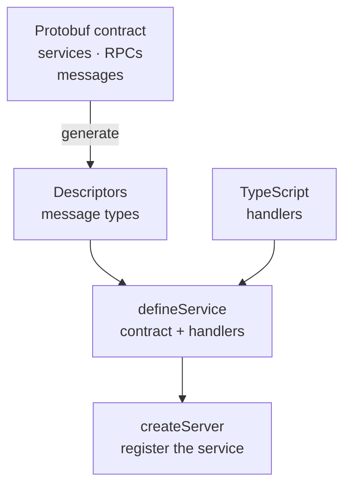

# What Is Connectum?

Connectum builds on ConnectRPC to give TypeScript services a common
way to start, stop and connect request middleware. Your API stays in Protobuf;
handlers use the generated types.

Use it when you want shared service conventions instead of assembling lifecycle,
middleware and service-call wiring separately for each application.
Direct ConnectRPC can be enough for a small endpoint or an application whose
existing setup already meets those needs. Connectum is not required just to get
typed Protobuf RPCs.

## Mental Model

<figure class="technical-diagram" aria-label="How a contract becomes a registered service">

<figcaption>Your contract describes the API; your handlers implement it; the server runs it. Generated descriptors connect the contract and implementation.</figcaption>
</figure>

Start with [one working RPC](/en/guide/quickstart), including a request rejected
by configured validation, without an external broker. Authentication, events,
telemetry and resilience are optional next steps, not prerequisites.

## What Connectum Owns

ConnectRPC supplies the RPC layer; protobuf-es supplies generated message and
service types; Protovalidate supplies constraint validation. Connectum adds a
shared server lifecycle, explicit module composition and typed catalog calls.
Runtime checks depend on the middleware and configuration you actually connect.
See [Guarantees and limits](/en/reference/guarantees) for prerequisites,
enforcement layers, limitations and source/test evidence.

Connectum does not provide an ORM, frontend framework, or CommonJS build. Public
packages ship compiled ESM for Node.js `>=22.13.0`; direct TypeScript execution
requirements are documented in [Runtime Compatibility](/en/guide/runtime-compatibility).

## Choose Your Path {#choose-your-path}

- New service: [Build Your First Connectum Service](/en/guide/quickstart)
- Server behavior: [Server](/en/guide/server)
- Validation and middleware: [Interceptors](/en/guide/interceptors)
- Service-to-service design: [Choosing a Communication Mechanism](/en/guide/service-communication/choosing-a-mechanism)
- Authentication and authorization: [Auth and Authz](/en/guide/auth)
- Production signals: [Observability](/en/guide/observability)
- Deployment: [Docker](/en/guide/production/docker) or [Kubernetes](/en/guide/production/kubernetes)
- Exact interfaces: [API and Reference](/en/reference/)

## Architecture and Boundaries {#architecture-overview}

See [Connectum Runtime Architecture](/en/guide/production/architecture) for process
boundaries and extension points. The [ADR index](/en/contributing/adr/) records
design decisions, including why capabilities remain separate modules.

## Non-Goals

::: details What stays outside the framework
- Managing application databases or domain models
- Replacing deployment platforms or service meshes
- Hiding transport, auth, or resilience policy behind implicit defaults
- Supporting CommonJS or legacy Node.js runtimes
:::

## External Resources

- [ConnectRPC documentation](https://connectrpc.com/docs)
- [OpenTelemetry for JavaScript](https://opentelemetry.io/docs/languages/js/)
- [gRPC health checking protocol](https://github.com/grpc/grpc/blob/master/doc/health-checking.md)
- [Protovalidate](https://github.com/bufbuild/protovalidate)
