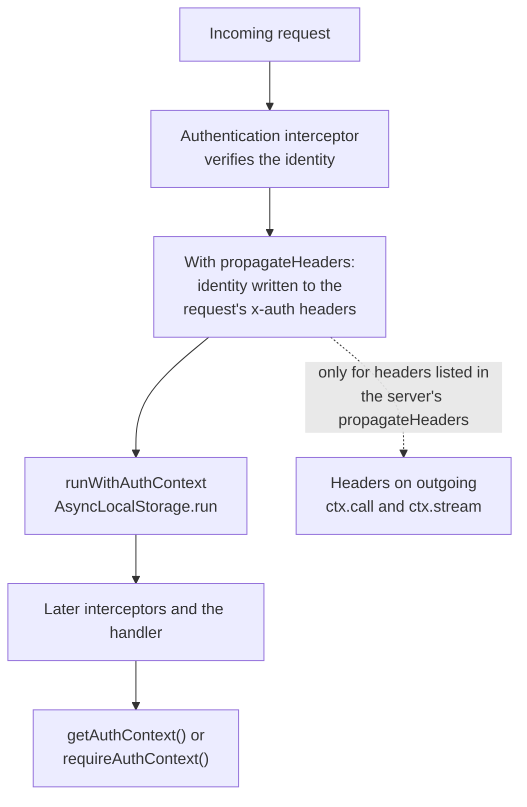

# Auth Context

All authentication interceptors in `@connectum/auth` store the verified identity in `AuthContext` via `AsyncLocalStorage`. This makes the identity available to any code running within the request scope -- service handlers, other interceptors, and utility functions.

The context is created once per request, inside the authentication interceptor:



Streaming responses are wrapped so that every `next`, `return`, and `throw` of the response stream runs inside the same context.

## Accessing Auth Context in Handlers

### Optional Access

Use `getAuthContext()` when the handler can work without an identity. This helper
only reads the current scope; it does not verify credentials. A method skipped by
the authentication interceptor does not gain an identity merely because a token
is present:

```typescript
import { getAuthContext } from '@connectum/auth';

function getProduct(req: GetProductRequest) {
  const auth = getAuthContext(); // undefined if not authenticated

  if (auth) {
    // Show personalized pricing for logged-in users
    return getProductWithPricing(req, auth.subject);
  }

  return getPublicProduct(req);
}
```

### Required Access

Use `requireAuthContext()` when the handler requires authentication. It throws `Unauthenticated` if no auth context exists:

```typescript
import { requireAuthContext } from '@connectum/auth';

function updateProfile(req: UpdateProfileRequest) {
  const auth = requireAuthContext(); // throws if not authenticated

  console.log(`User: ${auth.subject}, roles: ${auth.roles}`);
  // ...
}
```

### Streaming Handlers

The identity follows the whole call, not just the moment it was verified. A server-streaming or bidirectional handler is usually an `async function*`, and its code runs in pieces: before the first `yield`, after each `yield`, after every `await`, and in `finally`. Every one of those pieces sees the identity of the call it belongs to, over HTTP/2 and over the in-process `localClient()` alike:

```typescript
async function* watchOrders(req: WatchOrdersRequest) {
  const auth = requireAuthContext();       // the verified caller
  const cursor = await openCursor(auth.subject);
  try {
    for await (const order of cursor) {
      yield order;
      requireAuthContext();                // still the same caller after the consumer resumed us
    }
  } finally {
    await cursor.close({ owner: requireAuthContext().subject }); // runs after a cancel, a deadline or a server shutdown too
  }
}
```

A few details are worth knowing:

- The identity is scoped to the call, not to the process or the caller. When code calls a local client while holding its own identity, the handler sees the identity that was verified for *that* call, and the caller's own identity is unchanged after the call returns.
- The generator that produces the request messages of a client-streaming or bidirectional call belongs to the caller and runs under the caller's own identity (or none), in-process and over HTTP alike; it never observes the identity that was verified for the callee. Its `finally` after a cancellation runs in the context that raised the abort.
- Cleanup that is triggered by a cancellation, a deadline, or the server shutting down runs under the identity of the call it belongs to, even though the signal that triggered it comes from elsewhere.
- The identity scope replaces only the identity itself. Other `AsyncLocalStorage` values (a trace context, a tenant) are left as the surrounding code set them during iteration, so the in-process caller's own scopes stay visible to the handler; cleanup after a cancellation runs under the values that were active when the stream was created.
- A listener that the handler registers with `ctx.signal.addEventListener("abort", ...)` runs in the context of whatever raised the abort, not under the call's identity. Capture the identity (`const auth = requireAuthContext()`) before registering the listener and use that variable inside it.
- Leaving a consumer loop early with `break` is still not a cancellation: the handler stays suspended at its last `yield` until the call ends in another way, as it did before.
- A custom interceptor that opens an identity scope itself with `authContextStorage.run(context, () => next(req))` covers only the call that opens the stream. For streaming responses it must also scope every operation on the returned iterator (`next`, `return` and `throw`), as the built-in interceptors do.

### AuthContext Shape

The `AuthContext` object contains the following fields:

| Field | Type | Description |
|-------|------|-------------|
| `subject` | `string` | User identifier (from JWT `sub`, gateway header, or session) |
| `name` | `string \| undefined` | Display name |
| `roles` | `readonly string[]` | User roles |
| `scopes` | `readonly string[]` | OAuth scopes or permissions |
| `claims` | `Readonly<Record<string, unknown>>` | Raw claims from the token or session |
| `type` | `string` | Credential type chosen by the verifier; not a closed enumeration |
| `expiresAt` | `Date \| undefined` | Credential expiration time, when available |

## Cross-Service Propagation

Enable the authentication interceptor's `propagateHeaders` to write the verified
identity into the current request's headers. It does not send a downstream
request itself. To carry those fields on `ctx.call` or `ctx.stream`, also list the
chosen headers in the server's [header propagation](/en/guide/service-communication/service-catalog#header-propagation)
configuration; independent clients need an outgoing interceptor. The `x-auth-*`
headers are for downstream services: the response the
[fallback interceptor](/en/guide/interceptors/built-in#fallback-response) synthesises
does not hand them back to the caller.

```typescript
const jwtAuth = createJwtAuthInterceptor({
  jwksUri: '...',
  propagateHeaders: true,
});
```

To filter which claims are written into `x-auth-claims`, use `propagatedClaims` on
`createAuthInterceptor` (generic) or `createSessionAuthInterceptor`. It is not an
option of `createJwtAuthInterceptor` or `createGatewayAuthInterceptor`; enabling
their propagation writes all claims that fit the header limit. The session
snippet uses the validated `mapSession` helper from the [session guide](/en/guide/auth/session):

```typescript
const sessionAuth = createSessionAuthInterceptor({
  verifySession: verifySessionToken,
  mapSession,
  propagateHeaders: true,
  propagatedClaims: ['email', 'org_id'], // optional: filter sensitive claims
});
```

### Propagated Headers

| Header | Content |
|--------|---------|
| `x-auth-subject` | User ID |
| `x-auth-type` | Auth type |
| `x-auth-name` | Display name |
| `x-auth-roles` | JSON-encoded roles array |
| `x-auth-scopes` | Space-separated scopes |
| `x-auth-claims` | JSON-encoded filtered claims |

Each field is handled on its own terms when the headers are written:

- **`subject`, `type` and `name`** have control characters removed (tab is kept). Text up to U+00FF (ASCII and Latin-1) is written as is. Text with a character above U+00FF (Cyrillic, CJK, an emoji) is written as `utf-8''` followed by its percent-encoded UTF-8 bytes (an RFC 8187 `ext-value` without a language), and `parseAuthHeaders` and `createGatewayAuthInterceptor` (for the standard `x-auth-*` names) decode it. When the writer encoded at least one text it also sets `x-auth-encoding: percent-utf8`, and the readers decode `utf-8''` texts only when that header is present, so a literal `utf-8''admin` subject from a sender that does not encode (an older version, another gateway) stays that literal text. `x-auth-encoding` belongs to the `x-auth-*` family and has the same trust boundary: only an upstream you control may send it, so the edge in front of the service must remove client-supplied `x-auth-*` headers, this one included (the JWT, generic, session and gateway interceptors delete it). A text that itself starts with `utf-8''` is encoded too, so reading is unambiguous. A service that reads these headers without `@connectum/auth` sees the encoded form for such users, and no `x-auth-encoding` header for identities that needed no encoding.
- **`roles` and `claims`** are JSON-encoded, so their content is escaped by the encoding and never altered. Each character above U+00FF is written as a `\uXXXX` escape.
- **Each scope** is written exactly as granted, joined by single spaces. Scopes are not cleaned: a scope is an RFC 6749 `scope-token`, and editing one could make it equal a privilege nobody granted. For the same reason a scope that contains a space is rejected (see below): the reader splits the header on spaces, so the one granted scope `reports read admin` would arrive as three, `admin` among them.
- **NUL, CR, LF and lone surrogates are rejected, not removed.** With `propagateHeaders` on, a subject, type, name or scope that contains one of them, or a scope that contains a space, ends the request with `Unauthenticated` (text `Authentication failed`) before the identity is cached, so the next request with the same credential is verified again. Removing a line break would turn two different subjects (`al\nice` and `alice`) into the same header value. With `propagateHeaders` off the same identity is admitted. `setAuthHeaders` itself throws a `TypeError` (`UnsafeHeaderValueError`) that names the field (`AuthContext.subject`, `type`, `name` or `scopes`) and sets no header.

Limits and sizes:

- `x-auth-subject` holds at most 512 characters, `x-auth-type` 128 and `x-auth-name` 256, counted
  in the text before encoding.
- `x-auth-roles`, `x-auth-scopes` and `x-auth-claims` hold at most 8192 characters of the
  serialized value; the claims limit applies after the `propagatedClaims` filter.
- A value over its limit is **rejected, never cut or left out**. With `propagateHeaders` on, the
  request ends with `Unauthenticated` (text `Authentication failed`) and the identity is not cached;
  `setAuthHeaders` throws a `RangeError` (`HeaderValueTooLargeError`) and sets no header.
  Cutting would make two subjects that share their first 512 characters one identity, and
  leaving a role or claim out would stop a deny rule or an `authorize` callback that looks at it
  from matching. The readers are strict in the same way: `parseAuthHeaders` throws
  `Unauthenticated` for a value over its limit or a malformed encoded text, and the gateway
  interceptor rejects a claims header over 8192 characters.
- To keep large claims out of the headers, filter them with `propagatedClaims` (generic and
  session interceptors) or turn propagation off.

Loading `@connectum/auth` from two module instances (for example `src` and `dist`
imports mixed in one process) emits a `CONNECTUM_AUTH_DUP_INIT` process warning once. Both
instances share one auth context storage; the warning points to the duplicated import.

`createGatewayAuthInterceptor` can map these identity headers, but it still
requires its configured `trustSource` marker. Forwarded identity headers alone
do not establish caller trust; see [client auth interceptors](/en/guide/auth/client-interceptors)
for a client that attaches the gateway marker.

## Testing

The `@connectum/auth/testing` subpath export provides helpers for unit and integration tests.

### Mock Auth Context

Run a handler with a mock auth context:

```typescript
import { createMockAuthContext, withAuthContext } from '@connectum/auth/testing';

const result = await withAuthContext(
  createMockAuthContext({ subject: 'user-1', roles: ['admin'] }),
  () => myHandler(request),
);
```

The identity is scoped to the callback, not to a value it returns. If the handler is an `async function*`, iterate it inside the callback: a generator that is created inside the callback but consumed after it has returned does not see the identity.

### Test JWT

Generate a signed JWT for integration tests:

```typescript
import { createTestJwt, TEST_JWT_SECRET } from '@connectum/auth/testing';

const token = await createTestJwt({ sub: 'user-1', roles: ['admin'] });

// Map the roles claim explicitly when verifying this token.
// createJwtAuthInterceptor({ secret: TEST_JWT_SECRET, claimsMapping: { roles: 'roles' } })
```

### Full Test Example

::: runtime bun
Import the runner from `bun:test` instead of `node:test` and run the file with `bun test`.
Everything else is identical -- `node:assert` works under Bun.
:::

```typescript
import { describe, it } from 'node:test';
import assert from 'node:assert';
import { Code, ConnectError } from '@connectrpc/connect';
import { createMockAuthContext, withAuthContext } from '@connectum/auth/testing';

describe('updateProfile', () => {
  it('should update the profile for an authenticated user', async () => {
    const auth = createMockAuthContext({
      subject: 'user-42',
      name: 'Alice',
      roles: ['user'],
    });

    const result = await withAuthContext(auth, () =>
      updateProfile({ name: 'Alice Updated' }),
    );

    assert.strictEqual(result.name, 'Alice Updated');
  });

  it('should reject unauthenticated requests', () => {
    assert.throws(
      () => updateProfile({ name: 'Nope' }),
      (err: unknown) => err instanceof ConnectError && err.code === Code.Unauthenticated,
    );
  });
});
```

## Related

- [Auth Overview](/en/guide/auth) -- all authentication strategies
- [JWT Authentication](/en/guide/auth/jwt) -- token verification
- [Gateway Authentication](/en/guide/auth/gateway) -- header-based auth
- [Authorization](/en/guide/auth/authorization) -- RBAC and access control
- [@connectum/auth](/en/packages/auth) -- Package Guide
- [@connectum/auth API](/en/api/@connectum/auth/) -- Full API Reference
