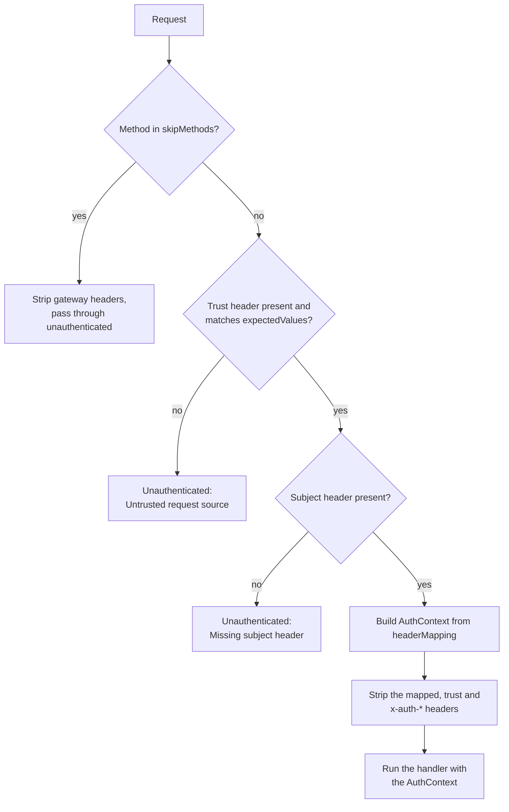

# Gateway Authentication

`createGatewayAuthInterceptor` reads identity headers from a gateway that has already authenticated the caller. Before accepting those fields, the interceptor checks a configured trust header. It does not verify the end-user token itself.

The interceptor decides in this order:



## Configuration

```typescript
import { createGatewayAuthInterceptor } from '@connectum/auth';

const gatewayAuth = createGatewayAuthInterceptor({
  headerMapping: {
    subject: 'x-user-id',
    name: 'x-user-name',
    roles: 'x-user-roles',
  },
  trustSource: {
    header: 'x-gateway-secret',
    expectedValues: [process.env.GATEWAY_SECRET!],
  },
});
```

`headerMapping` describes how trusted gateway headers become an `AuthContext`.
`trustSource` checks a header value before accepting the identity fields. The
example uses a shared secret. The matcher can also read IPv4 CIDR values, but a block is
matched against a header that a caller reaching the service directly chooses itself, so
`10.0.0.0/8` admits anyone who sends `10.9.9.9`. Creating the interceptor with a CIDR
block therefore throws unless you set `trustSource.allowCallerControlledCidr: true`; set it only
when a trusted upstream overwrites that header on every request and no client can reach
the service without passing through it. Trust based on the address of the connection
belongs in the mTLS and mesh-identity helpers. Shared secrets are compared through
fixed-size digests with `timingSafeEqual`. With the option set, an address in the header is read strictly: exactly four decimal octets from
0 to 255 without leading zeros (`10.0.0.1`), and a CIDR value is such an address, a
`/` and a prefix of 0 to 32 (`10.0.0.0/8`). A header value that is not an address, or an
`expectedValues` entry that is not a well-formed block, matches only if it is
byte-for-byte equal to the other side, so a malformed block never widens trust
(a shared secret may itself contain `/`). IPv6 ranges are not supported. Remove or overwrite client-supplied identity and trust headers at the
gateway, restrict direct access to the service, and protect the hop with TLS. See
[`GatewayAuthInterceptorOptions`](/en/api/@connectum/auth/interfaces/GatewayAuthInterceptorOptions)
for the exact nested fields.

### headerMapping

The `headerMapping` object maps `AuthContext` fields to the header names your gateway uses:

| Field | Expected header value | Example |
|-------|----------------------|---------|
| `subject` | User ID (string) | `x-user-id: user-123` |
| `name` | Display name (string) | `x-user-name: John Doe` |
| `roles` | JSON array of strings or comma-separated roles | `x-user-roles: ["admin","editor"]` or `x-user-roles: admin,editor` |

A `roles` value that is a JSON array is used as sent (items that are not strings are dropped). Every other value is read as a comma-separated list, with the items trimmed and empty items dropped. That includes JSON of another kind: `x-user-roles: 123` or `true` is the single role `"123"` or `"true"`, not an empty list.
| `scopes` | Space-separated scopes | `x-user-scopes: read write` |
| `type` | Credential type (string) | `x-user-type: oidc` |

### Credential Type and `defaultType`

`AuthContext.type` comes from the header named by `headerMapping.type`. When that mapping is not configured, or the gateway sends no such header, the interceptor uses `defaultType`:

| Option | Type | Default | Description |
|--------|------|---------|-------------|
| `defaultType` | `string` | `'gateway'` | Credential type used when the gateway sends no type header |

`defaultType` becomes `AuthContext.type` and, with `propagateHeaders`, the `x-auth-type` header, so a value containing NUL, CR or LF throws when the interceptor is created.

### trustSource Check

The `trustSource` check accepts requests carrying one of the configured values. A caller who knows the shared secret can also satisfy this check, so deployment controls are part of the trust boundary:

```typescript
trustSource: {
  header: 'x-gateway-secret',
  expectedValues: [process.env.GATEWAY_SECRET!],
}
```

If the header is missing or the value does not match any of the `expectedValues`, the interceptor throws `Unauthenticated`.

## Header Stripping

On an admitted request, the interceptor reads the identity from the mapped headers,
then deletes the mapped headers, the trust header, any additional `stripHeaders`,
and every standard `x-auth-*` identity header (`x-auth-subject`, `x-auth-type`,
`x-auth-name`, `x-auth-roles`, `x-auth-scopes`, `x-auth-claims`, `x-auth-encoding`), as the JWT,
generic and session interceptors do. It also deletes them on methods listed in
`skipMethods`, even though authentication is skipped there. Failed trust or
subject checks stop the call before downstream interceptors run.

A client-supplied `x-auth-*` header therefore never reaches the next hop, whether
or not it is one of the mapped headers. This matters with `propagateHeaders`: it
writes only the identity fields that have a value, so a forged `x-auth-roles`
would otherwise survive for a user without roles. A gateway that maps the
`x-auth-*` names itself (for example a service behind another Connectum service)
still reads them, because the identity is read before the headers are deleted.

With the default `propagateHeaders: false`, the deleted headers remain absent.
Enabling `propagateHeaders` writes the verified identity back using the standard
`x-auth-*` names, including all non-empty claims that fit the header limit. This
option does not restore the gateway trust secret. Choose it only when the next
hop needs those fields; gateway authentication has no `propagatedClaims` filter.
An identity that cannot be written into headers (NUL, CR or LF in the subject, type, name or a scope, a scope with a space, or a value that does not fit its header) is rejected with `Unauthenticated`. When the gateway reads the standard `x-auth-*` names it also decodes text that another service wrote as `utf-8''` plus percent-encoded UTF-8 (only when the sender set `x-auth-encoding: percent-utf8`), and it rejects a claims header over 8192 characters instead of reading it as empty; see [Auth Context](/en/guide/auth/context#propagated-headers).

`skipMethods` lists methods and `Service/*` patterns; the catch-all `'*'` is refused when the interceptor is created (see [Method Patterns](/en/guide/auth/authorization#method-patterns)).

## Full Example

```typescript
import { createServer } from '@connectum/core';
import { createDefaultInterceptors, createErrorHandlerInterceptor } from '@connectum/interceptors';
import { createGatewayAuthInterceptor, createAuthzInterceptor } from '@connectum/auth';

const gatewayAuth = createGatewayAuthInterceptor({
  headerMapping: {
    subject: 'x-user-id',
    name: 'x-user-name',
    roles: 'x-user-roles',
  },
  trustSource: {
    header: 'x-gateway-secret',
    expectedValues: [process.env.GATEWAY_SECRET!],
  },
});

const authz = createAuthzInterceptor({
  defaultPolicy: 'deny',
  rules: [
    { name: 'admin', methods: ['admin.v1.AdminService/*'], requires: { roles: ['admin'] }, effect: 'allow' },
  ],
});

const server = createServer({
  services: [routes],
  interceptors: [
    createErrorHandlerInterceptor(),
    gatewayAuth,
    authz,
    ...createDefaultInterceptors({ errorHandler: false }),
  ],
});

await server.start();
```

## Verify

Use a local test secret and call the protected method with both that marker and
the mapped subject. Repeat with no marker, a wrong marker, and no subject; each
must return `Code.Unauthenticated`. Supplying identity headers alone must not
authenticate the caller. Inspect the headers seen by the handler to confirm the
mapped and trust headers are absent with default propagation settings. Send the
same request with forged `x-auth-roles`, `x-auth-scopes`, `x-auth-name` and
`x-auth-claims` headers for a user without those fields: the handler, and any
service the headers are forwarded to, must not see them.

If a client gateway interceptor is rejected, compare its fixed `x-auth-subject`
and `x-auth-roles` names with the server's mapping. A trust header match does
not compensate for a mismatched subject header.

## Related

- [Auth Overview](/en/guide/auth) -- all authentication strategies
- [JWT Authentication](/en/guide/auth/jwt) -- direct token verification
- [Auth Context](/en/guide/auth/context) -- accessing identity in handlers
- [@connectum/auth](/en/packages/auth) -- Package Guide
- [@connectum/auth API](/en/api/@connectum/auth/) -- Full API Reference
