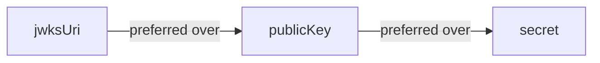

# JWT Authentication

`createJwtAuthInterceptor` verifies JSON Web Tokens from the `Authorization: Bearer <token>` header. It supports three key resolution strategies: JWKS, HMAC secret, and public key.

## JWKS (Recommended for Production)

JWKS (JSON Web Key Set) is the recommended approach. The interceptor fetches and caches signing keys from the identity provider automatically:

```typescript
import { createJwtAuthInterceptor } from '@connectum/auth';

const jwtAuth = createJwtAuthInterceptor({
  jwksUri: 'https://auth.example.com/.well-known/jwks.json',
  issuer: 'https://auth.example.com/',
  audience: 'my-api',
  maxTokenAge: '1h',
  claimsMapping: {
    roles: 'realm_access.roles',
    scopes: 'scope',
  },
});
```

Prefer one key source (`jwksUri`, `publicKey`, or `secret`), then constrain the
expected issuer, audience, age, and algorithms for your identity provider. Use
`claimsMapping` only for the claims that become application identity. See
[`JwtAuthInterceptorOptions`](/en/api/@connectum/auth/interfaces/JwtAuthInterceptorOptions)
for the complete field contract and defaults.

Omit `issuer`, `audience` or `maxTokenAge` to skip that check. A value that is
present must be usable, and the factory throws when it is created otherwise:
`issuer` and `audience` take a non-empty string or an array of non-empty strings,
and `maxTokenAge` a number of seconds above 0 or a duration string such as `'1h'`, `'30 minutes'` or `'7d'` (units: seconds, minutes, hours, days, weeks, years; a text such as `'1month'` is refused, and so is one that reads as zero or negative: `'0s'`, `'-1h'`, `'1h ago'`).
An empty string is therefore an error and not a way to switch a check off, which
matters for `issuer: process.env.JWT_ISSUER ?? ''`; read the variable, fail when it
is missing, and pass only a real value. An empty array matches no token.
See [Auth authorization and JWT validation](/en/migration/auth-authorization-validation)
when upgrading.

A token must carry an `exp` (expiration time) claim: a signed token without one
never expires, so one that leaks stays valid until the signing key is rotated. A
token without `exp`, or with an `exp` in the past, is rejected as `Unauthenticated`.
Set `requireExpiration: false` only for an issuer that cannot add `exp`; an expired
token is still rejected. See [Signed tokens must carry `exp`](/en/migration/token-expiration)
when upgrading.

### Key Rotation and an Unreachable Key Set

With `jwksUri`, the interceptor keeps the fetched key set in memory and refetches it by these rules (the defaults are those of the `jose` library):

- A token signed with a key that is **not** in the cached key set triggers a refetch only when the cooldown has passed since the last successful fetch (30 seconds by default). Inside the cooldown that token is rejected as `Unauthenticated`.
- The cached key set also expires after 10 minutes by default (`cacheMaxAge`), whatever the cooldown says: the next call after that fetches it again. Until a refetch happens, by expiry or by an unknown key, a key that the identity provider has already retired keeps verifying.
- A request for the key set is aborted after 5 seconds by default.

After a rotation, tokens signed with the **new** key are rejected for up to 30 seconds, while tokens signed with the **retired** key are still accepted from the cache. Neither window is fixed: the first token with the new key after the cooldown, or the first call after the cache expired, refetches the key set, and from then on the retired key is rejected. The 30 seconds and the 10 minutes are upper bounds, not guarantees.

A key set that cannot be fetched (the identity provider is down, answers with an error status, with a body that is not JSON, or does not answer within the timeout) ends the call with `Unauthenticated` and the text `Authentication failed`, exactly like a bad token. The interceptor does not tell the two apart for the client and writes no log line for it. A failed fetch is not cached: the next request that needs the key set tries again. An empty key set (`{"keys":[]}`) is different: it is a successful fetch, so it is cached, and a key published afterwards is accepted only after the cooldown has passed.

To shorten the window, or to bound the wait, set the `jwks` option. All values are in milliseconds, and an omitted value keeps its default, so nothing changes until you set one:

```typescript
const jwtAuth = createJwtAuthInterceptor({
  jwksUri: 'https://auth.example.com/.well-known/jwks.json',
  jwks: {
    cooldownDuration: 5_000, // refetch for an unknown key at most every 5 s (default 30000)
    cacheMaxAge: 120_000,    // fetch the key set again after 2 min (default 600000)
    timeoutDuration: 2_000,  // give up on one request after 2 s (default 5000)
  },
});
```

| Option | Default | Effect | Range |
|---|---|---|---|
| `cooldownDuration` | `30000` | Length of the window after a rotation in which a token with an unknown key is rejected without a refetch. `0` refetches for every unknown key. | finite number, 0 or more |
| `cacheMaxAge` | `600000` | Upper bound on how long a retired key keeps verifying (an earlier refetch ends it). `0` fetches the key set on every call; `Infinity` never expires the cache. | number, 0 or more |
| `timeoutDuration` | `5000` | How long one request waits for the key set before it ends as `Unauthenticated`. | whole number, 1 to 2147483647 |

::: warning
A short window has a cost. `cooldownDuration: 0` makes every token with an unknown key (for example, one signed with a forged `kid`) cause a request to the identity provider, and `cacheMaxAge: 0` makes every call fetch the key set. Pick the shortest window you can afford, not `0`, unless the identity provider is yours and can take the load.
:::

`jwks` is checked when the interceptor is created: it needs `jwksUri`, a misspelled name is refused, and a value out of its range throws a `TypeError` or `RangeError` that names the option.

### Errors and Skipped Methods

A token that fails verification (bad signature, wrong issuer or audience, expired, no `exp`) ends the call with `Unauthenticated` and the fixed text `Authentication failed`; the text of the verification error is not sent to the client. A valid token whose subject is missing, an empty string or not a string (a number, a boolean, an object) fails with `JWT missing subject claim`; the subject is `claimsMapping.subject` when it names a string claim, and `sub` otherwise. For the generic `createAuthInterceptor`, a `ConnectError` thrown by `verifyCredentials` is the exception: it reaches the client unchanged, so write its text for the client. `verifyCredentials` must also return a complete `AuthContext` (string `subject` and `type`, arrays `roles` and `scopes` of at most 8192 strings and without holes, an object `claims`); `null`, `undefined`, `false`, `{}` or a result with a missing or mistyped field ends the call with `Unauthenticated` and the text `Authentication failed`, with or without `propagateHeaders`, and is never cached.

`skipMethods` takes exact methods and `Service/*` patterns. The catch-all `'*'` is refused when the interceptor is created, because it would switch authentication off for every method; to disable the interceptor, do not register it. Any other pattern, such as `Service/Read*`, is refused too: it matches nothing.

## HMAC Secret

For simple setups and testing environments where tokens are signed with a shared secret:

```typescript
const jwtAuth = createJwtAuthInterceptor({
  secret: process.env.JWT_SECRET,
  algorithms: ['HS256'],
  issuer: 'my-service',
});
```

::: warning
HMAC secrets require both the issuer and the verifier to know the secret. For
HS256, the factory requires at least 32 UTF-8 bytes; HS384 requires 48 and HS512
64 when those algorithms are configured. Generate a random secret, keep it out
of source control, and check that the environment value is present. Use JWKS to
avoid giving verifiers a signing secret.
:::

## Public Key

For asymmetric verification with a pre-loaded public key:

```typescript
const publicKey = await crypto.subtle.importKey(
  'spki', keyData, { name: 'RSASSA-PKCS1-v1_5', hash: 'SHA-256' }, true, ['verify'],
);

const jwtAuth = createJwtAuthInterceptor({ publicKey });
```

## Key Resolution Priority

If more than one key source is set, the interceptor selects the first available
source in this order:



At least one must be provided. If `jwksUri` is set, `publicKey` and `secret` are ignored.

## Full Example

```typescript
import { createServer } from '@connectum/core';
import { createDefaultInterceptors, createErrorHandlerInterceptor } from '@connectum/interceptors';
import { createJwtAuthInterceptor } from '@connectum/auth';

const jwtAuth = createJwtAuthInterceptor({
  jwksUri: 'https://auth.example.com/.well-known/jwks.json',
  issuer: 'https://auth.example.com/',
  audience: 'my-api',
  maxTokenAge: '1h',
  claimsMapping: {
    roles: 'realm_access.roles',
    scopes: 'scope',
  },
});

const server = createServer({
  services: [routes],
  interceptors: [
    createErrorHandlerInterceptor(),
    jwtAuth,
    ...createDefaultInterceptors({ errorHandler: false }),
  ],
});

await server.start();
```

## Verify

Call a protected method with a token from the configured issuer and audience,
then repeat without the bearer header, with an expired token, and with a token
from the wrong issuer or audience. The valid token should reach the handler;
the other calls should return `Code.Unauthenticated`. Add explicit
`claimsMapping.roles` before checking a roles-based authorization rule: a JWT's
`roles` claim is not mapped automatically.

If factory creation fails, check the key source and HMAC secret length first.
If an intentionally public RPC still needs a token, check authentication
`skipMethods`; a proto public marker alone does not configure JWT authentication.

## Related

- [Auth Overview](/en/guide/auth) -- all authentication strategies
- [Authorization](/en/guide/auth/authorization) -- RBAC rules and programmatic authorization
- [Auth Context](/en/guide/auth/context) -- accessing identity in handlers
- [@connectum/auth](/en/guide/auth) -- Package Guide
- [@connectum/auth API](/en/api/@connectum/auth/) -- Full API Reference
