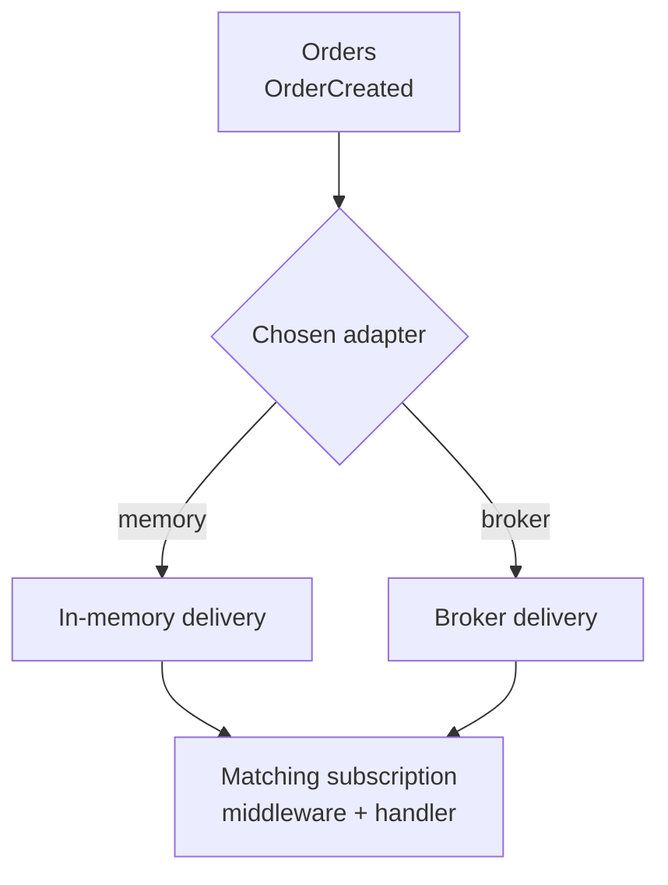

# Events

An order was accepted. Inventory or another subscriber may need to react,
but Orders does not need their answer to this publication. The EventBus
connects typed protobuf events to consuming handlers through an adapter.

<figure class="technical-diagram" aria-label="An event passes through an adapter to a subscriber">



<figcaption>Publication is not an RPC response from the subscriber.</figcaption>
</figure>

## One publication

Given a generated `OrderCreatedSchema` and a started `eventBus`:

```typescript
import { create } from '@bufbuild/protobuf';

await eventBus.publish(
  OrderCreatedSchema,
  create(OrderCreatedSchema, { orderId: 'order-42' }),
);
```

The adapter determines publication confirmation and delivery behavior.
Subscribers must account for failures and repeated deliveries; publishing
does not create a distributed transaction.

## Go deeper

- [Build a publisher and subscriber](/en/guide/events/getting-started).
- [Choose the broker adapter](/en/guide/events/adapters).
- [Routing, EventContext and shutdown drain](/en/guide/events/concepts).
- [Retry, dead letters and consuming middleware](/en/guide/events/middleware).

Features marked **Since 1.3.0** in the detailed guides require that package
release; they are not available from published **1.2.x** packages before it ships.

<GuideSections route="/en/guide/events" />
