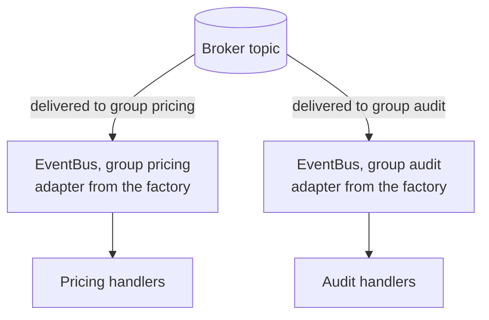

# Choose an Event Adapter

Every Connectum EventBus uses the same `EventAdapter` contract. Choose a broker
from workload and operational requirements, then keep broker-specific tuning in
that adapter's generated API reference.

This guide targets the documented `1.3.x` release line. Features marked `Since
1.3.0` require the corresponding package release; they are unavailable from the
published `1.2.x` packages until 1.3.0 is released.

## Broker Selection Matrix {#adapter-comparison}

| Adapter | Persistence | Consumer coordination | Ordering scope | Best starting fit |
|---|---|---|---|---|
| Memory | No | None | Publish call | Unit tests and local prototypes |
| NATS JetStream | Yes | Durable consumers | Subject | Lightweight, low-latency service events |
| Kafka / Redpanda | Yes | Native consumer groups | Partition | High-throughput streams and retained logs |
| Redis Streams / Valkey | Configurable by Redis | Consumer groups | Stream | Teams already operating Redis-compatible infrastructure |
| AMQP / RabbitMQ / LavinMQ | Durable queues/exchanges when configured | Competing consumers | Queue | Routing topologies and external AMQP contracts |

Production adapters support broker redelivery of unacknowledged events, so
handlers must be idempotent and acknowledge only after their side effects are
complete. Delivery and retention still depend on broker configuration, start
position, stable consumer groups, and settlement policy. For AMQP, a broker
confirm alone does not prove that any queue accepted the message; see
[Routing and delivery](/en/guide/events/amqp-reliability#routing-and-delivery).

## Memory {#memory-adapter}

`MemoryAdapter()` ships with `@connectum/events`. It has no external dependency,
persistence, or consumer groups and is intended for tests and local development.

```typescript
import { MemoryAdapter } from '@connectum/events';

const adapter = MemoryAdapter();
```

Since 1.3.0 `nack(true)` (and `nack()`) redelivers the event to the same
subscription as a later task, with `attempt` raised by one, so a handler's
retry-by-nack behaves in tests as it does on a broker. `nack(false)` discards the
event. A redelivery that is still waiting when the subscription is removed or
the adapter disconnects is dropped, which is what stops a bus that is draining
from looping nack, redeliver, nack. A handler that nacks every time is
redelivered for as long as its subscription lives: unlike a broker, `MemoryAdapter`
has no attempt cap and no dead-lettering. Before 1.3.0
a requeued event was silently lost.

## NATS JetStream {#nats-jetstream-adapter}

Choose NATS for durable subjects, wildcard routing, and a compact operational
footprint.

```typescript
import { NatsAdapter } from '@connectum/events-nats';

const adapter = NatsAdapter({ servers: 'nats://localhost:4222' });
```

- [Module hub](/en/packages/events-nats)
- [`NatsAdapterOptions`](/en/api/@connectum/events-nats/types/interfaces/NatsAdapterOptions)

### Start position {#nats-start-position}

`consumerOptions.deliverPolicy` sets where a new consumer starts: `"new"` (the default)
delivers only messages published after the consumer is created, `"all"` delivers every
available message, and `"last"` delivers the last message of each matching subject. Since
1.3.0, `"last"` maps to the JetStream policy `last_per_subject`, so a wildcard pattern such
as `orders.*` starts with the latest message of every subject it matches, not only the
single most recent message that matches the filter. For a literal pattern nothing changes.

The policy applies only when the consumer is created. A durable consumer that already
exists keeps the policy it was created with; the adapter logs one warning that names the
difference (for example `deliver_policy=last (requested last_per_subject)`) and continues
with the existing configuration. To start such a group with the new policy, delete its
durable consumer or use a new group name.

### Overlapping patterns {#nats-overlapping-patterns}

A subscription that lists patterns matching the same subject (`orders.created`,
`orders.*`, `orders.>`) runs its handler once per event. Every pattern keeps its
own durable consumer, so the server still sends the event once per matching
pattern; the adapter runs your handler for one of those deliveries and
acknowledges the others without running it.

The delivery that runs the handler is the one of the most specific pattern among
those whose consumer delivers the event: fewer `>` first, then fewer `*`, then
more tokens, then the pattern text. The order comes from the pattern text alone,
so every instance of a group picks the same delivery, and patterns that overlap
only in part (`a.*.c` and `a.b.*`) need no special case.

- **Existing consumers keep their backlog.** Consumers left by earlier versions
  or by earlier runs of the service keep their position. Events published while
  the service was down are delivered once, whichever of the overlapping patterns
  holds them. A pattern added later starts at `consumerOptions.deliverPolicy`
  (`"new"` by default) like any new route. Upgrading or rolling back needs no
  action.
- **Existing consumers are never modified.** The adapter reads an existing
  consumer and attaches to it; it does not update its configuration, so an
  earlier version of the adapter can create the same consumer again after a
  rollback, and consumers provisioned by an operator need only read and pull
  permissions (`$JS.API.CONSUMER.INFO.>`, `$JS.API.CONSUMER.MSG.NEXT.>`,
  `$JS.ACK.>`). Each instance works out from where every consumer delivers from
  what the server reports; nothing is written to the broker. When an existing
  consumer was configured with another `ackWait`, `maxDeliver` or `deliverPolicy`
  than the subscription asks for, the adapter keeps the existing one and logs one
  warning per consumer.
- **Instances with different route sets.** While a service is rolled out with a
  route added to a broader pattern, instances with and without that route run
  side by side. Nothing is lost, but an event can be handled by both kinds of
  instance, so a handler may see it twice. This is the at-least-once contract;
  the window lasts as long as the rollout. Handlers should tolerate redelivery.
  The same can happen on any server when instances attach at different times
  while a wider consumer still lags behind a narrower one, and when the consumer
  of a pattern holds a delivery that was never acknowledged.
- **Network traffic.** The server sends one copy per matching pattern. Prefer
  patterns that do not overlap on a hot subject.
- **Consumers of removed routes.** Consumers of patterns you stopped
  subscribing to stay on the broker, and their pending count grows with every
  matching event (on a stream with `interest` retention they keep every message).
  Once no instance runs the old route set, list them with
  `nats consumer ls <stream>` and remove the ones named
  `{group}--{pattern}--{hash}` (`nats consumer rm <stream> <name>`). Do not remove
  the consumer of a pattern a running instance still subscribes: it stops
  delivering without an error. A `subscribe()` that fails half-way leaves the
  consumers of a named group in place for the next start; only the consumers of
  an auto-generated group are removed.

## Kafka or Redpanda {#kafka-adapter}

Choose Kafka-compatible infrastructure for partitioned ordering, retained logs,
and high-throughput stream processing.

```typescript
import { KafkaAdapter } from '@connectum/events-kafka';

const adapter = KafkaAdapter({
  brokers: ['localhost:9092'],
  clientId: 'orders-service',
});
```

### Connection options {#kafka-connection-options}

TLS, SASL, timeouts, retry and the client's log level are options of `KafkaAdapter()`
with types that this package owns; none of them names the Kafka client library:

```typescript
const adapter = KafkaAdapter({
  brokers: ['kafka-1:9093'],
  ssl: { ca: process.env.KAFKA_CA },
  sasl: { mechanism: 'scram-sha-512', username: 'orders', password: process.env.KAFKA_PASSWORD ?? '' },
  requestTimeout: 30_000,
  retry: { retries: 8 },
  logLevel: 'warn',
  producerOptions: { compression: 'gzip' },
});
```

| Option | Value |
|---|---|
| `ssl` | `true` for the system trust store, or `{ ca, cert, key, passphrase, rejectUnauthorized, servername }` |
| `sasl` | `plain`, `scram-sha-256` and `scram-sha-512` with `username` and `password`; `oauthbearer` with an `oauthBearerProvider` function; `aws` with `authorizationIdentity`, `accessKeyId`, `secretAccessKey` and optionally `sessionToken` |
| `connectionTimeout`, `authenticationTimeout`, `requestTimeout`, `reauthenticationThreshold`, `enforceRequestTimeout` | Timeouts in milliseconds, the SASL re-authentication share, and whether the client enforces `requestTimeout` itself |
| `retry` | `maxRetryTime`, `initialRetryTime`, `factor`, `multiplier`, `retries` |
| `logLevel` | `nothing`, `error`, `warn`, `info` or `debug` |
| `producerOptions.compression` | `none`, `gzip`, `snappy`, `lz4` or `zstd` |

`gzip` works as shipped. `snappy`, `lz4` and `zstd` need a codec that your application
registers with the client library before the first publish; without one, publishing fails.

Settings that have no portable form go in `clientOptions`: a log factory, a socket
factory, a custom SASL mechanism. Its keys are those of the client library the adapter
uses today (KafkaJS); they are **not type-checked and not portable**, and may change if
that library is replaced. The value is merged shallowly over the typed options and can
never override `brokers` or `clientId`.

The `kafkaConfig` option of earlier versions is removed and throws a `TypeError`; see
[Kafka adapter options](/en/migration/kafka-adapter-options).

### Acknowledgement and redelivery {#kafka-ack-redelivery}

Delivery is at-least-once. The adapter commits a partition offset only from the
handler's outcome, never from a client timer:

| Handler outcome | Offset | What happens next |
|---|---|---|
| `ack()` (EventBus calls it after a successful handler) | committed | next message |
| `nack(false)` | committed | message is skipped; `nack(false)` itself publishes no DLQ copy |
| `nack(true)` or `nack()` | not committed | the message and the rest of the batch are delivered again, in order |
| handler throws while the message is still uncommitted | not committed | same as `nack(true)`; the error is logged with topic, partition and offset |
| handler throws after `ack()` or `nack(false)` committed the offset | committed | the message is not redelivered; the error is still logged with topic, partition and offset |
| adapter used directly, handler returns without settling | not committed | same as `nack(true)` |

Through the EventBus a handler that returns normally without settling is
acknowledged automatically, so call `nack(true)` when the message must be
redelivered. The DLQ middleware publishes a copy only when the handler throws; it
then acknowledges the original, so a message the DLQ middleware moved is not
redelivered.

A Kafka offset means "everything before it is consumed", so settlement is
ordered: the first message that is not committed ends the batch and is the first
one fetched again. The first settlement of a message wins; an `ack()` called
after the handler returned is ignored.

An unsettled message is delivered again after `consumerOptions.redeliveryDelay`
milliseconds (default `1000`): the adapter pauses the partition for that long.
`0` redelivers immediately, so a handler that fails permanently retries in a
tight loop and writes one log line per attempt. The maximum is `2147483647`.
On an otherwise idle consumer the observed gap is a whole fetch cycle (5 s in
KafkaJS) even for smaller values.

::: warning A message that always fails blocks its partition
Nothing behind a message that fails on every delivery is delivered until the
handler succeeds, `nack(false)` is called, or the DLQ middleware moves it.
`redeliveryDelay` only paces the loop; it does not end it. Bound a permanently
failing message with the retry and DLQ [middleware](/en/guide/events/middleware).
:::

`attempt` is always `1` on Kafka: the broker does not count deliveries.

### Commit strategy {#kafka-commit-strategy}

By default every acknowledged message is committed by its own `OffsetCommit`
request, so a batch of 20 acknowledged messages costs 20 requests to the group
coordinator. `consumerOptions.commitStrategy` changes when the commit is sent:

| Value | `OffsetCommit` requests | `await ack()` returns |
|---|---|---|
| `"per-message"` (default) | one for every acknowledged message | after the broker accepted the commit |
| `"per-batch"` | one for the last acknowledged message of the batch | at once, nothing is sent yet |

```typescript
const adapter = KafkaAdapter({
  brokers: ['localhost:9092'],
  consumerOptions: { commitStrategy: 'per-batch' },
});
```

With `"per-batch"` the commit is sent when the adapter stops working on the batch,
and it is sent on every way that can happen: the end of the batch, a message
that is requeued with `nack(true)` or returned without settling, a handler that
throws, the consumer being stopped, and a lost group membership (a failed
heartbeat). What was acknowledged is committed in each of these cases; a message
that was not acknowledged is never committed, so the ordering rules above are
the same in both modes. If the commit for a batch that otherwise ended normally
fails, the failure reaches KafkaJS like any other commit failure. If it fails
after the batch ended with an error, the original error is the one that reaches
KafkaJS and the commit failure is logged.

::: warning Wider window of duplicates
With `"per-batch"` an acknowledgement is not durable until the batch ends. If the
process dies, or the broker refuses the commit, between an `ack()` and the end of
the batch, every message acknowledged in that batch is delivered again, up to the
size of the batch, instead of at most one. Handlers must be idempotent. A
dead-letter copy published before the original is acknowledged can also be
published twice. Delivery stays at-least-once.
:::

How many requests `"per-batch"` saves depends on how many messages KafkaJS returns
in one fetch, not on a setting of the adapter. When a batch holds a single
message, both modes send the same one request.

### Long-running handlers {#kafka-long-handlers}

While a handler runs, the adapter keeps sending group heartbeats on its behalf,
so processing longer than `consumerOptions.sessionTimeout` (default `30000` ms)
does not by itself expire the group membership. Successful heartbeats allow the
handler to commit; a rebalance or connection failure can still cause redelivery.
The adapter beats every 3 seconds (the KafkaJS default
`heartbeatInterval`), checking twice per interval, and stops as soon as the handler
returns, throws, or its turn ends.

If a heartbeat fails (the broker removed the member or started a rebalance) and the
message was not committed, the adapter hands the error to KafkaJS so the consumer
rejoins the group instead of redelivering on a membership the broker no longer
recognises; the message is delivered again after the rejoin. A message whose
offset was already committed stays committed.

The handler is never cancelled by the adapter: the EventBus only aborts `ctx.signal`
after `handlerTimeout` (default `30000` ms), and a handler that ignores that signal
and never returns holds its place in the group indefinitely. Make long handlers
honour `ctx.signal`.

### Start position {#kafka-start-position}

A consumer group with no committed offset starts at the end of the topic
(`consumerOptions.fromBeginning: false`, the default), so messages published
before the group first commits an offset are not delivered. Once the group has
committed, messages published while it is stopped are delivered on restart. Set
`fromBeginning: true` to read a topic's history with a new group.

A subscription without an explicit `group` gets a new group named `connectum-<uuid>`
every time `subscribe()` runs. That group has never committed an offset, so with the
default `fromBeginning: false` a restarted service starts at the end of each topic and
the events published while it was down are not delivered. Set `group` (the `group`
option of the event bus) to a stable name for any subscription that must not lose them.

### Wildcard subscriptions {#kafka-wildcards}

`*` and `>` are converted to a regular expression over topic names. A pattern
longer than 256 characters, wildcard or literal, is refused: `subscribe()` rejects
with `Topic pattern exceeds maximum length (256): <length>`. Two
properties differ from NATS:

- A pattern that **opens with a wildcard** never matches topics whose name starts
  with `__`. That is the set of topics the brokers mark as internal (Kafka:
  `__consumer_offsets`, `__transaction_state`; Redpanda: `__consumer_offsets`).
  Without it, a catch-all `>` would feed the broker's binary bookkeeping records
  to your handler. The rule has no switch. A pattern that spells the prefix out
  (`__audit.>`), a literal topic name and names with a single leading underscore
  are unaffected. Other topics a platform keeps are ordinary names, and `>`
  receives them: Redpanda's Schema Registry topic `_schemas` is one, so use a
  narrower pattern such as `orders.>` when you do not want it.
- The topics a wildcard stands for are expanded when `subscribe()` runs and
  refreshed every `consumerOptions.topicDiscoveryInterval` (default five
  minutes): the adapter lists the broker's topics at that interval and, when a
  matching topic has appeared, restarts the subscription's consumer to include
  it. The restart rebalances the consumer group, so consumption pauses for a few
  seconds and messages being handled at that moment are delivered again; it
  happens only when there is a new topic, and an unchanged topic list costs one
  metadata request per wildcard subscription per interval. A discovered topic is
  read from its first message, whatever `fromBeginning` says. The checks use an
  extra admin connection, and subscriptions made only of literal topic names are
  never checked. A wildcard subscription lists the topics once when it starts
  even with the checks off (and once more right after subscribing, so that a topic
  created in between is not lost), so that it can tell a deleted topic from one that
  never existed (see [a topic is deleted](#kafka-topic-deleted)). If listing the topics fails when the subscription starts,
  `subscribe()` rejects with that error: the same metadata request expands the
  wildcard, and a discovery started from an empty list would read the history of
  every existing topic. A check that fails later (for example because the
  credentials may not describe the cluster) is logged and repeated at the next
  interval, so a permanent failure logs once per interval. Each discovery is
  logged with the names of the topics, so a rebalance it causes can be told from
  one caused by a failing member.
- Set `consumerOptions.topicDiscoveryInterval` to `false` to keep the topic list
  fixed (the behaviour of earlier versions). Then a matching topic created later
  is not consumed until the service restarts, and the restart reads it from its
  end unless `fromBeginning` is set: what was published to the topic before the
  restart is never handled by the group. The same window exists with the checks
  on when the service restarts before a check has seen the topic; it is at most
  one interval long.

In a group of several members the delay before a new topic is read completely is
the longest interval among the members: KafkaJS assigns partitions only from the
topic list of the group's leader, and a member drops assigned topics it has not
subscribed to itself, so every member has to discover the topic first. Nothing
is lost meanwhile. In a measurement with two members at 1 s and 20 s, all 12
messages sent to the new topic arrived, the last one 15.3 s after the topic was
created (15.1 s on Redpanda; the exact delay depends on where the 20 s check
falls). Give the members of a group the same interval.

#### A topic is deleted {#kafka-topic-deleted}

The Kafka client library cannot remove a topic from a running consumer. When a topic that
a wildcard had matched is deleted, the consumer crashes on its next fetch, and the library
restarts it with the same topic list, which fails on the deleted topic every time. Without
help the other topics of the subscription deliver nothing until the library's own metadata
refresh clears the state; in a measured run with Kafka 4.2.0 on Node 26 the first message
reached the handler 300.7 s after the deletion, after 936 `consumer-restore-failed` events
(`topicDiscoveryInterval` made no difference). With the replacement described below the same
scenario delivered its first message 12.0 s after the deletion, and the lifecycle showed one
`consumer-lost` and one `consumer-restored`.

The adapter handles it. When a consumer of a wildcard subscription crashes with "unknown
topic" and the broker's topic list shows that a topic the wildcard had matched is gone, it
replaces the consumer: the new one joins the same group, subscribes the literal topics and
the matches that still exist, and starts reading from the group's committed offsets.
Messages published to the remaining topics meanwhile are delivered after the replacement,
as with any restart of a consumer in a group that has committed (a topic the group has no
committed offset for starts where `fromBeginning` says, except a topic that was found after
the subscription started, which is read from its first message again). A matching topic that
was created in between is subscribed and read from its first message when discovery is on.
If the deleted topic is created again and discovery is on, it is consumed again from its
first message. The recovery works with `topicDiscoveryInterval: false` too; the new consumer
then keeps the topic list fixed and subscribes no topic created since the start. It cannot be
turned off.

With `lifecycle.onLifecycle` set you see one `consumer-lost` and then `consumer-restored`;
the adapter also logs one warning that names the deleted topics. The replacement rebalances
the group once, like a discovery restart, so messages being handled at that moment are
delivered again. A crash for any other reason, or a crash while the broker still lists every
matched topic, stays with the library's own restarts. When the adapter takes a crash over,
it tells the library not to restart that consumer, so the old consumer is never started
beside its replacement. If creating the replacement fails, the error is logged and the
attempt is repeated every five seconds. A replacement whose start fails without an error
from the client (for example because the group may not be joined: the client reports it as
a crash and returns) counts as failed in the same way: it is disconnected and started again
five seconds later, and the crash it caused reaches `lifecycle.onLifecycle` like any other.

A subscription to a literal topic name is not replaced: if that topic is deleted, the
consumer keeps failing until the topic exists again.

### Related

- [Module hub](/en/packages/events-kafka)
- [`KafkaAdapterOptions`](/en/api/@connectum/events-kafka/types/interfaces/KafkaAdapterOptions)
- [Redpanda example](https://github.com/Connectum-Framework/examples/tree/main/with-events-redpanda)

### Partition keys and metadata {#kafka-publish-metadata}

Pass `PublishOptions.key` to set the Kafka record key used by the broker client's
partitioner. Without it, the adapter sends a null key. Ordering is scoped to a
partition; selecting a key does not make ordering global across the topic.

`PublishOptions.metadata` becomes UTF-8 Kafka headers. The adapter writes its own
`x-event-id` and `x-published-at` after user metadata, so those values cannot be
overridden. Consumers extract those fields and remove them from `ctx.metadata`;
other headers remain available to the handler. Exact publish fields are in
[`PublishOptions`](/en/api/@connectum/events/types/interfaces/PublishOptions).

## Redis Streams or Valkey {#redis-streams-adapter}

Choose Redis Streams when the team already operates Redis-compatible
infrastructure and needs stream consumer groups without a separate broker stack.

```typescript
import { RedisAdapter } from '@connectum/events-redis';

const adapter = RedisAdapter({ url: 'redis://localhost:6379' });
```

The adapter speaks RESP2 unless you opt into RESP3 through `redisOptions`; see
[Redis protocol](/en/packages/events-redis#redis-protocol).

### Redelivery of pending entries {#redis-redelivery}

An entry that is not acknowledged stays in the consumer group's pending list:
`nack(true)` or `nack()` leaves it there, and so does a handler that throws
before the entry is settled. `nack(false)` acknowledges it, so it is not
redelivered. The adapter claims pending entries that have been idle for 30
seconds (`XAUTOCLAIM`) and delivers them again with the delivery count from the
group. Thirty seconds is the minimum idle eligibility, not a delivery deadline:
claiming runs every fifth consume-loop iteration, so reads and handlers can add
delay.

A handler failure on one redelivered entry is logged with the entry id and
affects only that entry: it stays pending and is claimed again after another 30
seconds, while the other entries claimed in the same pass are still delivered.
`XAUTOCLAIM` inspects a limited number of pending entries per call, so the
adapter continues each pass where the previous one stopped; entries behind a
long run of recently delivered ones are therefore reached too.

### Wildcards are not supported {#redis-wildcards}

Redis Streams has no pattern subscription. A topic containing `*` or `>` is
rejected when the subscription is made, so `bus.start()` fails with
`RedisAdapter: wildcard pattern "..." is not supported. Redis Streams requires explicit topic names.`
Subscribe to each topic by its exact name, or use the NATS, Kafka or AMQP adapter
when you need wildcard routing.

### Related

- [Module hub](/en/packages/events-redis)
- [`RedisAdapterOptions`](/en/api/@connectum/events-redis/types/interfaces/RedisAdapterOptions)

### Stream names and retention {#redis-stream-retention}

The topic `orders.created` maps to the Redis stream key `events:orders.created`.
The adapter stores the protobuf payload as base64 alongside `eventId`,
`eventType`, and `publishedAt`; user metadata is stored as `meta:<name>` fields
and restored as `ctx.metadata` when consumed.

`brokerOptions.maxLen` adds approximate `XADD MAXLEN ~` trimming. It bounds
retention, not the number of pending deliveries: trimming can remove entries
that a consumer has not processed, so choose it from your retention needs. A new
consumer group is created at `$` and starts with events published after its
creation. Use the same explicit group across restarts to retain its consumption
state; omitting `group` creates a new random group.

### Entries written by other producers {#redis-foreign-entries}

The entry layout is the adapter's own, so writing to these streams with a
different producer is not supported. An entry written by another producer
without `eventType`, or naming another topic, is acknowledged and dropped: the
event type it reports matches no route, and the EventBus acknowledges such a
delivery without running any handler or middleware (see
[Unmatched events](/en/guide/events/middleware#unmatched-events)).

## AMQP or RabbitMQ {#amqp--rabbitmq-adapter}

Choose AMQP for exchange/queue topology, competing consumers, or integration
with an externally governed AMQP contract.

```typescript
import { AmqpAdapter } from '@connectum/events-amqp';

const adapter = AmqpAdapter({
  url: 'amqp://localhost:5672',
  exchange: 'events',
  exchangeType: 'topic',
});
```

- [Module hub](/en/packages/events-amqp)
- [Run the AMQP adapter reliably](/en/guide/events/amqp-reliability) — publish retry, recovery, lifecycle, and broker-free tests
- [`AmqpAdapterOptions`](/en/api/@connectum/events-amqp/types/interfaces/AmqpAdapterOptions)
- [AMQP example](https://github.com/Connectum-Framework/examples/tree/main/with-events-amqp)

## Connection Lifecycle Events {#adapter-lifecycle}

The AMQP, NATS, Redis and Kafka adapters report their connection through
`lifecycle.onLifecycle`, so you can alert on a lost or abandoned broker connection. The
callback receives an object whose `type` field tells the event apart. The `type` strings
and the shared fields are the same everywhere; the event types themselves are local to
each package (`NatsLifecycleEvent`, `RedisLifecycleEvent`, `KafkaLifecycleEvent`,
`AmqpLifecycleEvent`). The option is off unless you set it: without it no listener is
attached to the broker client and nothing changes. The Memory adapter has no lifecycle option.

```typescript
const adapter = NatsAdapter({
  servers: 'nats://localhost:4222',
  lifecycle: {
    onLifecycle: (event) => {
      if (event.type === 'reconnect-failed') alert('NATS connection abandoned', event.error);
    },
  },
});
```

Rules for the callback, the same for all adapters:

- **It should not throw.** A thrown exception, or a returned promise that rejects, is
  isolated and reported once as a `lifecycle-error` event (`callback`, `event`,
  `error`); a failure while handling `lifecycle-error` itself is dropped. The broker
  clients run their listeners inside their own recovery code, so an unguarded exception
  there could stop the recovery or the subscription.
- **A returned promise is not awaited.** A slow callback never delays `disconnect()` or
  the recovery.
- **Your own `disconnect()` and `unsubscribe()` report nothing** as a loss.

The table below lists the NATS, Redis and Kafka events; the AMQP events are in
[AMQP reliability](/en/guide/events/amqp-reliability).

| Event | Fields | NATS | Redis | Kafka |
|---|---|---|---|---|
| `connected` | `reconnected` | After the first connect (`false`) and after every recovery (`true`, with `server`) | Once per connection on its first ready (`false`) and after every recovery (`true`) | Once, when the producer has connected (`false`) |
| `disconnected` | `error` (NATS: `server`) | Once per loss | Once per loss of a connection that had been ready, however many reconnect attempts fail | Not emitted |
| `reconnecting` | `attempt` (NATS), `attempt`, `delay`, `error` (Redis) | One per dial; the client gives no delay or error | One per scheduled attempt; the count restarts on ready | Not emitted |
| `reconnect-failed` | `error` | Terminal: the client closed itself without your `disconnect()`, usually after its reconnect budget ran out | Terminal: the client ended without your close, which needs a `retryStrategy` that returns no delay | Not emitted |
| `consumer-lost`, `consumer-restore-failed`, `consumer-restored` | `groupId`, `error`, `willRestore` / `attempt`, `willRetry` | — | — | A subscription's consumer crashed, crashed again before it came back, and joined its group again |

### NATS {#nats-lifecycle}

`reconnecting.attempt` counts dials since the loss, one for each address the client tries,
and resets on recovery. After `reconnect-failed` the adapter drops the dead connection:
`publish()` rejects with "not connected" and `connect()` can start a new one. The client's
own `staleConnection`, `forceReconnect`, `error`, `ldm`, `update`, `ping` and
`slowConsumer` events produce nothing. Events of the initial dial that happen before
`connect()` returns are not available from the client.

### Redis {#redis-lifecycle}

The adapter holds one publishing connection and one blocking connection for every
subscription, so a single loss of the server is reported once per connection; `connection`
says which: `"publisher"` or `{ group, patterns }`. With N subscriptions that is N + 1
`disconnected` events. Nothing is reported before a connection's first ready (`connect()`
rejects with the error itself). Setting `onLifecycle` attaches an `error` listener to every
connection, which replaces the client's own `[ioredis] Unhandled error event` line on
stderr: the cause is in the `error` field of the events instead.

### Kafka {#kafka-lifecycle}

The client library reports no loss of the producer's connection, and a consumer rides out
a short broker outage without any event, so the adapter does **not** emit `disconnected`,
`reconnecting` or `reconnect-failed`: it would have to guess them from failed sends. What
the client does report is a consumer that gave up retrying and crashed. `consumer-lost`
carries `willRestore` (whether the client restarts the consumer on its own),
`consumer-restore-failed` a counted `attempt` for each crash before the consumer came
back, and `consumer-restored` the first group join after a crash. A first join,
rebalances, the restart that [topic discovery](#kafka-wildcards) causes and your own
`unsubscribe()` produce nothing. When a wildcard subscription loses a matched topic, the
crash is reported as `consumer-lost` and the replacement consumer's first group join as
`consumer-restored` (see [a topic is deleted](#kafka-topic-deleted)).

## Automatic Client Identification

When an adapter-specific client or connection name is not supplied, the EventBus
derives a service identifier from registered proto service names and the host.
An explicit adapter option always wins. Use explicit names when broker ACLs,
dashboards, or support procedures depend on stable identifiers.

The derived name is `{packages}@{hostname}`. `{packages}` lists each distinct proto
package once, joined with `/`, **in the order the services were registered**; the
list is not sorted. Registering the same services in a different order therefore
produces a different name, and with it a different Kafka `clientId`, NATS connection
`name`, and Redis `CLIENT SETNAME`. A service whose type name has no proto package
contributes its whole type name instead of a package.

## Adapter Instances and Factories {#adapter-factory}

`createEventBus()` takes an adapter **instance**. Construct it once at the
composition root and pass it in. This is also how tests replace the broker:
inject `MemoryAdapter()` or another configured test double instead of the
production adapter.

```typescript
import { createEventBus, type EventAdapter } from '@connectum/events';

export function createOrdersBus(adapter: EventAdapter) {
  return createEventBus({ adapter, routes: [orderEvents], group: 'orders-service' });
}

// Production: createOrdersBus(NatsAdapter({ servers: 'nats://localhost:4222', stream: 'orders' }))
// Tests:      createOrdersBus(MemoryAdapter())
```

Use an `EventAdapterFactory` -- a zero-argument function that returns a new
adapter -- only when each consumer needs its own broker connection. Since 1.3.0
it is the named type of the `adapter` option of `createBroadcastSubscribers`,
which accepts either one shared instance or a factory. With a factory,
`createBroadcastSubscribers` calls it once per reactor when it builds the buses,
so every reactor gets an independent connection and consumer group:



```typescript
import { createBroadcastSubscribers, type EventAdapterFactory } from '@connectum/events';
import { NatsAdapter } from '@connectum/events-nats';

const newAdapter: EventAdapterFactory = () =>
  NatsAdapter({ servers: 'nats://localhost:4222', stream: 'orders' });

const buses = createBroadcastSubscribers({
  adapter: newAdapter,
  reactors: [
    { group: 'pricing', routes: [pricingRoutes] },
    { group: 'audit', routes: [auditRoutes] },
  ],
});

await Promise.all(buses.map((bus) => bus.start()));
```

The returned buses are not started, and you stop them yourself on shutdown.
Two reactors with the same `group` make `createBroadcastSubscribers` throw,
because a shared group load-balances events instead of delivering each event to
every reactor. Passing one shared instance instead fits `MemoryAdapter` in
tests: every bus then publishes and subscribes through the same in-memory
adapter. Stop those buses together, because stopping any one of them
disconnects the shared adapter and removes the subscriptions of all the others.

- [`EventAdapterFactory`](/en/api/@connectum/events/types/type-aliases/EventAdapterFactory)
- [`BroadcastSubscribersOptions`](/en/api/@connectum/events/interfaces/BroadcastSubscribersOptions)

## Custom Adapters {#eventadapter-interface}

Implement the generated [`EventAdapter`](/en/api/@connectum/events/types/interfaces/EventAdapter)
contract when a broker is not covered. Keep serialization, connection lifecycle,
subscription cancellation, acknowledgement behavior, and error semantics explicit.

## Next Steps

- [Publish and Subscribe](/en/guide/events/getting-started)
- [Event Middleware](/en/guide/events/middleware)
- [`@connectum/events`](/en/packages/events)
