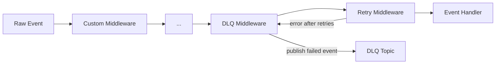
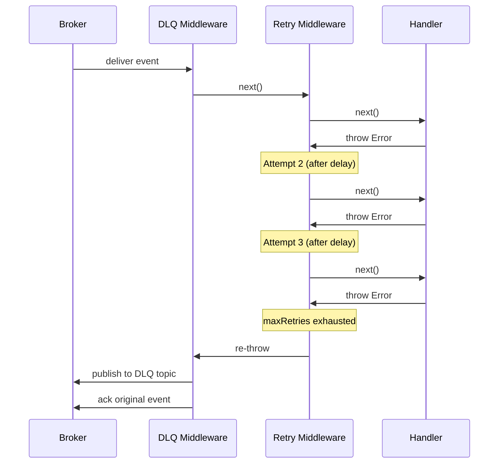

# Middleware

The EventBus middleware pipeline wraps event handlers in a composable onion model. Built-in middleware provides retry with configurable backoff and dead letter queue (DLQ) routing. You can add custom middleware for logging, metrics, validation, or any cross-cutting concern.

**Outcome:** configure one middleware chain and verify success, retry exhaustion, and DLQ behavior. Broker choice and delivery guarantees are owned by [Adapter selection](/en/guide/events/adapters); exact exported types are in the [`@connectum/events` API](/en/api/@connectum/events/).

## Pipeline Order

Middleware executes from outermost to innermost:



Each middleware receives three arguments:

```typescript
type EventMiddleware = (
  event: RawEvent,
  ctx: EventContext,
  next: EventMiddlewareNext,
) => Promise<void>;
```

Call `next()` to pass control to the inner middleware. Errors thrown from `next()` propagate outward through the chain.

## Retry Middleware

Retries failed event handlers with configurable backoff strategy. If all attempts are exhausted, the error is re-thrown for the next middleware in the chain (typically DLQ).

### Configuration

```typescript
const eventBus = createEventBus({
  adapter,
  routes: [myEvents],
  middleware: {
    retry: {
      maxRetries: 3,
      backoff: 'exponential',
      initialDelay: 1000,
      maxDelay: 30_000,
      multiplier: 2,
    },
  },
});
```

### RetryOptions

| Option | Type | Default | Description |
|--------|------|---------|-------------|
| `maxRetries` | `number` | `3` | Maximum number of retries after the first attempt, before giving up. An integer of at least `0`; `0` runs the handler once. A negative, fractional, `NaN` or infinite value throws when the middleware is created (`RangeError`; `TypeError` for a non-number) |
| `backoff` | `"exponential" \| "linear" \| "fixed"` | `"exponential"` | Backoff strategy between retries. Any other name throws (`RangeError`; `TypeError` for a non-string); an unknown name used to behave as `"fixed"` |
| `initialDelay` | `number` | `1000` | Initial delay in milliseconds: a finite number from `0` to `2147483647` |
| `maxDelay` | `number` | `30000` | Maximum delay cap in milliseconds: a finite number from `1` to `2147483647` |
| `multiplier` | `number` | `2` | Multiplier for exponential backoff: a finite number of at least `1` |
| `retryableErrors` | `(error: unknown) => boolean` | `undefined` | Filter function: only retry if it returns `true` |

Every option in the table except `retryableErrors` is checked when the middleware is created (`retryMiddleware()` itself, or `createEventBus()` for `middleware.retry`). A value outside the range above (`NaN`, a negative number, `Infinity`, a number above `2147483647`, `0` for `maxDelay`, a `multiplier` below `1`, a non-number) throws a `RangeError` or `TypeError` that names the option and the received value, before any event is handled. The ceiling `2147483647` is the longest delay a Node.js timer keeps; a larger delay used to be replaced by 1 ms.

### Backoff Strategies

| Strategy | Delay Formula | Example (initialDelay=1000, multiplier=2) |
|----------|--------------|-------------------------------------------|
| `exponential` | `initialDelay * multiplier^(attempt-1)` | 1000ms, 2000ms, 4000ms, 8000ms |
| `linear` | `initialDelay * attempt` | 1000ms, 2000ms, 3000ms, 4000ms |
| `fixed` | `initialDelay` | 1000ms, 1000ms, 1000ms, 1000ms |

All strategies are capped at `maxDelay`.

### Selective Retry

Use `retryableErrors` to only retry specific error types:

```typescript
middleware: {
  retry: {
    maxRetries: 3,
    backoff: 'exponential',
    retryableErrors: (error) => {
      // Only retry transient errors
      if (error instanceof Error) {
        return error.message.includes('ECONNREFUSED')
            || error.message.includes('timeout');
      }
      return false;
    },
  },
}
```

Non-retryable errors are thrown immediately without delay.

### Typed Error Classes

Instead of (or in addition to) the `retryableErrors` predicate, you can use typed error classes for declarative retry control:

```typescript
import { NonRetryableError, RetryableError } from '@connectum/events';

// Handler that uses typed errors
const orderEvents: EventRoute = (events) => {
  events.service(OrderEventHandlers, {
    onOrderCreated: async (msg, ctx) => {
      // Validation errors -- never retry
      if (!msg.orderId) {
        throw new NonRetryableError('Missing orderId');
      }

      try {
        await db.insertOrder(msg);
      } catch (err) {
        // Transient DB errors -- always retry
        if (isConnectionError(err)) {
          throw new RetryableError('DB connection lost', { cause: err });
        }
        throw err; // Other errors use predicate or default behavior
      }
    },
  });
};
```

**Priority order** (first match wins):

| Priority | Check | Behavior |
|----------|-------|----------|
| 1 | `NonRetryableError` | Skip retry, throw immediately |
| 2 | `RetryableError` | Force retry (ignores `retryableErrors` predicate) |
| 3 | `retryableErrors` predicate | Retry if predicate returns `true` |
| 4 | Default | Retry all errors |

Both classes use `Symbol.for()` branding, so they work across module boundaries and realms.

### Stopping during a retry pause {#stopping-during-a-retry-pause}

An event that waits for its next attempt has failed once and still has retry budget. If the shutdown signal (`server.stop()`) or the drain abort of `eventBus.stop()` ends that wait, the retry middleware returns the event to the broker with `ctx.nack(true)` and finishes without an error. The DLQ middleware never sees it, so nothing is published to the DLQ and the original is not acknowledged.

The broker decides what happens next. A durable broker such as NATS JetStream delivers the event again, to this service after the restart or to another replica of the group, and the retry budget starts over: the event may run up to `maxRetries + 1` more times in the new process. Delivery is at-least-once, so handlers must be idempotent. On NATS the next handler sees `ctx.attempt` 2, because JetStream counts the redelivery. `MemoryAdapter` keeps nothing across a stop, so the event is dropped there.

An abort caused by the per-event `handlerTimeout` is different: the event ran out of time, so it is thrown to the DLQ middleware as a failure (`dlq.error=TimeoutError`). A handler that fails while the bus is stopping is also still dead-lettered; see [Relay events during shutdown](/en/guide/events/relay-during-shutdown).

Retries re-enter the handler within the same broker delivery; they do not request
a broker redelivery. The retry middleware increments the `RawEvent.attempt` passed
to inner middleware. The handler's `ctx.attempt` remains the original delivery
indicator, so it is not a local retry counter.

## DLQ Middleware

When a handler fails after all retries are exhausted, the DLQ middleware publishes the failed event to a dedicated dead letter topic and acknowledges the original event. This prevents poison messages from blocking the queue.

If the DLQ publish fails, the middleware calls `ctx.nack(false)` and does not
rethrow. When that settlement is accepted, the original is no longer eligible
for redelivery: a broker dead-letter policy may retain it, otherwise it can be
lost. The failure is reported to the bus `observer` as `{ type: 'dlq-failed', topic, eventType, eventId, error }`
(see [Shutdown drain](/en/guide/events#shutdown-drain)); the bus has no logger of its own, so
log it there. When you compose `dlqMiddleware()` yourself, its third argument is the same
callback. A throw from the observer or the callback is dropped and does not change what happens
to the event. A failed `ctx.ack()` after a successful publish is not reported: the dead-letter
copy exists. If publishing succeeds but `ctx.ack()` rejects, the same fallback is
attempted; the context's first-settlement rule makes that later `nack()` a no-op,
so broker redelivery can still occur. Do not treat this middleware as a guarantee
that every failed event reaches the DLQ. An event already on the configured DLQ
topic is rethrown instead of being published back to itself; in that case the
middleware calls neither `ack()` nor `nack()`, and the event is left unacknowledged.

### Unmatched events {#unmatched-events}

Events that match no route never enter the pipeline and are acknowledged. When
the event type matches no registered topic, exactly or by pattern, the EventBus
acknowledges the delivery without running any handler or middleware. It does
not nack or requeue it and does not copy it to the DLQ, because the DLQ
middleware is part of a route's pipeline. This is reachable where the broker
can deliver more than the subscription asks for: an AMQP fanout exchange, or a
headers exchange whose queue has no operator-declared bindings, delivers every
message to the queue (see
[AMQP reliability](/en/guide/events/amqp-reliability)), and a Redis stream
entry without a matching `eventType` reports an empty or foreign type.

### Configuration

```typescript
const eventBus = createEventBus({
  adapter,
  routes: [myEvents],
  middleware: {
    retry: { maxRetries: 3, backoff: 'exponential' },
    dlq: { topic: 'my-service.dlq' },
  },
});
```

### DlqOptions

| Option | Type | Default | Description |
|--------|------|---------|-------------|
| `topic` | `string` | *required* | Topic name for dead letter events: a non-empty string. A missing, empty or blank value, or a non-string, throws when the middleware or the bus is created (`RangeError`, or `TypeError` for a non-string). Whether the broker accepts the name is decided by the adapter at the first publish; a rejected publish is reported as `dlq-failed` |
| `errorSerializer` | `(error: unknown) => string` | `undefined` | Custom error serializer for DLQ metadata. The default serializes `error.name` only; a custom serializer should return a redacted string. |

### DLQ Metadata

When an event is routed to the DLQ, the middleware attaches diagnostic metadata:

| Key | Description |
|-----|-------------|
| `dlq.original-topic` | Topic the event was originally published to |
| `dlq.original-id` | Unique event ID from the original message |
| `dlq.error` | Serialized error; the default is the error name, or `UnknownError` for a non-`Error` value |
| `dlq.attempt` | Delivery attempt of the original message as the broker adapter reports it (`RawEvent.attempt`); retries made by the retry middleware inside the process are not counted |

`dlq.attempt` is a delivery number, not the number of handler invocations: with
`retry: { maxRetries: 2 }` and a handler that always fails, the handler runs three
times and `dlq.attempt` is still the broker's number for that one delivery. Each
adapter fills it differently:

| Adapter | `dlq.attempt` |
|---------|---------------|
| NATS | The JetStream delivery count |
| Redis | `1` on a normal read; the pending-entry delivery count when the entry was reclaimed |
| AMQP | `2` when the broker marks the message `redelivered`, otherwise `1` (there is no exact counter) |
| Kafka, in-memory | Always `1` |

The DLQ copy contains the original payload and these diagnostic fields. Original
user metadata is not copied; the adapter creates a new event identity for the
publish, so use `dlq.original-id` to correlate it with the failed delivery.

### Monitoring the DLQ

Subscribe directly to the DLQ topic using the adapter to monitor and process failed events:

```typescript
const subscription = await adapter.subscribe(
  ['my-service.dlq'],
  async (rawEvent, ack) => {
    const originalTopic = rawEvent.metadata.get('dlq.original-topic') ?? 'unknown';
    const error = rawEvent.metadata.get('dlq.error') ?? 'unknown';
    console.error(`DLQ event from ${originalTopic}: ${error}`);
    // Log, alert, or attempt recovery
    await ack();
  },
  { group: 'dlq-monitor' },
);

// On shutdown, close this directly managed subscription.
await subscription.unsubscribe();
```

## Retry + DLQ Together

The most common pattern combines retry and DLQ: retry transient errors, route persistent failures to DLQ.

```typescript
const eventBus = createEventBus({
  adapter: NatsAdapter({ servers: 'nats://localhost:4222', stream: 'orders' }),
  routes: [orderEvents],
  group: 'order-service',
  middleware: {
    retry: { maxRetries: 2, backoff: 'fixed', initialDelay: 200 },
    dlq: { topic: 'dead-letter-queue' },
  },
});
```

Execution flow on handler error:



## Custom Middleware

### Writing Custom Middleware

A middleware is any function matching the `EventMiddleware` signature:

```typescript
import type { EventMiddleware } from '@connectum/events';

const loggingMiddleware: EventMiddleware = async (event, ctx, next) => {
  const start = performance.now();
  console.log(`[${ctx.eventType}] Processing event ${ctx.eventId}`);

  try {
    await next();
    const duration = performance.now() - start;
    console.log(`[${ctx.eventType}] Completed in ${duration.toFixed(1)}ms`);
  } catch (error) {
    const duration = performance.now() - start;
    console.error(`[${ctx.eventType}] Failed after ${duration.toFixed(1)}ms:`, error);
    throw error; // Re-throw to let retry/DLQ handle it
  }
};
```

### Registering Custom Middleware

Pass custom middleware in the `middleware.custom` array. They execute outermost, wrapping retry and DLQ:

```typescript
const eventBus = createEventBus({
  adapter,
  routes: [myEvents],
  middleware: {
    custom: [loggingMiddleware, metricsMiddleware],
    retry: { maxRetries: 3 },
    dlq: { topic: 'my-service.dlq' },
  },
});
```

Execution order: `loggingMiddleware → metricsMiddleware → DLQ → retry → handler`

### Metrics Middleware Example

```typescript
import type { EventMiddleware } from '@connectum/events';

const metricsMiddleware: EventMiddleware = async (event, ctx, next) => {
  const labels = { event_type: ctx.eventType, attempt: String(ctx.attempt) };

  try {
    await next();
    eventCounter.inc({ ...labels, status: 'success' });
  } catch (error) {
    eventCounter.inc({ ...labels, status: 'error' });
    throw error;
  }
};
```

### Validation Middleware Example

```typescript
import type { EventMiddleware } from '@connectum/events';

const payloadSizeMiddleware: EventMiddleware = async (event, ctx, next) => {
  const MAX_PAYLOAD_SIZE = 1024 * 1024; // 1 MB

  if (event.payload.length > MAX_PAYLOAD_SIZE) {
    console.warn(`Event ${ctx.eventId} payload exceeds 1MB, skipping`);
    await ctx.nack(false); // Don't requeue
    return;
  }

  await next();
};
```

## Advanced: Manual Composition

For advanced use cases, you can compose middleware manually using `composeMiddleware()`:

```typescript
import { composeMiddleware, retryMiddleware, dlqMiddleware } from '@connectum/events';
import type { EventMiddleware } from '@connectum/events';

const middlewares: EventMiddleware[] = [
  loggingMiddleware,
  dlqMiddleware({ topic: 'my.dlq' }, adapter),
  retryMiddleware({ maxRetries: 3 }),
];

const composed = composeMiddleware(middlewares, async (rawEvent, ctx) => {
  // Final handler
  console.log(`Processing ${ctx.eventId}`);
  await ctx.ack();
});
```

## Related

- [Events Overview](/en/guide/events) -- architecture and core concepts
- [Getting Started](/en/guide/events/getting-started) -- step-by-step setup
- [with-events-dlq](https://github.com/Connectum-Framework/examples/tree/main/with-events-dlq) -- full DLQ example with NATS JetStream
- [@connectum/events](/en/packages/events) -- Package Guide
