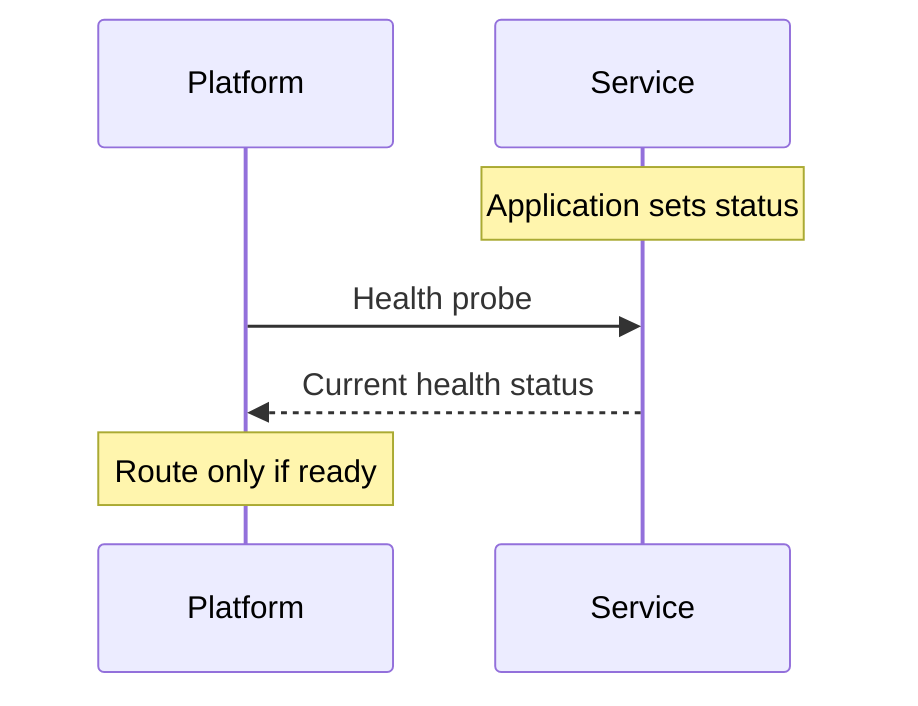

# Health Checks

`@connectum/healthcheck` implements the gRPC Health Checking Protocol and can expose HTTP endpoints for platform probes. The application owns status transitions; the protocol only reports them.

<figure class="technical-diagram guide-topic-diagram--scroll" aria-label="Application state is reported to platform probes">



<figcaption>Listening on a port does not automatically mean the service is ready.</figcaption>
</figure>

With the healthcheck imports and your `routes` in scope:

```typescript
const server = createServer({
  services: [routes],
  protocols: [Healthcheck({ httpEnabled: true })],
});

server.on('ready', () => {
  healthcheckManager.update(ServingStatus.SERVING);
});
```

## Choose the owning guide

Start with the [health protocol](/en/guide/health-checks/protocol) or
[Kubernetes probes](/en/guide/health-checks/kubernetes).

::: details Exact health tasks and API
| Need | Canonical destination |
|---|---|
| Configure protocol options, HTTP paths, status semantics, components, or dependency state | [Health protocol](/en/guide/health-checks/protocol) |
| Configure Kubernetes HTTP/gRPC probes and termination timing | [Kubernetes integration](/en/guide/health-checks/kubernetes) |
| Coordinate drain hooks and the global shutdown deadline | [Graceful shutdown](/en/guide/server/graceful-shutdown) |
| Find an exact manager or protocol symbol | [`@connectum/healthcheck` API](/en/api/@connectum/healthcheck/) |
:::

Readiness means the process can accept useful work; liveness means it should not be restarted. During shutdown, mark the service not serving before draining traffic. Worker-only processes with `services: []` should register an application component in the manager so `/healthz` has an explicit readiness source; the protocol guide owns that pattern.

Use the [`@connectum/healthcheck` module hub](/en/packages/healthcheck) for installation and navigation.
