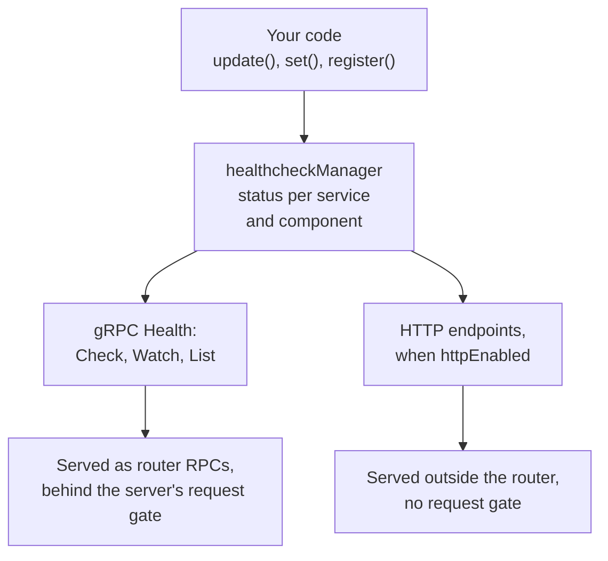

# Health Check Protocol

Connectum implements the [gRPC Health Checking Protocol](https://github.com/grpc/grpc/blob/master/doc/health-checking.md) with additional HTTP endpoints for load balancers and Kubernetes integration.

## Configuration

The `Healthcheck()` factory function accepts the following options:

```typescript
Healthcheck({
  httpEnabled: true,                              // Enable HTTP health endpoints
  httpPaths: ['/healthz', '/health', '/readyz'],  // HTTP endpoint paths
  watchInterval: 500,                             // Watch re-check interval (ms)
  manager: customManager,                         // Custom manager instance
})
```

Use `httpEnabled` and `httpPaths` for platform endpoints, `watchInterval` for the
`Watch` re-check period (see [Health.Watch](#health-watch)), and `manager` when a test
or multi-server process must avoid the singleton. See [`HealthcheckOptions`](/en/api/@connectum/healthcheck/@connectum/healthcheck/types/interfaces/HealthcheckOptions)
for the exact field types and defaults.

`Healthcheck()` checks its options when it is called and throws instead of starting a
server that misbehaves later:

| Option | Accepted | Otherwise |
|--------|----------|-----------|
| `options` | an object, or nothing | `TypeError` (`null`, an array, a string) |
| `httpEnabled` | `true` or `false` | `TypeError` (`"yes"`, `1`, `null`) |
| `watchInterval` | an integer from 1 to 2147483647 | `RangeError` for `0`, a fraction, `NaN`, a negative number, `Infinity` or a larger number; `TypeError` for a string or `null` |
| `manager` | a `HealthcheckManager` | `TypeError` |
| `httpPaths` | see [Custom Paths](#custom-paths) | `RangeError` or `TypeError` |

An omitted option (or an explicit `undefined`) takes its default. One server answers
`grpc.health.v1.Health` from one registration: a second `Healthcheck()` in `protocols`,
or an application service that is already `grpc.health.v1.Health`, makes `start()`
(and the first call made through `localClient()`) reject with an error naming the service. The check
runs when the server builds its routes, not at `createServer()`. One `Healthcheck()`
value can still be passed to several servers.

If a configuration that used to start now throws, see
[Healthcheck option checks](/en/migration/healthcheck-option-checks).

## The healthcheckManager Singleton

The `healthcheckManager` is a global singleton you import from anywhere in your application to update service health status:

```typescript
import { healthcheckManager, ServingStatus } from '@connectum/healthcheck';

// Update overall health status
healthcheckManager.update(ServingStatus.SERVING);

// Update a specific service's health status
healthcheckManager.update(ServingStatus.SERVING, 'my.service.v1.MyService');

// Mark as unhealthy
healthcheckManager.update(ServingStatus.NOT_SERVING);
```

Every probe reads this one state:



### ServingStatus Values

| Status | Value | Description |
|--------|-------|-------------|
| `UNKNOWN` | `0` | Status is unknown (initial state) |
| `SERVING` | `1` | Service is healthy and accepting requests |
| `NOT_SERVING` | `2` | Service is unhealthy or draining connections |
| `SERVICE_UNKNOWN` | `3` | Requested service is not registered |

### Manager Methods

| Method | Description |
|--------|-------------|
| `update(status, service?)` | Update status. Without `service`, updates **all** registered entries (services and components). Throws on an unknown name. |
| `register(component, initialStatus?)` | Register an application health component (default `UNKNOWN`). Re-registering preserves the current status. |
| `set(component, status)` | Set a component's status (upsert: registers the component if absent). |
| `subscribe(listener)` | Call `listener` (no arguments) after every change of the registry; returns a function that removes it. `Health.Watch` is built on this. A listener must not change the registry: calling `update`, `register`, `set`, `unregister`, `initialize` or `clear` from inside one throws, so every listener sees the state of the change that notified it. |
| `unregister(component)` | Remove a registered component. |
| `getStatus(service)` | Get status of a specific service or component. Returns `ServiceStatus \| undefined` (`undefined` for an unknown name — does not throw). |
| `getAllStatuses()` | Get a Map of all service and component statuses |
| `areAllHealthy()` | Check if all services and components report `SERVING` |
| `initialize(serviceNames)` | Initialize the RPC service slice (called by the protocol's `setup`, before its first `register`; in-process transports do not re-run it, a retry after a failed route materialization does). Replaces only `service` entries; never touches components. |
| `clear()` | Clear all services and components |

`update()`, `register()` and `set()` accept only the four `ServingStatus` values above. A value of another type (a string such as `"SERVING"`, `null`, `undefined`) throws `TypeError`; a number outside 0 to 3 (a fraction, `NaN`, `99`) throws `RangeError`; a component or service name that is not a string throws `TypeError`. The registry is left as it was, so `Health.Check` and `Health.List` keep answering.

## gRPC Health Check Protocol

The package implements three gRPC methods on the `grpc.health.v1.Health` service:

The `grpcurl` commands below require `Reflection()` and a plaintext HTTP/2
listener (`allowHTTP1: false`). See [Server reflection](/en/guide/protocols/reflection)
for setup. Use the HTTP examples with the default plaintext HTTP/1.1 listener.

### Health.Check

Returns the current health status:

```bash
# Check overall health
grpcurl -plaintext localhost:5000 grpc.health.v1.Health/Check

# Check a specific service
grpcurl -plaintext \
  -d '{"service": "my.service.v1.MyService"}' \
  localhost:5000 grpc.health.v1.Health/Check
```

A service the manager does not track answers `NOT_FOUND`. The message repeats at most the first 128 characters of the requested name, followed by `…` when the name was longer, so a request with a very long name cannot build an oversized response.

### Health.Watch {#health-watch}

Streams health status changes in real time:

```bash
grpcurl -plaintext localhost:5000 grpc.health.v1.Health/Watch
```

Behavior follows the gRPC specification:
- Immediately sends the current status
- Sends one message for every change of the status, in the order the changes happened, and nothing while the status holds
- For unknown services, sends `SERVICE_UNKNOWN` (does not terminate the call)
- Terminates when the client disconnects

Changes come from the manager's notifications (`subscribe()`), not from sampling. A change reaches the client as soon as it is made, and a status that goes `NOT_SERVING` and back to `SERVING` inside one `watchInterval` is delivered as two messages. For that reason a watcher also sees short intermediate states, for example `UNKNOWN` between a service being registered and its first `update()`. `watchInterval` (default 500 ms) is only the period of a re-check that also finds a state change the manager did not announce.

A client that stops reading while its status keeps changing makes the server hold one pending message per change for that call; the messages are not dropped, because dropping them would hide transitions.

### Health.List

`List` is part of the [gRPC health protocol](https://github.com/grpc/grpc-proto/blob/master/grpc/health/v1/health.proto),
alongside `Check` and `Watch`. It returns a snapshot of the tracked service statuses.

Lists all tracked services with their statuses. Healthcheck tracks the services mounted before it in `protocols`; a service that is only declared — for example next to a mounted service in the same `.proto` file — is not tracked, and `Check` answers `NOT_FOUND` for it:

```bash
grpcurl -plaintext localhost:5000 grpc.health.v1.Health/List
```

## HTTP Health Endpoints

When `httpEnabled: true`, the following HTTP endpoints are available:

### Default Endpoints

| Path | Description |
|------|-------------|
| `/healthz` | Overall health status |
| `/health` | Overall health status (alias) |
| `/readyz` | Overall health status (alias; no separate readiness state) |

### Response Format

```json
{
  "status": "SERVING",
  "service": "overall",
  "timestamp": "2026-02-12T10:30:00.000Z"
}
```

### HTTP Status Codes

| ServingStatus | HTTP Code |
|---------------|-----------|
| `SERVING` | `200 OK` |
| `NOT_SERVING` | `503 Service Unavailable` |
| `UNKNOWN` | `503 Service Unavailable` |
| `SERVICE_UNKNOWN` | `404 Not Found` |

### Check a Specific Service via HTTP

```bash
curl 'http://localhost:5000/healthz?service=my.service.v1.MyService'
```

The `service` query parameter selects one service or component. The answer depends on the URL alone: the `Host` header of the request, including an empty or malformed one, does not change which service the response describes.

| Request | Response |
|---------|----------|
| No `service` parameter | Overall health; the body carries `"service": "overall"` |
| `?service=` (empty value) | The overall status and HTTP code, as if the parameter were absent; the body carries `"service": "overall"` |
| `?service=<known name>` | The status of that service or component, with its name in the `service` field |
| `?service=<unknown name>` | `404 Not Found`, status `SERVICE_UNKNOWN`, with the requested name in the `service` field |

### Custom Paths

```typescript
Healthcheck({
  httpEnabled: true,
  httpPaths: ['/healthz', '/ready', '/live'],
})
```

`httpPaths` replaces the default list. It must be a non-empty array of absolute paths: each entry starts with `/` and contains no `?` or `#`. `Healthcheck()` checks it whenever it is passed, also with `httpEnabled: false`, and throws instead of starting a server that serves nothing:

| Value | Result |
|-------|--------|
| not passed (`undefined`) | The default paths `/healthz`, `/health`, `/readyz` |
| `[]` | `RangeError`. To turn the HTTP endpoint off, set `httpEnabled: false` |
| an entry that is not a string, has no leading `/`, or contains `?` or `#` | `TypeError` |

A request matches a configured path only when the path is identical:

- The comparison is exact and case-sensitive. `/healthz/` and `/Healthz` do not match `/healthz`; such a request is not handled by the health endpoint. To serve both forms, list both.
- The query string is ignored when matching, so `/healthz?service=my.service.v1.MyService` matches `/healthz`.
- The request method is not checked.

`createHttpHealthHandler(manager, healthPaths)`, the exported factory behind the endpoint, applies the same rules to `healthPaths` (`RangeError` for `[]`, `TypeError` for a bad entry) and serves the default paths when the argument is omitted.

If you passed `httpPaths: []` before 1.3, see [HTTP health options validation](/en/migration/healthcheck-http-options).

## Custom Dependency Health Checks

Monitor downstream dependencies (databases, external APIs) alongside your service health:

```typescript
import { healthcheckManager, ServingStatus } from '@connectum/healthcheck';

// Application components survive the protocol's RPC-service initialization.
// Component names must be non-empty and contain no dots.
healthcheckManager.register('database');
healthcheckManager.register('cache');

// Periodically check database health
setInterval(async () => {
  try {
    await db.ping();
    healthcheckManager.set('database', ServingStatus.SERVING);
  } catch {
    healthcheckManager.set('database', ServingStatus.NOT_SERVING);
  }
}, 10000);

// Check cache health
setInterval(async () => {
  try {
    await redis.ping();
    healthcheckManager.set('cache', ServingStatus.SERVING);
  } catch {
    healthcheckManager.set('cache', ServingStatus.NOT_SERVING);
  }
}, 10000);
```

Start these checks only when the dependencies are connected, and clear their
intervals in a shutdown hook. Mark each RPC service `SERVING` separately in the
`ready` listener: an unqualified `update(SERVING)` also marks dependency components
healthy, even before their checks succeed.

### Worker-only processes

A process with no RPC services (`services: []`) still needs an explicit readiness
source, because an empty registry is never healthy. Register a component before
`start()` and flip it with the server lifecycle:

```typescript
import { createServer } from '@connectum/core';
import { Healthcheck, healthcheckManager, ServingStatus } from '@connectum/healthcheck';

const server = createServer({
  services: [],
  port: 5000,
  protocols: [Healthcheck({ httpEnabled: true })],
});

healthcheckManager.register('process');
server.on('ready', () => healthcheckManager.set('process', ServingStatus.SERVING));
server.on('stopping', () => healthcheckManager.set('process', ServingStatus.NOT_SERVING));

await server.start();
```

`/healthz` then returns `200` once the component is `SERVING`, and gRPC
`Check` for `process` reports the same status, which is what a
`docker compose` `service_healthy` condition or a Kubernetes probe needs.

Use `areAllHealthy()` for aggregate health status:

```bash
curl http://localhost:5000/healthz
# Returns 503 if ANY dependency reports NOT_SERVING
```

## Isolated Manager for Testing

Use `createHealthcheckManager()` to create isolated instances for tests or multi-server setups:

::: runtime bun
Import the runner from `bun:test` instead of `node:test` and run the file with `bun test`.
:::

```typescript
import { describe, it } from 'node:test';
import assert from 'node:assert';
import {
  Healthcheck,
  createHealthcheckManager,
  ServingStatus,
} from '@connectum/healthcheck';
import { createServer } from '@connectum/core';

describe('health check', () => {
  it('should track service status', () => {
    const manager = createHealthcheckManager();
    manager.initialize(['my.service.v1.MyService']);

    manager.update(ServingStatus.SERVING, 'my.service.v1.MyService');
    assert.ok(manager.areAllHealthy());

    manager.update(ServingStatus.NOT_SERVING, 'my.service.v1.MyService');
    assert.ok(!manager.areAllHealthy());
  });

  it('should work with createServer', async () => {
    const manager = createHealthcheckManager();

    const server = createServer({
      services: [routes],
      protocols: [Healthcheck({ httpEnabled: true, manager })],
    });

    server.on('ready', () => {
      manager.update(ServingStatus.SERVING);
    });

    await server.start();
    // ... test assertions ...
    await server.stop();
  });
});
```

## Related

- [Health Checks Overview](/en/guide/health-checks) -- back to overview
- [Kubernetes Integration](/en/guide/health-checks/kubernetes) -- probes, graceful shutdown, shutdown timeline
- [@connectum/healthcheck](/en/packages/healthcheck) -- Package Guide
- [@connectum/healthcheck API](/en/api/@connectum/healthcheck/) -- Full API Reference
