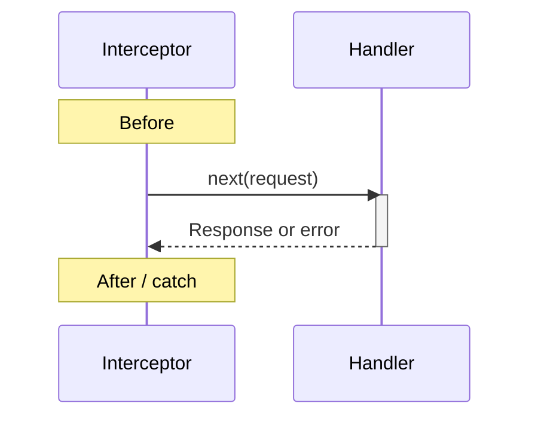

# Interceptors

Keep handlers focused on business decisions. Interceptors wrap the RPC with
shared behavior such as error handling, validation or a timeout.

<figure class="technical-diagram" aria-label="An interceptor wraps the handler call">



<figcaption>Order changes behavior. An outer interceptor sees both the request and the inner result. With several wrappers, the response or error unwinds through them in reverse order.</figcaption>
</figure>

## Start with the default chain

```typescript
import { createServer } from '@connectum/core';
import { createDefaultInterceptors } from '@connectum/interceptors';

const server = createServer({
  services: [routes],
  interceptors: createDefaultInterceptors(),
});
```

Here `routes` is your service registration. The default chain includes error
handling and validation; resilience features are opt-in.

::: details Opt into timeout and retry
```typescript
const interceptors = createDefaultInterceptors({
  timeout: { duration: 10_000 },
  retry: { maxRetries: 2 },
});
```

Pass this chain as the server's `interceptors`. Retry can repeat work; enable it
only where the operation is safe to retry.
:::

Error handling and validation are structural defaults. Timeout, bulkhead, circuit breaker, retry, fallback, and serializer behavior is opt-in because it changes request semantics. The canonical chain order, defaults, and standalone factories live in [Built-in interceptors](/en/guide/interceptors/built-in); exact fields live in [`DefaultInterceptorOptions`](/en/api/@connectum/interceptors/defaults/interfaces/DefaultInterceptorOptions).

## Choose the extension route

Start with the [built-in chain](/en/guide/interceptors/built-in),
[write a custom interceptor](/en/guide/interceptors/custom), or
[scope it to selected methods](/en/guide/interceptors/method-filtering).

::: details Other middleware tasks and exact APIs
| Need | Route |
|---|---|
| Configure the supported chain | [Built-in interceptors](/en/guide/interceptors/built-in) |
| Add business-specific middleware | [Custom interceptors](/en/guide/interceptors/custom) |
| Apply behavior to selected services or methods | [Method filtering](/en/guide/interceptors/method-filtering) |
| Authenticate or authorize calls | [Auth and authz](/en/guide/auth) |
| Trace incoming or outgoing calls | [Tracing](/en/guide/observability/tracing) |
| Look up an exact factory or option | [`@connectum/interceptors` API](/en/api/@connectum/interceptors/) |
:::

Use native router scoping when an interceptor belongs to one service, a method-filter interceptor for declarative name patterns, and a custom interceptor only when selection depends on runtime request data.

Native per-service `interceptors` **replace**, rather than append to, the server-level chain. Include all required error handling, validation and other middleware explicitly; see the [complete service-scoped example](/en/guide/interceptors/method-filtering#approach-1-connectrpc-native-per-service-per-method).

## Module route

The [`@connectum/interceptors` module hub](/en/packages/interceptors) owns installation, the minimal example, key entry points, and Learn / Configure / API navigation.
