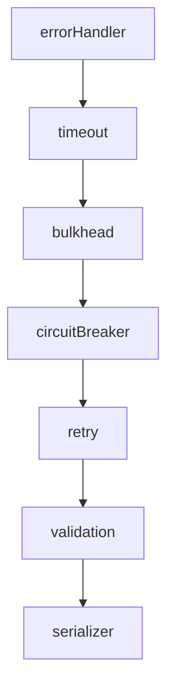
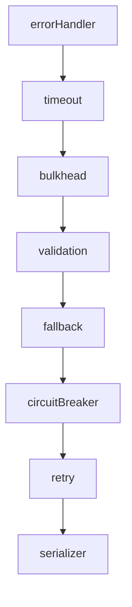
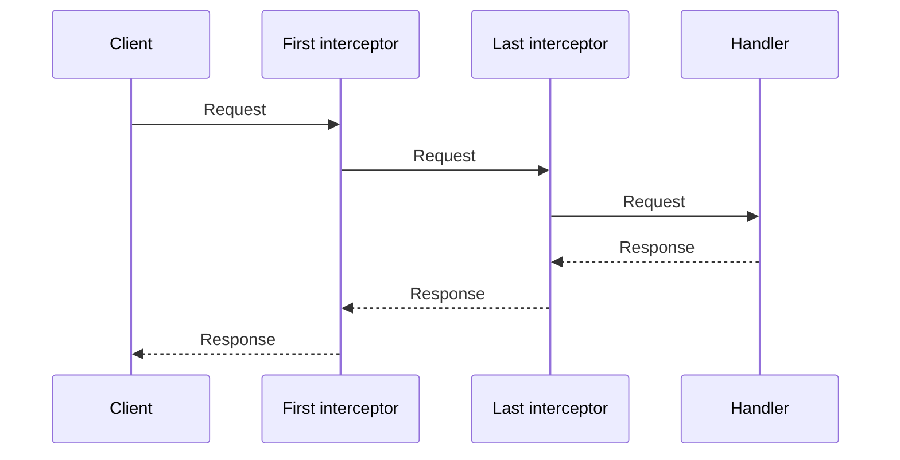

# Built-in Interceptors

`createDefaultInterceptors()` provides eight built-in interceptors in a fixed order for error handling, resilience, validation, and serialization.

## The Default Chain



This is the order without a `fallback`. When you enable a `fallback`, it moves out together with validation, in front of the circuit breaker and retry (see [Fallback position](#fallback-position)).

| # | Interceptor | Purpose | Default |
|---|-------------|---------|---------|
| 1 | **errorHandler** | Normalizes errors into `ConnectError` and hides the text of non-Connect failures from the client | Enabled |
| 2 | **timeout** | Limits request execution time | **Opt-in** (30s when enabled) |
| 3 | **bulkhead** | Limits concurrent requests | **Opt-in** (capacity 10, queue 10 when enabled) |
| 4 | **circuitBreaker** | Prevents cascading failures (outbound pattern, see below) | **Opt-in** (threshold 5 when enabled) |
| 5 | **retry** | Retries transient failures with exponential backoff and jitter (see [Retry delay](#retry-delay)) | **Opt-in** (3 retries when enabled) |
| 6 | **validation** | Validates via `@connectrpc/validate`; stands outside the fallback, so a rejected request is never answered by the fallback value | Enabled |
| 7 | **serializer** | JSON serialization for protobuf | **Opt-in** |
| n/a | **fallback** | Graceful degradation; stands outside `circuitBreaker` and `retry` (see [Fallback position](#fallback-position)) | **Opt-in** (requires an options object with a handler; `true` is refused) |

The order is deliberate: `errorHandler` is outermost (wraps `next(req)`), `serializer` is innermost (closest to the handler). The order applies to whichever interceptors you enable. In particular, `circuitBreaker` wraps `retry`, so one logical request increments the failure counter at most once regardless of retry attempts. The fallback is the one interceptor whose place depends on the others: it stands in front of both, see [Fallback position](#fallback-position).

::: warning No hidden behavioral logic
Only structural interceptors (errorHandler, validation) are enabled by default. Resilience interceptors (timeout, bulkhead, circuitBreaker, retry) alter request behavior and must be enabled explicitly with `true` or an options object.
:::

`skipGrpcServices` matches service names beginning with `grpc.`, such as Health
and Reflection. It does not skip every request using the gRPC wire protocol.

## What a client sees when a handler fails {#what-a-client-sees-when-a-handler-fails}

The text of a failure often carries a connection string, a query or a value from the request, so `errorHandler` sends it to the client only when the author chose to. The behavior is the same over gRPC, Connect and `server.localClient()`.

This interceptor catches failures thrown or rejected by `next(req)`. It does not
wrap later response-stream iteration or request gates that run before the
interceptor chain; the rules below do not cover those failures.

| Thrown by the handler | Client receives |
|---|---|
| `ConnectError` | Unchanged: code, text, details, metadata |
| `SanitizableError` | Its `clientMessage` and code (`Internal` when the code is not an integer from 1 to 16); `serverDetails` stay on the server |
| An `Error` named `AbortError` or `TimeoutError` (a `DOMException` from an aborted `fetch` or `AbortSignal.timeout()` too), whatever its `code` | `Canceled` with an empty text |
| Any other value with an integer `code` from 1 to 16 | That code; the text is empty, except for `Internal` (13), which carries `internal error` |
| Anything else: an `Error` without a `code`, a thrown string, a `code` that is not an integer from 1 to 16 (`0`, `17`, `1.5`, `NaN`, an HTTP status, an errno, `"ECONNRESET"`) | `Internal` with the text `internal error` |

The rows are checked in this order, and the first match decides. A `SanitizableError` is
recognised before the name check, so one that happens to be named `AbortError` still sends
its `clientMessage` and code. With `exposeErrorMessages: true` the rows from the third on
keep their codes and carry the original text instead; the first two rows do not change.

Only the codes 1 to 16 (`Canceled` to `Unauthenticated`) are failure codes; `0` means success in gRPC, so another number is not sent to the client as a code. This holds for a `SanitizableError` too: its `clientMessage` is kept and its code becomes `Internal`. `onError` receives the code the client receives, and the original error keeps its own `code`.

With the default `exposeErrorMessages: false`, a non-Connect, non-Sanitizable
failure is retained as `cause` of the normalized `ConnectError`; transports do
not serialize `cause`. An existing `ConnectError` is unchanged. Converting a
`SanitizableError` does not attach the original error as `cause`.

If supplied, `onError` receives the original `SanitizableError`, including
`serverDetails`, or the server-side `ConnectError.from()` result for other
failures. Console logging runs only when `onError` is absent and `logErrors` is
enabled; `logErrors` defaults to `process.env.NODE_ENV !== "production"`.

When console logging runs, it has one entry per handled error: the failure itself, with its stack and `cause`. A second line, `Transformed ConnectError:`, appears only when the client receives something other than what was thrown, and shows it as a short text such as `[internal] internal error`. A `ConnectError` that leaves unchanged, such as a validation failure, is one entry. `includeStackTrace` controls the `stack` field that `onError` receives.

`onError` is a reporting hook and cannot change the outcome of a call. It may be `async`; the interceptor does not wait for it. If it throws, or the promise it returns rejects, the client still receives the error from the table above and the process sees no unhandled rejection. The first failure of the callback is written once to `console.error`; later ones are dropped, because a sink that is down fails on every call.

To send a message on purpose, throw a `ConnectError` or a `SanitizableError`. To send the original text of every failure (for a thrown value that is not an `Error`, its string form), set `exposeErrorMessages: true`. The option is server-side, defaults to `false` and does not depend on `NODE_ENV`; use it only for trusted internal callers or while debugging:

```typescript
createDefaultInterceptors({ errorHandler: { exposeErrorMessages: true } });
```

The same option exists on `createErrorHandlerInterceptor({ exposeErrorMessages: true })`. Clients that parsed these texts must read the code, or a `ConnectError` with details, instead. See [Error handler keeps non-Connect messages on the server](/en/migration/error-handler-messages).

## Cancellation and Streaming Scope {#cancellation-and-streaming-scope}

An enabled timeout forwards its own deadline and caller cancellation to
downstream work. Its own deadline rejects with `DeadlineExceeded`. Caller
cancellation preserves an existing `ConnectError`, including its code, message,
metadata, and details; other caller reasons become `Canceled`. The first
observed cancellation cause wins. Custom interceptors observe `req.signal`; RPC
handlers observe `ctx.signal` and pass it to cancellable I/O.

Retry interrupts a pending backoff and starts no further attempts after
cancellation. It waits for an already running handler to settle, then rejects a
late success with the cancellation reason. This keeps the bulkhead slot occupied
until the work actually finishes. An outer timeout or transport can stop the
caller's wait earlier.

A bulkhead call that waits in the queue leaves it as soon as its request signal
aborts: it frees its queue place for the next caller, its handler never runs, and
it fails with `Canceled` (the abort reason itself when that is a `ConnectError`).
A call that arrives with an already aborted signal fails the same way without
taking a slot or a queue place. A slot that is already held stays held until the
work settles, as described above.

Handlers that ignore the signal can still finish and commit side effects.
Cancellation does not roll them back. Retry only idempotent operations.

The signal a unary call hands downstream follows the caller's signal while the call
runs, and the caller's own abort reason reaches the handler. It does not stay linked
afterwards, so many calls can share one long-lived signal, such as an
application-wide shutdown signal, without piling up memory. While the handler is still
running, the caller's abort reaches it. An abort that reaches a signal-unaware handler
only after that handler has returned (over HTTP, the server can learn of the
cancellation that late) no longer changes the signal that finished call held: the call
is over, so there is no running work left to cancel. An opened stream, with `skipStreaming: false`, keeps following the caller's signal for the
life of the stream.

Timeout and retry skip streaming calls by default. With `skipStreaming: false`,
they cover opening the streaming response, not subsequent iteration. Successful
opening clears the timeout without aborting the stream; later caller cancellation
still reaches it. Retry can repeat opening failures, but cannot restart a response
iterator that fails after opening.

## Retry delay {#retry-delay}

The pause between attempts is exponential with decorrelated jitter: the retry
interceptor uses the `ExponentialBackoff` of its `cockatiel` dependency with that
library's default generator, scaled by `initialDelay` and capped at `maxDelay`. The
delays are randomized, so the interceptor does not guarantee exact values or a fixed
multiplier between attempts. Do not build timing assumptions on them; if you need a
fixed schedule, write your own interceptor.

## Circuit Breaker: Placement and Error Classification

The circuit breaker is an **outbound/client-side pattern**: it protects the caller from a sick upstream (fail fast instead of waiting on timeouts) and gives that upstream room to recover. On a server's inbound stack it degenerates into error-rate load shedding — for inbound protection prefer explicit `timeout` + `bulkhead`.

```typescript
// Recommended: circuit breaker on an outbound client transport
import { createConnectTransport } from '@connectrpc/connect-node';
import { createCircuitBreakerInterceptor } from '@connectum/interceptors';

const transport = createConnectTransport({
  baseUrl: 'http://upstream:5000',
  httpVersion: '1.1', // required by the types; use '2' for an upstream that serves HTTP/2
  interceptors: [
    createCircuitBreakerInterceptor({ threshold: 5, halfOpenAfter: 30_000 }),
  ],
});
```

**One probe in the half-open state.** After `halfOpenAfter` has passed, exactly one call goes through as the probe. A call that arrives while the probe is still running is rejected at once with `Unavailable` and the text `Circuit breaker is open (N consecutive failures)`, the same error as in the open state; it does not wait for the probe and never reaches the handler. A successful probe closes the circuit, so the next call passes. A failed probe opens it again for another `halfOpenAfter`. To bound a slow probe, put the `timeout` interceptor in front of the breaker.

**One breaker per interceptor.** Each `createCircuitBreakerInterceptor()` call creates one breaker, and that breaker counts the failures of every call that passes through the returned interceptor (streaming calls are skipped by default), whatever the service or method. Two upstreams that must trip independently need two interceptors, each on its own transport.

**Error classification.** By default only infrastructure errors count as circuit failures: `Unknown`, `DeadlineExceeded`, `Internal`, `Unavailable`, `DataLoss`, `ResourceExhausted` (plus any non-`ConnectError` thrown value). Business codes (`invalid_argument`, `not_found`, `failed_precondition`, `already_exists`, ...) are expected responses of a healthy service: they never open the breaker, and in half-open state they close it.

Customize with `failurePredicate(error, defaultPredicate)` — the default predicate (exported as `defaultFailurePredicate`) is passed in for composition:

```typescript
import { Code, ConnectError } from '@connectrpc/connect';
import { createCircuitBreakerInterceptor } from '@connectum/interceptors';

// Exclude upstream per-client rate limits from tripping the breaker
createCircuitBreakerInterceptor({
  failurePredicate: (err, def) =>
    def(err) && !(err instanceof ConnectError && err.code === Code.ResourceExhausted),
});

// Restore legacy behavior (every error trips the breaker)
createCircuitBreakerInterceptor({ failurePredicate: () => true });
```

::: tip When to enable the serializer
Ordinary Connect JSON calls need no serializer interceptor: ConnectRPC's transport
already handles protobuf JSON encoding. Use the server's `jsonOptions` for wire
JSON settings. The optional serializer instead converts the request message to
JSON before `next()` and converts its response back to a protobuf message, so the
inner handler must accept and return protobuf JSON shapes.

```typescript
// Opt in only for an inner handler that intentionally works with JSON shapes
const interceptors = createDefaultInterceptors({
  serializer: true,
});

// Normal protobuf handlers over Connect or gRPC: leave it disabled
const interceptors = createDefaultInterceptors();

// Custom serializer options
const interceptors = createDefaultInterceptors({
  serializer: {
    alwaysEmitImplicit: true,
    ignoreUnknownFields: false,
  },
});
```
:::

## Using with createServer

The recommended way to add the built-in interceptors:

```typescript
import { createServer } from '@connectum/core';
import { Healthcheck, healthcheckManager, ServingStatus } from '@connectum/healthcheck';
import { Reflection } from '@connectum/reflection';
import { createDefaultInterceptors } from '@connectum/interceptors';

const server = createServer({
  services: [routes],
  port: 5000,
  protocols: [Healthcheck({ httpEnabled: true }), Reflection()],
  interceptors: createDefaultInterceptors(),
  shutdown: { autoShutdown: true },
});

server.on('ready', () => {
  healthcheckManager.update(ServingStatus.SERVING);
});

await server.start();
```

## Customizing the Default Chain

Pass options to `createDefaultInterceptors()` to customize individual interceptors. Pass `true` or an options object to enable an opt-in interceptor; set one of the default-enabled interceptors to `false` to disable it:

```typescript
import { createDefaultInterceptors } from '@connectum/interceptors';

const interceptors = createDefaultInterceptors({
  timeout: { duration: 10_000 },   // Enable timeout (10s)
  bulkhead: { capacity: 20, queueSize: 20 }, // Enable bulkhead with custom limits
  // errorHandler and validation remain enabled by default
});

const server = createServer({
  services: [routes],
  port: 5000,
  protocols: [Healthcheck({ httpEnabled: true }), Reflection()],
  interceptors,
  shutdown: { autoShutdown: true },
});
```

Each key accepts only `true`, `false`, `undefined` or an options object. `validation` accepts only a boolean. `fallback` accepts `false` or an options object with a `handler`; there is no default handler, so `fallback: true` is refused. Any other value (`null`, a number, a string, an array, a function) throws a `TypeError` that names the key, for example `timeout must be true, false or an options object, got null`. A value the helper does not understand never switches an interceptor off silently.

The keys are `errorHandler`, `timeout`, `bulkhead`, `circuitBreaker`, `retry`, `fallback`, `validation` and `serializer`. A key outside this list throws a `TypeError` that names it and lists the known keys, so a typo such as `timout` cannot leave a protection off unnoticed. The logger and the method filter are not part of the default chain: create them with `createLoggerInterceptor()` and `createMethodFilterInterceptor()` and add them to the `interceptors` array yourself. An argument that is not an object (`null`, for example) is refused too.

```typescript
createDefaultInterceptors({ fallback: { handler: () => ({ items: [] }) } }); // enabled
createDefaultInterceptors({ fallback: true });  // TypeError: fallback must be false or an options object with a handler, got true
createDefaultInterceptors({ timeout: null });   // TypeError: timeout must be true, false or an options object, got null
createDefaultInterceptors({ timout: true });    // TypeError: createDefaultInterceptors: unknown option "timout"; the known options are errorHandler, timeout, bulkhead, circuitBreaker, retry, fallback, validation, serializer
createDefaultInterceptors(null);                // TypeError: createDefaultInterceptors: options must be an object, got null
```

### Fallback position {#fallback-position}

The fallback stands outside `circuitBreaker` and `retry`, and inside `timeout` and `bulkhead`. Validation stands directly outside the fallback, so a request that breaks a validation rule is rejected with `InvalidArgument` and never answered by the fallback value. With a `fallback` the chain is:



The order has these consequences:

- The retries run first. With `retry: { maxRetries: 3 }` a handler that keeps failing with `Unavailable` is called four times, and only then does the `handler` of the fallback produce the response. A call that succeeds on a retry is served as it is, and the fallback is not asked.
- The circuit breaker sees the failures behind the fallback and opens at its threshold. While it is open, the fallback answers the refused calls without calling the service handler, and its `handler` receives the `Unavailable` "Circuit breaker is open" error.
- The `handler` of the fallback receives the error that ended the call: the last failure after the retries, or the first one for a code that retry does not repeat (`Internal`, `NotFound`, ...).
- The `handler` is also called with the `Canceled` or `DeadlineExceeded` error that retry raises after the caller cancelled or the deadline passed. The client still receives the cancellation from the layer that raised it, but side effects of the `handler` run for such calls.
- An error thrown by the `handler` itself is not repeated by retry and not counted by the breaker.
- With the breaker open, an invalid request gets `InvalidArgument`; without a fallback it gets `Unavailable` "Circuit breaker is open", because validation stands behind the breaker there.
- With `skipStreaming: false` on both `retry` and `fallback`, opening a stream that fails with `Unavailable` is attempted `maxRetries + 1` times, then the fallback message is the only message of the stream.

A fallback placed inside `circuitBreaker` or `retry` would answer the first failure with a value: no retry would run and the breaker would never record a failure. If you compose the interceptors yourself instead of using `createDefaultInterceptors()`, list `createFallbackInterceptor` before `createCircuitBreakerInterceptor` and `createRetryInterceptor`, and put the validation interceptor before the fallback. A chain without a `fallback` keeps validation after `retry`.

### Refusals of access are not replaced {#fallback-access-refusals}

A fallback value stands in for a failed dependency, a timeout or a bug, never for a caller who is not allowed. A failure with the code `Unauthenticated` or `PermissionDenied` is rethrown as it is and the `handler` is not called for it. This holds wherever the authentication or authorization interceptor stands relative to the fallback interceptor, and also for a refusal raised by the service handler itself. Failures with any other code, and errors that are not a `ConnectError`, still receive the fallback value.

Place authentication and authorization immediately after `errorHandler`, before timeout and other resilience interceptors: `errorHandler → AUTH → AUTHZ → resilience`. See the [manual chain example](/en/guide/interceptors/custom#composing-with-built-in-interceptors). This keeps auth failures inside error handling while rejecting unauthorized calls before downstream policies run.

### Rejected requests are not replaced {#fallback-validation}

A request that breaks a validation rule is a client error, not a failed dependency. `createDefaultInterceptors` places `validation` before `fallback`, so the caller receives `INVALID_ARGUMENT`, and neither the service handler nor the `handler` of the fallback runs. When you build the chain yourself, put the validation interceptor before the fallback interceptor: with the order reversed, an invalid request is answered with the fallback value as if it had been served.

### What the handler returns {#fallback-handler-result}

The `handler` returns the response message of the method that failed: a message made with `create(OutputSchema, { ... })`, or a plain object with that message's fields, which the interceptor turns into one. The `{ items: [] }` above works for a method whose response has an `items` field. A field of a oneof is set as `pick: { case: "a", value }`, under the name of the oneof.

A plain object is checked field by field before the message is built, because `create()` alone drops unknown keys and coerces wrong values (a number in a string field becomes `"5"`). The first problem fails the call with a `TypeError` that names `createFallbackInterceptor`, the expected type and the path of the problem. Refused are:

- `undefined`, `null`, a string, or an array instead of the object;
- a key that is not a field of the type, in a nested object too, and the bare name of a oneof member;
- a value of another kind than its field takes: a number in a string field, a non-boolean in a bool field, a string in an int32 field, a non-array in a repeated field, an enum name instead of its number, a wrong item in a list or map;
- a number the encoder cannot write: a fraction or a value beyond the range in an int32, `NaN`;
- a map key that is not the canonical form of its key type: for an integer key a decimal number inside the range without a leading zero, a sign `+`, a space, an exponent, a hexadecimal prefix, `-0` or an empty string; for a bool key only `"true"` or `"false"`. The encoder would read `"01"` as 1 and `"yes"` as `true`, so the response would name a different key. A 64-bit integer given as a string follows the same rule;
- a string with a lone surrogate in any position, keys of a `Struct` at every depth included (it would be written as U+FFFD), `NaN` or `Infinity` inside a `Struct` (JSON cannot carry them), bytes given as an `ArrayBuffer`, a `DataView` or an array with holes or values outside 0 to 255, and a oneof object with keys other than `case` and `value`.

An enum number that the enum does not name is accepted. The forms are those of protobuf-es: a wrapper (`StringValue`, `Int64Value`, ...) in a singular field outside a oneof is its bare value (`name: "cached"`, not `{ value: "cached" }`), and a `Struct` is a plain JSON object; a ready message is refused in both places, while a plain object that only carries another `$typeName` is just a JSON object in a `Struct` field. `Timestamp`, `Duration`, `Value`, `ListValue`, `Any`, `FieldMask` and `Empty` are objects with their own fields (`{ seconds: 1n }`), and a wrapper in a list or a oneof is an object with `value`. Behind the error handler the client receives `Internal` with the text `internal error`, and `onError` and the console log show the full text.

### Fallback response {#fallback-response}

::: warning Streaming fallback limitation
Keep the default `skipStreaming: true` for fallback. With `false`, a server-streaming
opening failure calls the provider but produces an invalid response: real gRPC and
Connect clients receive no fallback messages and `Internal(13)`. This is a known
defect, tracked in [#465](https://github.com/Connectum-Framework/connectum/issues/465),
not the opening-only scope of timeout and retry.
:::

For unary RPCs, the response the fallback interceptor synthesises carries only the protocol headers it needs, on a server chain and on a client transport alike:

- `content-type` equal to the `content-type` of the request. A Connect GET request has none, so it is derived from the `encoding` query parameter (`json` gives `application/json`, `proto` gives `application/proto`); with no type to derive, the header stays empty.
- the trailer `grpc-status: 0` when the request `content-type` starts with `application/grpc` (gRPC and gRPC-web). For any other protocol the trailer is empty.

No header of the request is copied into the response, whichever interceptor added it. Connect, gRPC and gRPC-web clients over HTTP/2 and HTTP/1.1 accept the response. Metadata the caller needs belongs in the message the `handler` returns, not in the headers.

## Option ranges and validation {#option-ranges-and-validation}

The options of the interceptors are checked when the factory is called (or when `createDefaultInterceptors()` builds the chain), so a misconfiguration fails at startup instead of changing behavior under load. The numeric options come first; the options that are not numbers follow the table of refusals.

| Factory | Option | Accepted value | Default |
|---|---|---|---|
| `createTimeoutInterceptor` | `duration` | integer, 1 to 2147483647 ms | 30000 |
| `createBulkheadInterceptor` | `capacity` | integer, 1 or more | 10 |
| `createBulkheadInterceptor` | `queueSize` | integer, 0 or more | 10 |
| `createCircuitBreakerInterceptor` | `threshold` | integer, 1 or more | 5 |
| `createCircuitBreakerInterceptor` | `halfOpenAfter` | integer, 0 to 2147483647 ms | 30000 |
| `createRetryInterceptor` | `maxRetries` | finite number, 0 or more (a fraction such as `0.5` is allowed) | 3 |
| `createRetryInterceptor` | `initialDelay` | integer, 0 to 2147483647 ms | 200 |
| `createRetryInterceptor` | `maxDelay` | integer, 0 to 2147483647 ms | 5000 |
| `createFallbackInterceptor` | `handler` | function | required |

2147483647 ms (about 24.8 days) is the longest delay the platform timer honors. A longer delay does not wait longer: the timer fires after 1 ms, so a very large timeout would expire at once. To run without a time limit, omit the `timeout` interceptor instead of passing a large number.

A refusal names the factory, the option, the rule and the received value:

| Received | Thrown | Example message |
|---|---|---|
| Not a number (`"30s"`, `null`, `true`; `undefined` selects the default) | `TypeError` | `createTimeoutInterceptor: duration must be an integer from 1 to 2147483647 milliseconds, got "30s"` |
| A number outside the rule (`NaN`, `Infinity`, a fraction, zero or negative where not allowed, above the ceiling) | `RangeError` | `createBulkheadInterceptor: capacity must be an integer of at least 1, got 1.5` |
| A `fallback` options object without a function `handler` | `TypeError` | `createFallbackInterceptor: handler must be a function` |

The options that are not numbers are checked in the same way. A wrong type throws a `TypeError`, a right type with a wrong value a `RangeError`, and the message names the factory and the option:

| Factory | Option | Accepted value |
|---|---|---|
| every factory that takes options | the options argument | an object (`null`, a number, a string and an array are refused; the factories with defaults still accept no argument) |
| timeout, bulkhead, circuit breaker, retry, fallback | `skipStreaming` | `true` or `false` |
| logger | `skipHealthCheck`, `includeTransport`, `includeBodies` | `true` or `false` |
| serializer | `skipGrpcServices`, `alwaysEmitImplicit`, `ignoreUnknownFields` | `true` or `false` |
| logger | `level` | `"debug"`, `"info"`, `"warn"` or `"error"` |
| logger | `logger` | a function, when given |
| circuit breaker | `failurePredicate` | a function, when given |
| retry | `retryableCodes` | an array of Connect codes (`Code.Unavailable` and the like); an empty array retries nothing |

A string such as `"no"` is not a boolean: before, it was read as `true`, and `retryableCodes: null` turned the first failing call into `Internal`.

### Bulkhead refusal

A request that finds every slot and the whole queue taken is rejected with the code `ResourceExhausted` and the text `Bulkhead capacity exceeded (capacity: N, queueSize: M)`, where N and M are the values you configured. The text carries no live occupancy. Branch on the code, not on the text: the text is for people reading logs and can change between releases.

Upgrading from a release where these were accepted? See [Interceptor option validation](/en/migration/interceptor-options).

## Combining with Custom Interceptors

Spread the default chain and append your own interceptors:

```typescript
import { createDefaultInterceptors } from '@connectum/interceptors';

const server = createServer({
  services: [routes],
  port: 5000,
  protocols: [Healthcheck({ httpEnabled: true }), Reflection()],
  interceptors: [
    ...createDefaultInterceptors(),
    myCustomInterceptor,  // Added after the built-in chain
  ],
  shutdown: { autoShutdown: true },
});
```

::: tip Auth interceptors require a specific position
If your custom interceptor is an authentication or authorization interceptor from `@connectum/auth`, it must be placed **immediately after** `errorHandler` -- before `timeout` and other resilience interceptors. See the [Custom Interceptors](/en/guide/interceptors/custom) guide for a manual chain example and [ADR-024](/en/contributing/adr/024-auth-authz-strategy) for the rationale.
:::

## Standalone Usage

You can use `createDefaultInterceptors()` outside of `createServer`:

```typescript
import { createDefaultInterceptors } from '@connectum/interceptors';

const interceptors = createDefaultInterceptors({
  timeout: { duration: 10_000 },
  retry: { maxRetries: 5 },
});
```

For exact factory options, see the [interceptor API](/en/api/@connectum/interceptors/).

## Request Logging

`createLoggerInterceptor()` is not part of the default chain. Add it to `interceptors` when you want every RPC except health checks (`skipHealthCheck` defaults to `true`) logged with a request line, a response line and its duration. The health checks it skips are the calls to the `grpc.health` package, `grpc.health.v1.Health` or the same package under a prefix such as `acme.grpc.health.v1.Probe`. A service whose name only contains the text inside a longer segment, such as `acme.grpc.healthcare.v1.Svc`, is logged:

```typescript
import { createServer } from '@connectum/core';
import { createDefaultInterceptors, createLoggerInterceptor } from '@connectum/interceptors';

const server = createServer({
  services: [routes],
  interceptors: [
    ...createDefaultInterceptors(),
    createLoggerInterceptor({
      level: 'info',            // default: 'debug'
      skipHealthCheck: true,    // default: true
      includeTransport: true,   // default: false
      includeBodies: false,     // default: false
    }),
  ],
});
```

With `includeTransport: true`, every line of a call carries the transport right after the `RPC` / `STREAM` prefix — `[in-process]` for calls made through `server.localClient()` or `createLocalTransport()` (see [In-Process Transport](/en/guide/production/in-process-transport)), `[http]` for all other calls:

```text
RPC [in-process] /greeter.v1.GreeterService/SayHello request
RPC [http] /greeter.v1.GreeterService/SayHello completed in 1.84ms
```

`includeTransport` is off by default; without it the log lines carry no tag.

::: warning Telemetry only
The transport tag comes from a framework-internal request marker. Use it to read logs, never to authorize: base access decisions on `req.service.typeName` and `req.method.name`.
:::

### What a call writes

Every call writes a request line, a response line and a completion line:

```text
RPC /greeter.v1.GreeterService/SayHello request
RPC /greeter.v1.GreeterService/SayHello response
RPC /greeter.v1.GreeterService/SayHello completed in 1.84ms
```

A call that fails writes `RPC <path> failed with <Code>` before the completion line. `<Code>` is the Connect code name, or `Unknown` for an error that is not a `ConnectError`; the original error reaches the caller unchanged. A streaming call writes `STREAM <path> request` and `STREAM <path> response` for every message, and its completion line when the stream ends: fully read, failed midway, or closed early by the reader with `break` or `return()`. The duration therefore covers the whole stream.

### Message bodies are opt-in

By default a log line carries only metadata: no request or response body reaches the `logger` function, because bodies can hold credentials, tokens and personal data, and a log outlives the call and has more readers. Set `includeBodies: true` to pass them. A unary call then hands its request and response message to `logger` as an extra argument, and a streaming call hands each request message and the JSON form of each response message:

```typescript
createLoggerInterceptor({ includeBodies: true });
// logger('RPC /greeter.v1.GreeterService/SayHello request', { name: 'Ada' })
```

::: warning Bodies in logs
Enable `includeBodies` only where the log is as protected as the traffic itself. Since 1.3.0, bodies are opt-in. See [Logger bodies are opt-in](/en/migration/logger-bodies).
:::

### The logger cannot break a call

Logging never changes the outcome of a call. If the `logger` function you pass throws, or returns a promise that rejects, the call still returns its response or its original error: the first failure is reported once on the console, and later ones are dropped. A streamed message that cannot be converted to JSON is logged as a marker and the stream continues.

## Execution Order

Interceptors execute in the order they are defined. Each interceptor wraps the next one:



This means:

- **Before-logic** of the first interceptor runs first
- **After-logic** of the first interceptor runs last
- The first interceptor is the outer layer (ideal for error handling)
- The last interceptor is closest to the handler (ideal for serialization)

This is why the default chain places `errorHandler` first and `serializer` last.

## Best Practices

1. **Error handler first** -- place it first to normalize failures thrown or rejected by downstream `next(req)`, within the [error-handler boundary](#what-a-client-sees-when-a-handler-fails).

2. **Do not mutate `req.message`** -- create a new request object via spread: `{ ...req, message: newMessage }`.

3. **Always call `next()`** -- if the interceptor does not abort the chain, it must call `next(req)` and return the result.

4. **Cleanup in `finally`** -- use `try/finally` for resource cleanup (timers, counters).

5. **Type safety** -- use `import type { Interceptor }` for type-safe interceptor definitions.

6. **Use factories** -- wrap interceptors in `create*Interceptor(options)` for configurability.

7. **`skip*` options for call scope** -- options like `skipStreaming` and `skipGrpcServices` control call-kind or operational-service exclusions. Their scope depends on the interceptor; use method filtering for business routing.

8. **`createMethodFilterInterceptor` for routing** -- use it for declarative interceptor routing by service and method.

## Related

- [Interceptors Overview](/en/guide/interceptors) -- quick start and key concepts
- [Custom Interceptors](/en/guide/interceptors/custom) -- factory pattern, error handling, testing
- [Method Filtering](/en/guide/interceptors/method-filtering) -- per-service and per-method routing
- [@connectum/interceptors](/en/packages/interceptors) -- Package Guide
- [@connectum/interceptors API](/en/api/@connectum/interceptors/) -- Full API Reference
- [ADR-006: Resilience Patterns](/en/contributing/adr/006-resilience-pattern-implementation) -- design rationale for the interceptor chain
