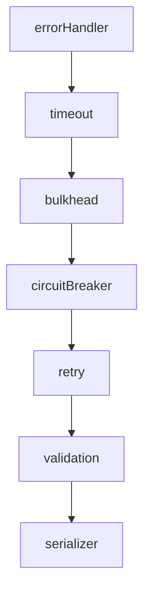
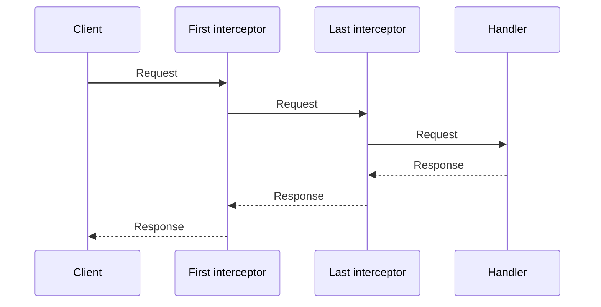

# Interceptor usage and chain composition

An interceptor wraps the next request handler. Its request-side logic runs on
the way in; its response/error logic runs on the way out. The first interceptor
is therefore the outermost wrapper.

## Installation {#installation}

::: pm
== npm
```bash
npm install @connectum/interceptors
```
== pnpm
```bash
pnpm add @connectum/interceptors
```
== bun
```bash
bun add @connectum/interceptors
```
:::

Share protobuf and Connect peers with the application; see
[peer dependency compatibility](/en/migration/peer-dependencies).

## The default chain {#the-default-chain}

Without a fallback, `createDefaultInterceptors()` builds enabled wrappers in
this order:



With fallback enabled, validation moves directly outside it. Fallback stands
outside circuitBreaker and retry, inside timeout and bulkhead. See
[Fallback position](/en/guide/interceptors/fallback#fallback-position).

| Interceptor | Enablement | Guide |
|---|---|---|
| errorHandler | enabled by default | [Error handling](/en/guide/interceptors/error-handling) |
| timeout | opt-in | [Timeout](/en/guide/interceptors/timeout) |
| bulkhead | opt-in | [Bulkhead](/en/guide/interceptors/bulkhead) |
| circuitBreaker | opt-in | [Circuit breaker](/en/guide/interceptors/circuit-breaker) |
| retry | opt-in | [Retry](/en/guide/interceptors/retry) |
| fallback | opt-in, requires a handler | [Fallback](/en/guide/interceptors/fallback) |
| validation | enabled by default | [Validation](/en/guide/validation) |
| serializer | opt-in | [Serialization](/en/guide/interceptors/serialization) |

Request logging is a separate factory, not a member of this chain:
[Request logging](/en/guide/interceptors/logging).

## Configure the server {#using-with-createserver}

With `routes` registered by your application:

```typescript
import { createServer } from '@connectum/core';
import { createDefaultInterceptors } from '@connectum/interceptors';

const server = createServer({
  services: [routes],
  interceptors: createDefaultInterceptors({
    timeout: { duration: 10_000 },
    bulkhead: { capacity: 20, queueSize: 20 },
  }),
});
```

Error handling and validation remain enabled. Resilience changes request
semantics and is opt-in; retry can repeat side effects, and a circuit breaker
normally belongs on an outgoing client rather than an inbound server.

## Select wrappers {#customizing-the-default-chain}

Each key accepts `true`, `false`, `undefined` or an options object, except:

- `validation` accepts only a boolean.
- `fallback` accepts `false` or an options object with a `handler`.
  `fallback: true` is refused because there is no default fallback handler.

`null`, numbers, strings, arrays and functions are refused with a `TypeError`
that names the key. An unsupported value never silently disables a wrapper.

The supported keys are `errorHandler`, `timeout`, `bulkhead`, `circuitBreaker`,
`retry`, `fallback`, `validation` and `serializer`. Unknown keys throw a
`TypeError` naming the key and listing the known keys, so `timout` cannot leave
a protection disabled. The options argument itself must be an object.

The logger and method filter are not default-chain members. Create them with
`createLoggerInterceptor()` and `createMethodFilterInterceptor()` and add them
to the array yourself.

Resilience, logger and serializer factories validate options when called,
including when the default-chain helper constructs them. Wrong types throw
`TypeError`; accepted types with values outside their range throw `RangeError`.
Diagnostics name the factory and option; numeric diagnostics also name the
rule and received value. See each focused guide's option limits, the generated
[options API](/en/api/@connectum/interceptors/defaults/interfaces/DefaultInterceptorOptions)
and [option-validation migration](/en/migration/interceptor-options).

## Add custom middleware {#combining-with-custom-interceptors}

Spread the default chain when your custom wrapper belongs inside it:

```typescript
const interceptors = [...createDefaultInterceptors(), myCustomInterceptor];
```

Authentication and authorization need a deliberate position immediately after
error handling: `errorHandler → AUTH → AUTHZ → resilience`. Use the
[manual composition example](/en/guide/interceptors/custom#composing-with-built-in-interceptors)
instead of appending auth after the default chain.

The same interceptor array can be passed to a ConnectRPC client transport;
see [client interceptors](/en/guide/service-communication/client-interceptors).

## Execution order {#execution-order}



The first wrapper's before-logic runs first and its after-logic runs last.
That is why error handling is outermost and serialization innermost. In the
default chain the breaker wraps retry, so a logical request counts at most one
breaker failure regardless of its retry attempts.

Native per-service interceptors replace the global chain; they do not append
to it. Include every required wrapper in a replacement chain. Use
[method filtering](/en/guide/interceptors/method-filtering) to select wrappers by
service/method patterns. `skipGrpcServices` matches service names starting with
`grpc.`, such as Health and Reflection; it does not skip the gRPC wire protocol.

## Custom-wrapper practices {#best-practices}

- Keep error handling outside work whose thrown/rejected errors it must normalize.
- Create a new request with `{ ...req, message: newMessage }` rather than mutating
  `req.message` in place.
- Unless rejecting or synthesizing a response, return the result of `next(req)`.
- Release timers and counters in `finally`.
- Use `import type { Interceptor }` and factory functions for configurable wrappers.
- Use method filtering for business routing; `skip*` options describe a wrapper's
  call-kind or operational-service exclusions.

## Previously linked sections

<MovedInterceptorSections />

## Related

- [Interceptors overview](/en/guide/interceptors)
- [Custom interceptors](/en/guide/interceptors/custom)
- [Method filtering](/en/guide/interceptors/method-filtering)
- [Generated API](/en/api/@connectum/interceptors/)
- [ADR-006](/en/contributing/adr/006-resilience-pattern-implementation)
