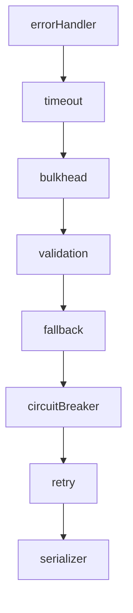

# Fallback interceptor

A fallback supplies a deliberate substitute result after a dependency or handler
fails. The application must define that result; there is no implicit fallback:

```typescript
import { createFallbackInterceptor } from '@connectum/interceptors';

const fallback = createFallbackInterceptor({
  handler: () => ({ items: [] }),
});
```

The example is suitable only for a response whose message fields include
`items`. Use a response that matches your actual contract.
With `createDefaultInterceptors()`, use `fallback: { handler }` to enable it.
`fallback: true` or an options object without a function `handler` throws
`TypeError` at construction.

## Fallback position {#fallback-position}

Fallback stands outside circuit breaker and retry, inside timeout and bulkhead.
Validation stands directly outside fallback, so a rejected request never reaches
the fallback provider. With fallback enabled, the default chain is:



- Retries run first. With `maxRetries: 3`, a handler that keeps failing with
  `Unavailable` is called four times before fallback supplies the response.
  A successful retry returns normally without asking fallback.
- The breaker sees the failures and can open. An open breaker calls the
  fallback provider with `Unavailable` without reaching the service handler.
- The provider receives the last failure after retries, or the first failure
  for a code that retry does not repeat.
- `Canceled` or `DeadlineExceeded` raised by the inner retry also reaches the
  provider. The client still receives cancellation from the layer that raised
  it, but provider side effects such as metrics and logs run.
- An error thrown by the provider itself is neither retried nor counted by
  the breaker; it goes straight to error handling.
- With an open breaker, an invalid request gets `InvalidArgument` when fallback
  is enabled. Without fallback, validation stands behind the breaker and the
  same request gets `Unavailable` first.

When composing manually, put validation before fallback, and fallback before
the breaker and retry. An inner fallback would replace the first failure with
a value, preventing retries and breaker accounting. A chain without fallback
keeps validation after retry.

## Access refusals are preserved

`Unauthenticated` and `PermissionDenied` are rethrown unchanged and never call
the fallback handler, wherever authentication/authorization appears relative to
fallback and even when the service handler itself raises the refusal. Other
codes and non-`ConnectError` failures still receive the substitute result.

Place authentication and authorization immediately after error handling,
before resilience policies. See [manual composition](/en/guide/interceptors/custom#composing-with-built-in-interceptors).

## Rejected requests are not replaced {#fallback-validation}

Validation failures are client errors. `createDefaultInterceptors()` places
validation before fallback: the caller receives `InvalidArgument`, and neither
the service handler nor the fallback provider runs. Reversing that manual order
would replace an invalid request with a fallback value.

## What the handler returns {#fallback-handler-result}

Return a message made with `create(OutputSchema, { ... })` or a plain object
with that response message's fields. Oneofs use their group name with
`{ case: 'member', value }`. The interceptor checks an initializer before
constructing the message, because `create()` alone drops unknown keys and
coerces some wrong values.

The first problem fails with a `TypeError` naming the factory, expected type
and field path. It rejects:

- `undefined`, `null`, a string or an array instead of the object;
- unknown keys at any depth and bare oneof member names;
- values of another kind than their field: numbers in string fields, non-boolean
  bools, non-array repeated fields, enum names instead of numbers, and invalid
  list or map members;
- numbers the encoder cannot write, including fractions or out-of-range int32
  values and `NaN`;
- non-canonical integer or bool map keys, and non-canonical strings for 64-bit
  integers: no leading zero, `+`, spaces, exponents, hexadecimal, `-0` or empty
  strings; bool keys must be `"true"` or `"false"`;
- lone surrogates anywhere, including nested `Struct` keys, and `NaN` or
  `Infinity` inside `Struct`;
- bytes supplied as `ArrayBuffer`, `DataView` or arrays with holes or values
  outside 0 to 255, and oneof objects with keys other than `case` and `value`.

Unknown enum numbers are accepted. Follow protobuf-es message forms: singular
wrappers outside a oneof use bare values, and `Struct` uses plain JSON objects;
ready messages are refused in both places. A plain object with another
`$typeName` remains a JSON object in a `Struct` field. `Timestamp`, `Duration`,
`Value`, `ListValue`, `Any`, `FieldMask` and `Empty` use their own message fields,
such as `{ seconds: 1n }`; wrappers in lists or oneofs use objects with `value`.
Behind error handling, invalid provider results reach clients as `Internal`
with `internal error`; reporting hooks and logs retain the full diagnostic.

## Streaming scope

Streaming calls are skipped by default. With `skipStreaming: false`, an opening
failure produces a streaming response whose only message is the fallback
value, including the single response of a client-streaming call. A failure
while reading an already opened response is not replaced. `skipStreaming`
must be a boolean; invalid types throw `TypeError` at construction.

## Fallback response metadata

For unary RPCs the synthesized response carries only required protocol metadata,
on server chains and client transports alike:

- `content-type` matches the request. Connect GET has no such header, so it is
  derived from `encoding`: `json` gives `application/json`, `proto` gives
  `application/proto`; otherwise the header stays empty.
- `grpc-status: 0` is added as a trailer when the request type starts with
  `application/grpc` (gRPC and gRPC-web). Other protocols get an empty trailer.

No request headers are copied into this response. Connect, gRPC and gRPC-web
clients over HTTP/2 and HTTP/1.1 accept it. Put metadata needed by callers in
the returned message. See
[FallbackOptions](/en/api/@connectum/interceptors/interfaces/FallbackOptions).
