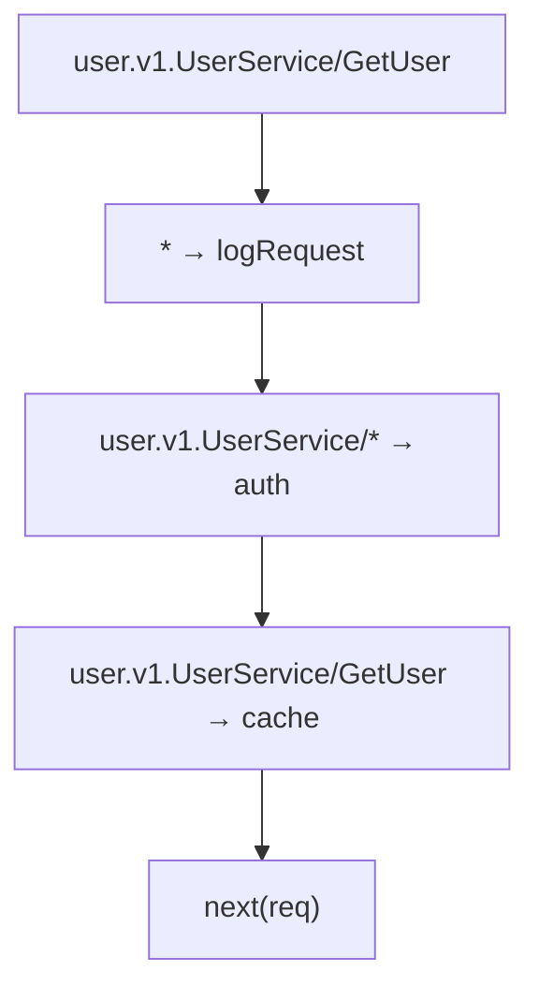

# Per-Method Interceptor Routing

Server-level interceptors apply unless a service overrides that chain. In practice, you often need different interceptors for different services or methods -- authentication for admin endpoints, aggressive timeouts for fast reads, circuit breakers for external-facing APIs.

Connectum provides three approaches for per-method interceptor routing.

## Approach 1: ConnectRPC Native Per-Service/Per-Method {#approach-1-connectrpc-native-per-service-per-method}

Connectum's `defineService()` forwards its third argument to ConnectRPC's
`router.service()` options. Use that argument to scope interceptors to a service:

::: warning Replacement, not addition
Per-service `interceptors` replace the server-level array. They do not inherit its
error handler, validation or other middleware. Supply the complete required chain.
:::

This example explicitly retains the global timeout and validation policy.
`greeterImpl`, `requireAuth`, `requireAuthz` and `auditLog` are application-provided
values; the auth interceptors authenticate and authorize the caller, respectively.

```typescript
import { createServer, defineService } from '@connectum/core';
import {
  createErrorHandlerInterceptor,
  createTimeoutInterceptor,
} from '@connectum/interceptors';
import { createValidateInterceptor } from '@connectrpc/validate';
import { GreeterService } from '#gen/greeter_pb.ts';

const processingInterceptors = [
  createTimeoutInterceptor({ duration: 10_000 }),
  createValidateInterceptor(),
];

export const greeterService = defineService(GreeterService, greeterImpl, {
  interceptors: [
    createErrorHandlerInterceptor(),
    requireAuth,
    requireAuthz,
    ...processingInterceptors,
    auditLog,
  ],
});

const server = createServer({
  services: [greeterService],
  // Default for services without their own interceptors array.
  interceptors: [
    createErrorHandlerInterceptor(),
    ...processingInterceptors,
  ],
});
```

Greeter runs only its replacement chain:
`errorHandler → AUTH → AUTHZ → timeout → validation → auditLog`.
The server-level chain is not also executed for that service.

Use this approach when interceptors belong to one service. For one method within
that service, use the filtering helper below. Raw router callbacks are not
`ServiceDefinition` values accepted by `createServer({ services })`.

## Approach 2: createMethodFilterInterceptor

`createMethodFilterInterceptor` is a declarative helper for routing interceptors to methods based on wildcard patterns. It produces a single `Interceptor` you can add to the global chain:

```typescript
import {
  createMethodFilterInterceptor,
  createTimeoutInterceptor,
  createCircuitBreakerInterceptor,
} from '@connectum/interceptors';

const perMethodInterceptor = createMethodFilterInterceptor({
  // Global wildcard: applies to all methods
  '*': [logRequest],

  // Service wildcard: applies to all methods of the service
  'admin.v1.AdminService/*': [requireAdmin],

  // Exact match: applies to a specific method only
  'user.v1.UserService/DeleteUser': [requireAdmin, auditLog],
});

const server = createServer({
  services: [routes],
  interceptors: [perMethodInterceptor],
});
```

### Supported Patterns

| Pattern | Description | Example |
|---------|-------------|---------|
| `"*"` | All methods of all services | `"*": [logRequest]` |
| `"package.Service/*"` | All methods of a service | `"admin.v1.AdminService/*": [auth]` |
| `"package.Service/Method"` | Exact method match | `"user.v1.UserService/GetUser": [cache]` |

::: tip
Pattern keys use the protobuf fully-qualified service name (`service.typeName`) plus the method name: `"package.v1.ServiceName/MethodName"`.
:::

### Resolution Order

All matching patterns execute sequentially, from most general to most specific:



If no patterns match, the request passes through to the next interceptor in the chain unchanged.

### Invalid Patterns

The following patterns throw an error at creation time:

```typescript
// Empty service name -- throws Error
createMethodFilterInterceptor({ '/*': [auth] });

// No slash separator -- throws Error
createMethodFilterInterceptor({ 'SomeService': [auth] });
```

### Practical Example: Different Resilience Per Method

```typescript
import {
  createDefaultInterceptors,
  createMethodFilterInterceptor,
  createTimeoutInterceptor,
  createCircuitBreakerInterceptor,
} from '@connectum/interceptors';

const resilience = createMethodFilterInterceptor({
  // Fast reads: 5 second timeout
  'catalog.v1.CatalogService/GetProduct': [
    createTimeoutInterceptor({ duration: 5_000 }),
  ],

  // Heavy reports: 60 second timeout
  'report.v1.ReportService/*': [
    createTimeoutInterceptor({ duration: 60_000 }),
  ],

  // Admin mutations: audit logging
  'admin.v1.AdminService/*': [
    createAuditLogInterceptor(),
  ],
});

const server = createServer({
  services: [routes],
  interceptors: [
    // Structural defaults; avoid a global timeout that would cap the 60s rule
    ...createDefaultInterceptors(),
    resilience,
  ],
});
```

## Approach 3: Custom Interceptor with Manual Filtering

For dynamic or complex filtering logic that does not fit wildcard patterns, write a custom interceptor:

```typescript
import type { Interceptor } from '@connectrpc/connect';

const conditionalAuth: Interceptor = (next) => async (req) => {
  // Dynamic condition: check service name at runtime
  if (req.service.typeName === 'admin.v1.AdminService') {
    await verifyAdminToken(req);
  }

  // Check method kind
  if (req.method.methodKind === 'server_streaming') {
    attachStreamMonitoring(req);
  }

  return next(req);
};
```

Use this approach for filtering based on request content, runtime state, or conditions that cannot be expressed as static patterns.

## skip* Options on Built-in Interceptors

Built-in interceptors have `skip*` options for call-kind and operational-service policies. These serve a different purpose from business routing:

| Option | Used by | Why |
|--------|---------|-----|
| `skipStreaming` | timeout, bulkhead, circuitBreaker, retry, fallback | Skips streaming calls by default; opting in does not imply coverage of the full stream lifetime. |
| `skipGrpcServices` | serializer | Skips operational services whose names start with `grpc.`; it does not select by wire protocol. |
| `skipHealthCheck` | logger | Convenience shortcut to reduce log noise from frequent health checks. |

::: warning Streaming fallback
Keep fallback's default `skipStreaming: true` until
[#465](https://github.com/Connectum-Framework/connectum/issues/465) is resolved.
Its streaming response has a known defect, separate from the opening-only timeout
and retry behavior below; see [Fallback response](/en/guide/interceptors/built-in#fallback-response).
:::

For timeout and retry, `skipStreaming: false` covers opening the response, not
subsequent iteration: retry can repeat opening failures, and timeout limits the
opening wait. Neither restarts or times out consumption of an opened response.
See [Cancellation and Streaming Scope](/en/guide/interceptors/built-in#cancellation-and-streaming-scope).

These options complement `createMethodFilterInterceptor`: method filtering selects
methods, while each matched interceptor applies its own call-scope policy.

## Choosing the Right Approach

| Scenario | Approach |
|----------|----------|
| Interceptor tied to a specific service | `defineService(..., { interceptors })` |
| Declarative routing by pattern across multiple services | `createMethodFilterInterceptor` |
| Dynamic logic based on request content or runtime state | Custom interceptor with manual filtering |
| Call-kind bypass or operational-service exclusion | `skip*` options on built-in interceptors |

::: warning
Setting `skipStreaming: true` bypasses retry for streaming calls; it does not mean retry can never handle response opening. Use `createMethodFilterInterceptor` or router-level interceptors to select services and methods.
:::

## Related

- [Interceptors Overview](/en/guide/interceptors) -- quick start and key concepts
- [Built-in Interceptors](/en/guide/interceptors/built-in) -- default chain reference
- [Custom Interceptors](/en/guide/interceptors/custom) -- creating custom interceptors
- [Custom Protocols](/en/guide/protocols/custom) -- creating protocol plugins
- [@connectum/interceptors](/en/packages/interceptors) -- Package Guide
- [ADR-014: Method Filter Interceptor](/en/contributing/adr/014-method-filter-interceptor) -- design rationale
