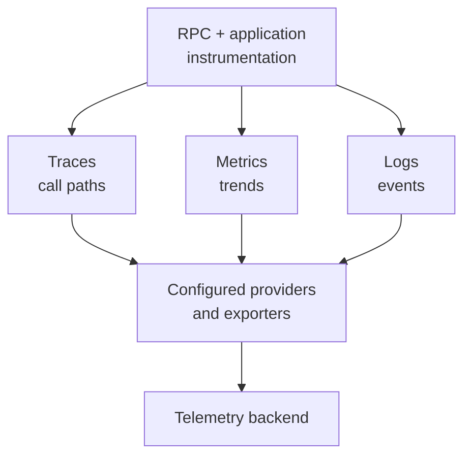

# Observability

`@connectum/otel` connects RPC telemetry and application instrumentation to OpenTelemetry. Instrumentation decides what signals to create; provider/exporter configuration decides where those signals go.

<figure class="technical-diagram guide-topic-diagram--scroll" aria-label="Telemetry needs both instrumentation and an export destination">



<figcaption>Adding an interceptor alone does not configure a production collector or dashboard.</figcaption>
</figure>

## Minimal RPC instrumentation

```typescript
import { createServer } from '@connectum/core';
import { createOtelInterceptor } from '@connectum/otel';

const server = createServer({
  services: [routes],
  interceptors: [
    createOtelInterceptor(),
  ],
});
```

Here `routes` is your service registration. Configure the
[provider and exporter](/en/guide/observability/backends) as well.

::: details Exclude health RPCs from this instrumentation
Use `createOtelInterceptor({ filter: ({ service }) => !service.includes('grpc.health') })`.
:::

## Choose the signal

[Trace one call](/en/guide/observability/tracing),
[measure many calls](/en/guide/observability/metrics), or
[write correlated logs](/en/guide/observability/logging).

::: details Instrumentation and configuration references
| Need | Canonical guide |
|---|---|
| Server/client RPC spans, propagation, `traced()` or `traceAll()` | [Tracing](/en/guide/observability/tracing) |
| Automatic RPC instruments and application meters | [Metrics](/en/guide/observability/metrics) |
| Structured records and trace correlation | [Logging](/en/guide/observability/logging) |
| OTLP endpoints, exporters, resource metadata, provider lifecycle | [Backends and configuration](/en/guide/observability/backends) |
:::

Focused guides explain task behavior. Exact option fields belong to generated interfaces such as [`OtelInterceptorOptions`](/en/api/@connectum/otel/interfaces/OtelInterceptorOptions) and [`ProviderOptions`](/en/api/@connectum/otel/provider/interfaces/ProviderOptions).

Use the [`@connectum/otel` module hub](/en/packages/otel) for installation, key entry points, source, and API routes. Avoid copying exporter tables into tracing or metrics pages; backend configuration is their canonical owner.

The project's Bun CI does not validate this telemetry integration; see
[runtime limitations](/en/guide/runtime-compatibility-details#otel).
