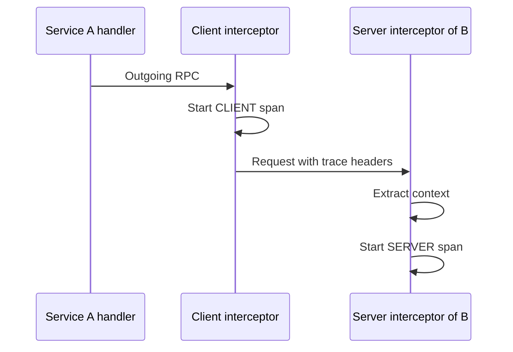
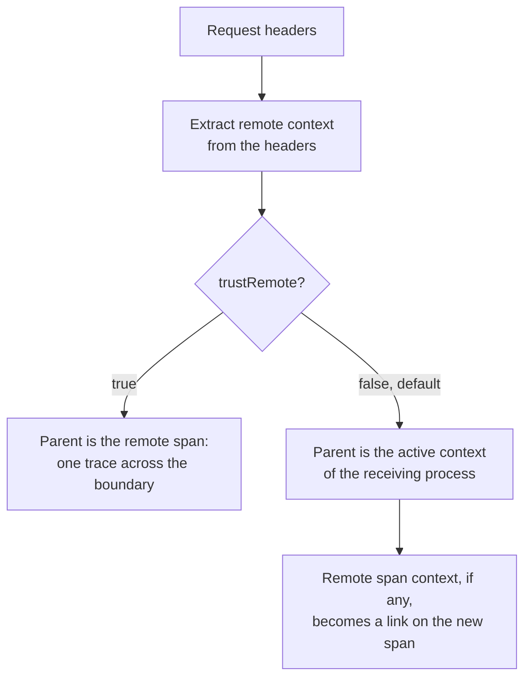

# Tracing

Connectum provides distributed tracing through OpenTelemetry interceptors for both server-side and client-side RPC calls, plus deep tracing utilities for your business logic.

## Server Interceptor

`createOtelInterceptor()` automatically creates spans for all incoming RPC calls with OpenTelemetry semantic conventions:

```typescript
import { createOtelInterceptor } from '@connectum/otel';

const interceptor = createOtelInterceptor({
  filter: ({ service }) => !service.includes('grpc.health'),
  serverPort: 5000,
  recordMessages: false,
  trustRemote: false,
});
```

All server interceptor options are optional. Configure only the filtering, endpoint
attributes, signal toggles, or data recording that the service requires; use
[`OtelInterceptorOptions`](/en/api/@connectum/otel/interfaces/OtelInterceptorOptions)
for the exact fields. Keep message recording disabled unless its privacy and volume
impact has been reviewed.

### Callbacks that throw

`filter` and `attributeFilter` run your code on the path of every call, on the
server and on the client interceptor. A bug in them never fails the call. A `filter`
that throws instruments the call (losing telemetry silently is worse than an extra
span). An `attributeFilter` that throws for an attribute drops that attribute, so an
attribute is exported only if the filter approved it; the other attributes are kept.
The error is reported once per interceptor, not once per call, through the
OpenTelemetry diagnostics channel (`diag.error`). That channel prints nothing until a
diagnostics logger is registered; `initProvider()` registers one at the `ERROR`
level.

### Span status

A span that ends without a failure keeps the default status, **unset**. The
interceptors, `traced()` and `traceAll()` never set `OK`: the OpenTelemetry Trace API
asks instrumentation libraries not to, and the RPC conventions leave the status unset
when a call succeeds. They set `ERROR`, with the error message, only when the call or
function fails. A stream whose consumer stops early (`return()` or
`break`) also ends unset, because that is neither a failure nor a confirmed success.

Which Connect codes are failures depends on the side of the call, as the
OpenTelemetry Connect RPC conventions define it:

| Span | `ERROR` for | Status unset for |
|------|-------------|------------------|
| Client (`createOtelClientInterceptor()`) | every code except `OK` | `OK` |
| Server (`createOtelInterceptor()`) | `unknown`, `deadline_exceeded`, `unimplemented`, `internal`, `unavailable`, `data_loss`, and an error that is not a `ConnectError` (the server turns it into `unknown`) | every other code, for example `not_found`, `invalid_argument`, `permission_denied`, `unauthenticated`, `failed_precondition`, `canceled` |

The same rule applies to a stream that fails after it started. The code is reported
either way: `rpc.response.status_code` and `error.type` carry the code name on the
server span of a `NOT_FOUND` answer, whose status stays unset.

To count failures of the server, filter on `status = error`; to count every non-OK
answer, use the `rpc.response.status_code` or `error.type` attribute. To count
successes, use "status is not error" or `rpc.response.status_code`, which still
reports `OK` for a successful unary call. Cancellation is reported as `CANCELED` (one L, the Connect
spelling) in `rpc.response.status_code` and `error.type`. Queries over data from
both Connect and gRPC stacks can match both spellings with `CANCEL+ED`. See
[RPC telemetry attribute names](/en/migration/otel-rpc-attributes#span-status-is-unset-on-success).

### Spans in streaming handlers

The server span is the active span for the whole handler of a unary, client-streaming, server-streaming, or bidirectional call. In a generator handler this holds at the start, after every `await` and `yield`, and in `finally`, so a span started with `traced()` or `tracer.startActiveSpan()` there is a child of the call's server span:

```typescript
import { traced } from '@connectum/otel';

const loadPage = traced(async (cursor: string) => db.items.page(cursor), {
  name: 'ItemRepository.page',
});

async function* listItems(req: ListItemsRequest) {
  let cursor: string | undefined = req.cursor;
  while (cursor !== undefined) {
    const page = await loadPage(cursor); // child of the server span, on every iteration
    yield* page.items;
    cursor = page.next;
  }
}
```

The span is active only while the handler runs. Code that consumes the response stream keeps its own active span.

The request stream is pulled by the code below `createOtelInterceptor()` (the handler, or an interceptor placed after it), so a wrapper of the request stream runs under the server span wherever it is placed relative to the OpenTelemetry interceptor. A wrapper of the response stream runs under the server span only when it is placed after `createOtelInterceptor()`: put `createLoggerInterceptor()` after it if the response and completion records must carry the span's `trace_id` and `span_id`.

::: info Since 1.3.0
Before 1.3.0 the active span inside a server-streaming or bidirectional handler was empty over HTTP, and in-process it was the caller's span, so spans started there were not children of the server span. The generator that produces the request messages of a client-streaming or bidirectional call belongs to the caller and runs in the caller's context, over HTTP and in-process alike (under the client span when `createOtelClientInterceptor()` is mounted); before 1.3.0 an in-process client-streaming generator ran under the server span.
:::

## Client Interceptor

For outgoing RPC calls, use `createOtelClientInterceptor()` to propagate trace context:

```typescript
import { createConnectTransport } from '@connectrpc/connect-node';
import { createClient } from '@connectrpc/connect';
import { createOtelClientInterceptor } from '@connectum/otel';
import { UserService } from '#gen/user_pb.js';

const transport = createConnectTransport({
  baseUrl: 'http://user-service:5001',
  interceptors: [
    createOtelClientInterceptor({
      serverAddress: 'user-service',   // Required
      serverPort: 5001,
    }),
  ],
});

const client = createClient(UserService, transport);
```

The client interceptor:
- Injects trace context into outgoing requests via `propagation.inject()`
- Creates `SpanKind.CLIENT` spans
- Records `rpc.client.*` metrics

## Deep Tracing with `traced()`

Wrap individual functions to create spans for your business logic:

```typescript
import { traced } from '@connectum/otel';

const findUser = traced(async (id: string) => {
  return await db.users.findById(id);
}, {
  name: 'UserRepository.findUser',
  recordArgs: true,         // Record function arguments as span attributes
});

// Each call creates a span: "UserRepository.findUser"
const user = await findUser('123');
```

`recordArgs: true` serializes argument values into the `function.args` span
attribute. Arguments can contain credentials or personal data; leave recording
disabled unless the values are safe to export, or use `argsFilter` to redact
them. An array passed to `recordArgs` selects zero-based argument positions.

Recording never affects the call. If the arguments cannot be recorded (a
`BigInt`, a circular structure, or an `argsFilter` that throws), the function
still runs and returns its own result, and the span has no `function.args`
attribute.

### Promises, generators and other results

The span ends when the result of the function is final:

- A returned `Promise`: when it settles. A rejection ends the span with `ERROR`.
- A returned sync or async generator (the result of calling a `function*` or `async function*`): when the generator is exhausted, throws, or is closed early with `break` or `return()`. A generator function returns before its body has run, so the span stays open while you iterate. Every step of the body runs with the span as the active span, and spans that the body starts are its children. You receive an iterator with the same protocol (`next`, `return`, `throw`). A generator that you never iterate never ends its span, because none of its code runs.
- Anything else, including arrays, `Map`, streams and a thenable that is not a native `Promise`: when the function returns. A thenable is not awaited, because calling its `then` can start work (a lazily executed query builder) that the caller has not asked for yet.

`traceAll()` applies the same rules to every traced method.

### Thrown values

Any thrown value is a failure, including `null`, `undefined`, `0` and `""`: the
span ends with status `ERROR` and a recorded exception, and the caller receives
the original value unchanged. For a value that is not an `Error` the recorded
message is the text of the value (the empty string is shown as `""`). The same
holds for `traceAll()`, the server and client interceptors and streams: a stream
that raises a falsy value ends its span with `ERROR`.

The recorded `exception` event names the class of the error in `exception.type`
(`ConnectError` for a Connect error, never its numeric code). The Connect code is
in `error.type` and `rpc.response.status_code` of the span. `error.type` is never
empty: an error whose class has no name reports the error's `name`, and `_OTHER`
when that is empty too.

## Deep Tracing with `traceAll()`

Wrap all methods of an object via Proxy:

```typescript
import { traceAll } from '@connectum/otel';

class OrderRepository {
  async findById(id: string) {
    return await db.orders.findById(id);
  }

  async create(data: OrderData) {
    return await db.orders.create(data);
  }

  async updateStatus(id: string, status: string) {
    return await db.orders.update(id, { status });
  }
}

// Auto-instrument all methods (does NOT mutate the original)
const repository = traceAll(new OrderRepository(), {
  prefix: 'OrderRepository',
  exclude: ['internalHelper'],
  recordArgs: true,
});

// Calls automatically create spans:
// "OrderRepository.findById", "OrderRepository.create", etc.
await repository.findById('order-123');
```

The same data rule applies to `traceAll`: `recordArgs: true` captures argument
values, and an array selects zero-based positions. Prefer `argsFilter` when
values need redaction before they become span attributes.

::: tip Performance
`traceAll()` uses ES6 Proxy and creates method wrappers lazily on first access. It prevents double-wrapping automatically.
:::

Property reads pass through untouched. Getters run with the original object as `this`, so a getter over a `#private` field, `Map.size` and `Set.size` work on a traced object. One case cannot be traced: an own method that is neither writable nor configurable, which is every method of a frozen object (`Object.freeze()`). A proxy must return the real value of such a property, so that method is returned as it is and produces no span.

## Distributed Tracing Across Services

The client interceptor starts a `CLIENT` span under whatever span is active in the calling handler and injects the trace context into the request headers. The receiving server interceptor extracts it:



The server interceptor chooses the parent of its span like this:



Over HTTP the receiving process has no active span, so the default yields a root span with a link. On the [in-process transport](/en/guide/production/in-process-transport#observability) the caller's span is active, so the same default yields a child of the client span.

A complete example showing trace context propagation between two services:

```typescript
// ---- Service A (Gateway) ----
import { createServer } from '@connectum/core';
import { createConnectTransport } from '@connectrpc/connect-node';
import { createClient } from '@connectrpc/connect';
import { createOtelInterceptor, createOtelClientInterceptor } from '@connectum/otel';
import { UserService } from '#gen/user_pb.js';
import gatewayRoutes from '#gen/routes.js';

// Server: trace incoming requests
const server = createServer({
  services: [gatewayRoutes],
  port: 5000,
  interceptors: [
    createOtelInterceptor({
      serverPort: 5000,
      filter: ({ service }) => !service.includes('grpc.health'),
    }),
  ],
});

// Client: propagate trace context to Service B
const transport = createConnectTransport({
  baseUrl: 'http://user-service:5001',
  interceptors: [
    createOtelClientInterceptor({
      serverAddress: 'user-service',
      serverPort: 5001,
    }),
  ],
});

const userClient = createClient(UserService, transport);

// By default the receiver does not trust the remote parent: its server span
// starts a new trace and links to the extracted remote span context. Set
// trustRemote: true only when remote parentage is trusted and a single
// parent-child trace across the boundary is intended.
```

## Related

- [Observability Overview](/en/guide/observability) -- back to overview
- [Service Communication](/en/guide/service-communication) -- inter-service calls, transport configuration
- [Client Interceptors](/en/guide/service-communication/client-interceptors) -- OTel client interceptor, resilience
- [Metrics](/en/guide/observability/metrics) -- counters, histograms, automatic RPC metrics
- [Logging](/en/guide/observability/logging) -- structured logging with trace correlation
- [@connectum/otel](/en/packages/otel) -- Package Guide
- [@connectum/otel API](/en/api/@connectum/otel/) -- Full API Reference
