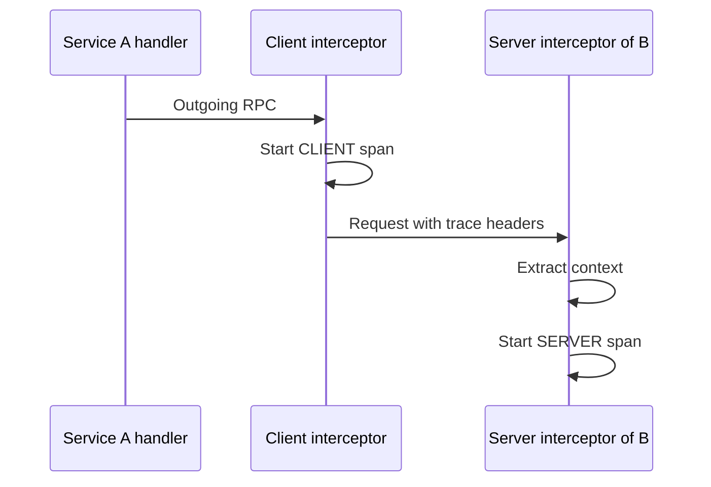
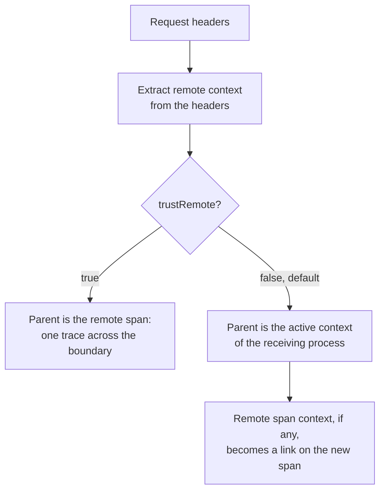

# Tracing

Connectum provides distributed tracing through OpenTelemetry interceptors for both server-side and client-side RPC calls, plus deep tracing utilities for your business logic.

## Server Interceptor

`createOtelInterceptor()` automatically creates spans for all incoming RPC calls with OpenTelemetry semantic conventions:

```typescript
import { createOtelInterceptor } from '@connectum/otel';

const interceptor = createOtelInterceptor({
  filter: ({ service }) => !service.includes('grpc.health'),
  serverPort: 5000,
  recordMessages: false,
  trustRemote: false,
});
```

All server interceptor options are optional. Configure only the filtering, endpoint
attributes, signal toggles, or data recording that the service requires; use
[`OtelInterceptorOptions`](/en/api/@connectum/otel/interfaces/OtelInterceptorOptions)
for the exact fields. Keep message recording disabled unless its privacy and volume
impact has been reviewed.

### Span status

A span that ends without a failure keeps the default status, **unset**. The
interceptors, `traced()` and `traceAll()` never set `OK`: the OpenTelemetry Trace API
asks instrumentation libraries not to, and the RPC conventions leave the status unset
when a call succeeds. They set `ERROR`, with the error message, only when the call or
function fails or is canceled. A stream whose consumer stops early (`return()` or
`break`) also ends unset, because that is neither a failure nor a confirmed success.

To count failures, filter on `status = error`; to count successes, use "status is not
error" or the `rpc.response.status_code` attribute, which still reports `OK` for a
successful unary call. Cancellation is reported as `CANCELED` (one L, the Connect
spelling) in `rpc.response.status_code` and `error.type`. Queries over data from
both Connect and gRPC stacks can match both spellings with `CANCEL+ED`. See
[RPC telemetry attribute names](/en/migration/otel-rpc-attributes#span-status-is-unset-on-success).

### Spans in streaming handlers

The server span is the active span for the whole handler of a unary, client-streaming, server-streaming, or bidirectional call. In a generator handler this holds at the start, after every `await` and `yield`, and in `finally`, so a span started with `traced()` or `tracer.startActiveSpan()` there is a child of the call's server span:

```typescript
import { traced } from '@connectum/otel';

const loadPage = traced(async (cursor: string) => db.items.page(cursor), {
  name: 'ItemRepository.page',
});

async function* listItems(req: ListItemsRequest) {
  let cursor: string | undefined = req.cursor;
  while (cursor !== undefined) {
    const page = await loadPage(cursor); // child of the server span, on every iteration
    yield* page.items;
    cursor = page.next;
  }
}
```

The span is active only while the handler runs. Code that consumes the response stream keeps its own active span.

The request stream is pulled by the code below `createOtelInterceptor()` (the handler, or an interceptor placed after it), so a wrapper of the request stream runs under the server span wherever it is placed relative to the OpenTelemetry interceptor. A wrapper of the response stream runs under the server span only when it is placed after `createOtelInterceptor()`: put `createLoggerInterceptor()` after it if the response and completion records must carry the span's `trace_id` and `span_id`.

::: info Since 1.3.0
Before 1.3.0 the active span inside a server-streaming or bidirectional handler was empty over HTTP, and in-process it was the caller's span, so spans started there were not children of the server span. The generator that produces the request messages of a client-streaming or bidirectional call belongs to the caller and runs in the caller's context, over HTTP and in-process alike (under the client span when `createOtelClientInterceptor()` is mounted); before 1.3.0 an in-process client-streaming generator ran under the server span.
:::

## Client Interceptor

For outgoing RPC calls, use `createOtelClientInterceptor()` to propagate trace context:

```typescript
import { createConnectTransport } from '@connectrpc/connect-node';
import { createClient } from '@connectrpc/connect';
import { createOtelClientInterceptor } from '@connectum/otel';
import { UserService } from '#gen/user_pb.js';

const transport = createConnectTransport({
  baseUrl: 'http://user-service:5001',
  interceptors: [
    createOtelClientInterceptor({
      serverAddress: 'user-service',   // Required
      serverPort: 5001,
    }),
  ],
});

const client = createClient(UserService, transport);
```

The client interceptor:
- Injects trace context into outgoing requests via `propagation.inject()`
- Creates `SpanKind.CLIENT` spans
- Records `rpc.client.*` metrics

## Deep Tracing with `traced()`

Wrap individual functions to create spans for your business logic:

```typescript
import { traced } from '@connectum/otel';

const findUser = traced(async (id: string) => {
  return await db.users.findById(id);
}, {
  name: 'UserRepository.findUser',
  recordArgs: true,         // Record function arguments as span attributes
});

// Each call creates a span: "UserRepository.findUser"
const user = await findUser('123');
```

`recordArgs: true` serializes argument values into the `function.args` span
attribute. Arguments can contain credentials or personal data; leave recording
disabled unless the values are safe to export, or use `argsFilter` to redact
them. An array passed to `recordArgs` selects zero-based argument positions.

Recording never affects the call. If the arguments cannot be recorded (a
`BigInt`, a circular structure, or an `argsFilter` that throws), the function
still runs and returns its own result, and the span has no `function.args`
attribute.

### Thrown values

Any thrown value is a failure, including `null`, `undefined`, `0` and `""`: the
span ends with status `ERROR` and a recorded exception, and the caller receives
the original value unchanged. For a value that is not an `Error` the recorded
message is the text of the value (the empty string is shown as `""`). The same
holds for `traceAll()`, the server and client interceptors and streams: a stream
that raises a falsy value ends its span with `ERROR`.

## Deep Tracing with `traceAll()`

Wrap all methods of an object via Proxy:

```typescript
import { traceAll } from '@connectum/otel';

class OrderRepository {
  async findById(id: string) {
    return await db.orders.findById(id);
  }

  async create(data: OrderData) {
    return await db.orders.create(data);
  }

  async updateStatus(id: string, status: string) {
    return await db.orders.update(id, { status });
  }
}

// Auto-instrument all methods (does NOT mutate the original)
const repository = traceAll(new OrderRepository(), {
  prefix: 'OrderRepository',
  exclude: ['internalHelper'],
  recordArgs: true,
});

// Calls automatically create spans:
// "OrderRepository.findById", "OrderRepository.create", etc.
await repository.findById('order-123');
```

The same data rule applies to `traceAll`: `recordArgs: true` captures argument
values, and an array selects zero-based positions. Prefer `argsFilter` when
values need redaction before they become span attributes.

::: tip Performance
`traceAll()` uses ES6 Proxy and creates method wrappers lazily on first access. It prevents double-wrapping automatically.
:::

## When the span ends {#when-the-span-ends}

`traced()` and `traceAll()` end the span of a call when its result is final. What that means depends on what the function returns:

| Result | The span ends |
|---|---|
| A native `Promise` (a promise from another realm, such as a `vm` context, counts) | When the promise settles. A rejection marks the span `ERROR`. |
| A sync or async generator object | When the generator is exhausted, throws, or is closed. A generator that is never iterated never ends its span. |
| A thenable that is not a native promise, such as a lazy query builder (a Knex builder, a Mongoose `Query`, a superagent request) | When the caller reads it with `await` or `then()` and it settles. |
| Anything else (a plain value, an array, a `Map`) | When the function returns. |

For a generator and for a thenable the caller receives the same object the function returned. A thenable keeps its prototype and its chain methods (`where()`, `limit()`), and it stays lazy: tracing does not start it before the caller reads it. While the span follows a thenable, `then` is replaced on the object itself; when the thenable settles, the original `then` is put back. The work that a lazy thenable starts inside its `then` runs with the span as the active span, so spans it starts are children of the traced span.

```typescript
import { traceAll } from '@connectum/otel';

const orders = traceAll({
  // Returns a lazy query builder: nothing runs until the caller awaits it.
  findOpen: () => knex('orders').where({ status: 'open' }),
}, { prefix: 'Orders' });

const query = orders.findOpen(); // the span "Orders.findOpen" starts here
const rows = await query;        // the query runs and the span ends when it settles
```

### Thenable details {#thenable-details}

- **Idle time.** The span of a thenable covers the time between the call and the first read. The event `connectum.result.read` is added on the first `then` and marks where that idle time ends.
- **Rejections.** A rejection of the thenable marks the span `ERROR`, and the caller receives the original error. A handler the caller leaves out (`then(onSuccess)`, or `catch(onFailure)`, which goes through `then(undefined, onFailure)`) reaches the thenable as missing, as it would without tracing. The span then follows the outcome through the native promise that `then` returns, which real libraries return. A callback-style thenable that returns no native promise tells the span nothing about an outcome the caller did not ask for; `await` passes both handlers.
- **Nested layers.** Traced functions that return the same thenable one from another (a `traceAll` service over a `traceAll` repository) all end when it settles, up to eight layers. The spans past the eighth end at once.
- **Ends at once.** The span ends when the function returns, as for any other value, if the thenable is frozen or sealed, if its `then` is a getter (tracing does not read the getter), or if eight layers already follow it.

### A thenable that is never read {#unread-thenable}

A thenable is followed through its `then`. A builder that the caller consumes another way never calls the replaced `then`. The same holds for an immutable builder whose chain methods return new objects, because the caller then holds a different object than the one that was traced. Calls of this kind:

- Mongoose: `exec()`, `cursor()`, `clone()`
- Knex: `stream()`, `toSQL()`, `clone()`
- superagent: `end(callback)`

The span of such a call ends when the garbage collector collects the builder. It is closed at the moment the traced function returned, so it covers only the call and not the work, and it carries the event `connectum.result.unread`. The moment is up to the collector: the span is exported late, and a process that exits before the collection exports nothing.

To get a span that covers the work, wrap the call in an async function and await the builder inside it:

```typescript
import { traced } from '@connectum/otel';

const findOpen = traced(
  async () => await Order.find({ status: 'open' }).exec(),
  { name: 'Orders.findOpen' },
);
```

::: info Since 1.3.0
Before 1.3.0 the span of a generator or of a thenable that is not a native promise ended the moment the function returned and had zero duration. It now covers the work. A builder consumed without `then` still has a span that covers only the call, but the span is exported when the garbage collector runs, or not at all, instead of immediately. Dashboards and alerts that relied on the old zero-length spans can see the difference.
:::

## Distributed Tracing Across Services

The client interceptor starts a `CLIENT` span under whatever span is active in the calling handler and injects the trace context into the request headers. The receiving server interceptor extracts it:



The server interceptor chooses the parent of its span like this:



Over HTTP the receiving process has no active span, so the default yields a root span with a link. On the [in-process transport](/en/guide/production/in-process-transport#observability) the caller's span is active, so the same default yields a child of the client span.

A complete example showing trace context propagation between two services:

```typescript
// ---- Service A (Gateway) ----
import { createServer } from '@connectum/core';
import { createConnectTransport } from '@connectrpc/connect-node';
import { createClient } from '@connectrpc/connect';
import { createOtelInterceptor, createOtelClientInterceptor } from '@connectum/otel';
import { UserService } from '#gen/user_pb.js';
import gatewayRoutes from '#gen/routes.js';

// Server: trace incoming requests
const server = createServer({
  services: [gatewayRoutes],
  port: 5000,
  interceptors: [
    createOtelInterceptor({
      serverPort: 5000,
      filter: ({ service }) => !service.includes('grpc.health'),
    }),
  ],
});

// Client: propagate trace context to Service B
const transport = createConnectTransport({
  baseUrl: 'http://user-service:5001',
  interceptors: [
    createOtelClientInterceptor({
      serverAddress: 'user-service',
      serverPort: 5001,
    }),
  ],
});

const userClient = createClient(UserService, transport);

// By default the receiver does not trust the remote parent: its server span
// starts a new trace and links to the extracted remote span context. Set
// trustRemote: true only when remote parentage is trusted and a single
// parent-child trace across the boundary is intended.
```

## Related

- [Observability Overview](/en/guide/observability) -- back to overview
- [Service Communication](/en/guide/service-communication) -- inter-service calls, transport configuration
- [Client Interceptors](/en/guide/service-communication/client-interceptors) -- OTel client interceptor, resilience
- [Metrics](/en/guide/observability/metrics) -- counters, histograms, automatic RPC metrics
- [Logging](/en/guide/observability/logging) -- structured logging with trace correlation
- [@connectum/otel](/en/packages/otel) -- Package Guide
- [@connectum/otel API](/en/api/@connectum/otel/) -- Full API Reference
