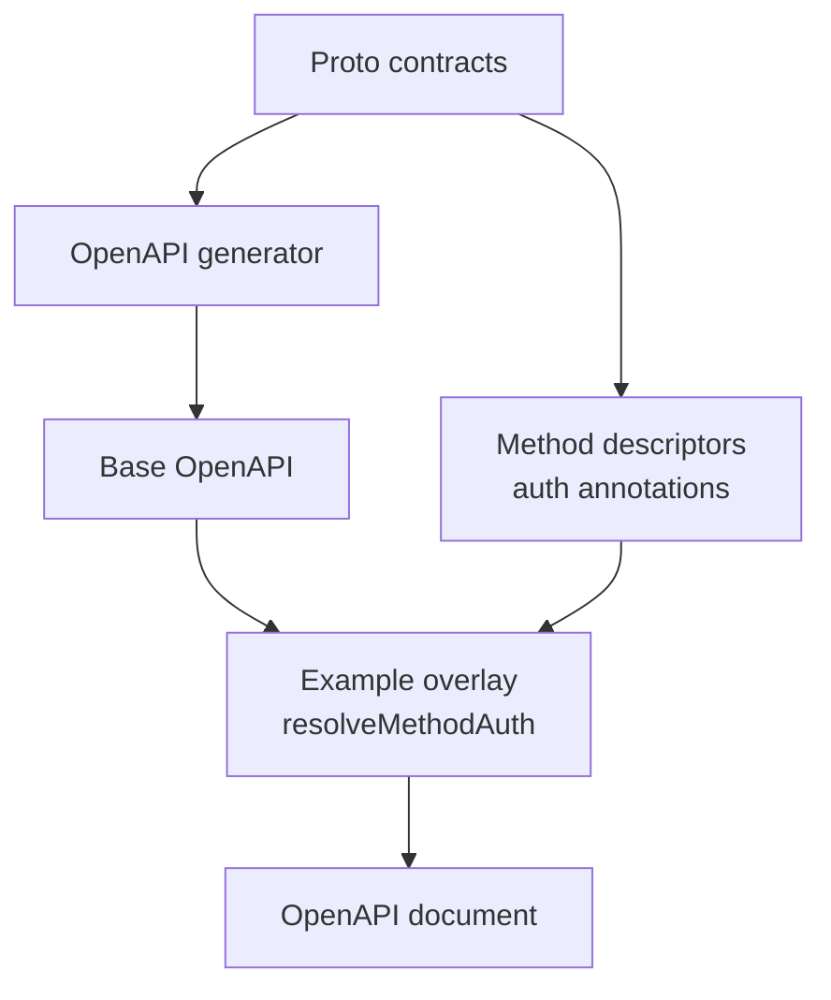

# OpenAPI

Your service speaks gRPC and Connect, but Swagger UI, API catalogs and SDK
generators may need an OpenAPI document. Generate it from the same proto
contracts instead of describing the API twice.

<figure class="technical-diagram" aria-label="Generate and annotate the OpenAPI artifact">



<figcaption>This produces documentation. Runtime interceptors still enforce access.</figcaption>
</figure>

## One shared policy reader

The overlay uses the same annotation reader as proto-based authorization:

```typescript
import { resolveMethodAuth } from '@connectum/auth/proto';

const auth = resolveMethodAuth(method);
```

This excerpt reads one generated method descriptor. The
[complete generation recipe](/en/guide/openapi-generation) shows how to write
its result into the spec. It is an example script, not a `connectum openapi` command.

## Go deeper

- [Generate and inspect the artifact](/en/guide/openapi-generation).
- [Understand omitted streaming operations and other limits](/en/guide/openapi-generation#notes-limitations).
- [Expose REST through a gateway](/en/guide/production/envoy-gateway).

<GuideSections route="/en/guide/openapi" />
