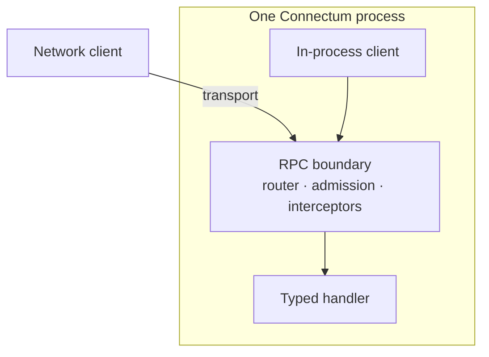

# Connectum Runtime Architecture

Think of Connectum as the inside of one service process, not the whole
deployment platform. `createServer()` composes that process's services,
protocols, middleware and lifecycle.

<figure class="technical-diagram" aria-label="The shared application request path">

<figcaption>The application path is shared; network-specific behavior still belongs to the transport.</figcaption>
</figure>

## Inside and outside

**Inside:** registration, RPC dispatch, request middleware, startup and shutdown.

**Connected explicitly:** EventBus adapters and telemetry instrumentation.

**Outside:** the broker, scheduler, gateway, service mesh and telemetry backend.
You choose those systems independently.

## Go deeper

- [Explore runtime composition, routing and extension diagrams](/en/guide/production/architecture-details).
- [Understand the server boundary](/en/guide/server).
- [Compare local and network calls](/en/guide/production/in-process-transport).
- [Read the architecture decisions](/en/contributing/adr/).

<GuideSections route="/en/guide/production/architecture" />
