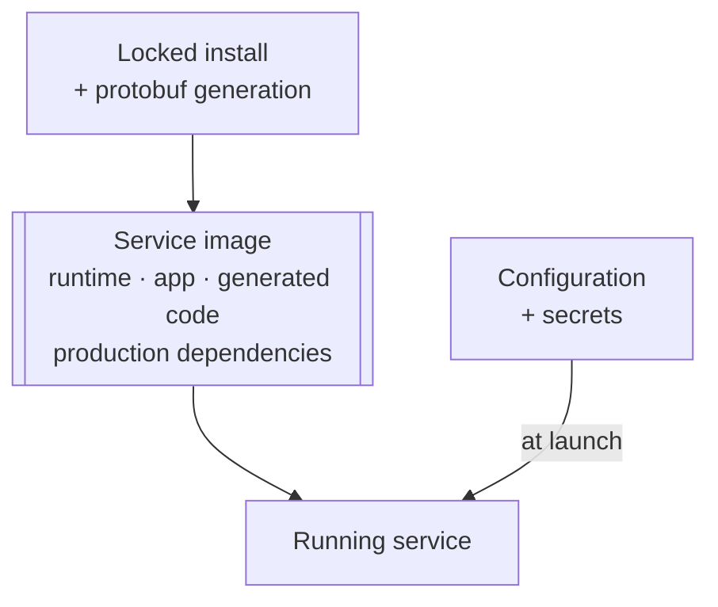

# Docker Containerization

A container packages your service; it does not change how the service works.
The image needs the application, generated protobuf code, production
dependencies and a compatible runtime.

<figure class="technical-diagram guide-topic-diagram--scroll" aria-label="Build once, then start the packaged service">

<figcaption>The image should contain everything required to start without fetching packages.</figcaption>
</figure>

## Three checks before deployment

1. **Can it execute the application?** Native `.ts` on Node.js requires
   **≥25.2.0**; compiled JavaScript and tsx follow the package floor,
   **≥22.13.0**. A production tsx launch needs tsx in production dependencies.
2. **Does the probe speak the right protocol?** A plaintext h2c listener needs
   an HTTP/2-capable probe, not an HTTP/1.1-only health check.
3. **Can it stop cleanly?** Deliver the termination signal and leave time for drain.

## Go deeper

- [Build the image, configure probes and avoid startup downloads](/en/guide/production/docker-configuration).
- [Configure runtime and dependency variants](/en/guide/production/docker-configuration#runtime-command).
- [Deploy the image to Kubernetes](/en/guide/production/kubernetes).

<GuideSections route="/en/guide/production/docker" />
