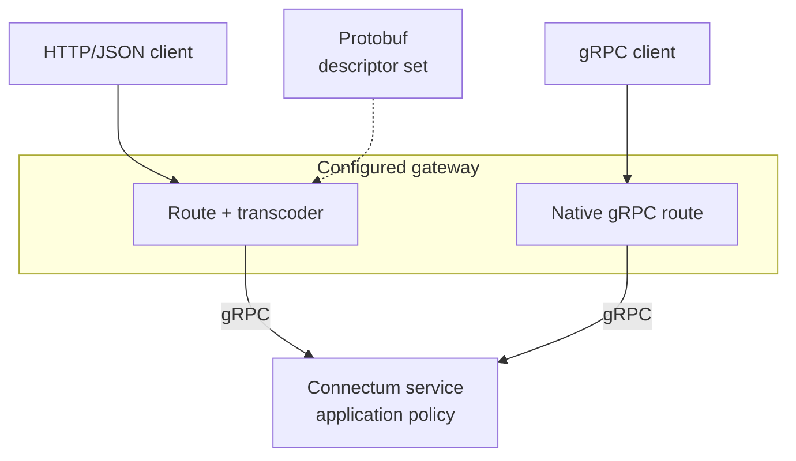

# Envoy Gateway + OpenAPI

A gateway is an optional edge in front of your services. It can route native
gRPC traffic. With a separately configured transcoder and descriptors, it can
also turn an HTTP/JSON request into a gRPC call.

<figure class="technical-diagram guide-topic-diagram--wide" aria-label="An explicitly configured REST-to-gRPC path">

<figcaption>Generating OpenAPI alone does not install a transcoder or expose a REST endpoint.</figcaption>
</figure>

## Keep the artifacts separate

**OpenAPI** describes the API for people and tools. The **descriptor set**
and **gateway configuration** make the transcoding path work. Native gRPC
clients can keep using the gRPC route without REST conversion.

## Go deeper

- [Configure annotations, descriptors, routes and transcoding](/en/guide/production/envoy-gateway-setup).
- [Generate the OpenAPI document](/en/guide/openapi).
- [Check the listener and proxy protocol](/en/guide/production/transport-matrix).

<GuideSections route="/en/guide/production/envoy-gateway" />
