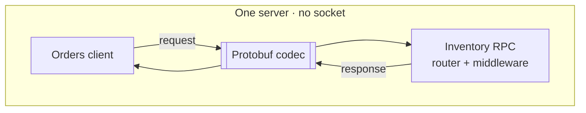

# In-Process Transport

Orders and Inventory can run on one `Server`. A local client reaches Inventory
without opening a socket, but still goes through the router and configured
server middleware. It is not a direct call to the handler function.

<figure class="technical-diagram" aria-label="A local RPC keeps the application boundary">



<figcaption>Messages are copied through the codec, not shared between caller and handler.</figcaption>
</figure>

## A local call

With `inventory` registered on `server` and `InventoryService` generated:

```typescript
const client = server.client(InventoryService);
const stock = await client.checkStock({ sku: 'A-1' });
```

A local call needs no `server.start()`. Calling a non-local service needs a
configured resolver. Local tests do not prove TLS, HTTP framing or proxy behavior.

## Go deeper

- [API choices, parity guarantees, cancellation and security limits](/en/guide/production/in-process-transport-details).
- [Watch local and remote routing](/en/guide/service-communication/resolvers).
- [Test the deployed boundary too](/en/guide/testing).

<GuideSections route="/en/guide/production/in-process-transport" />
