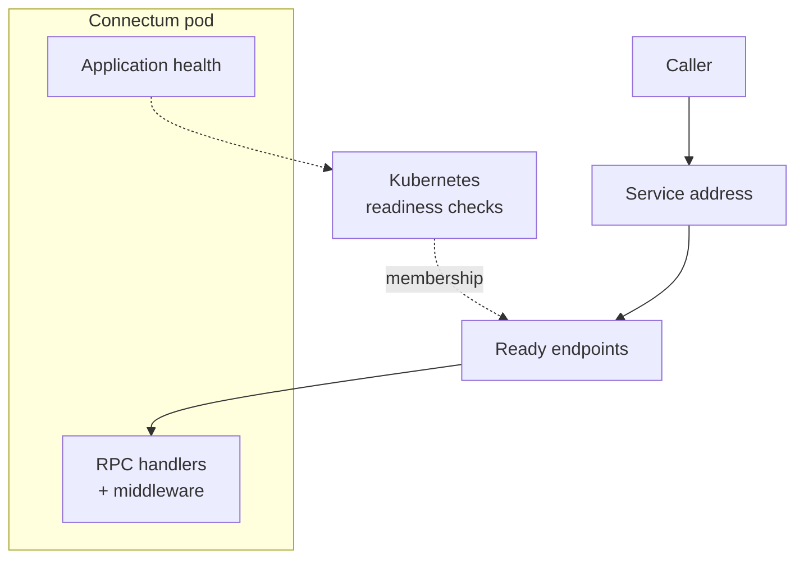

# Kubernetes Deployment

Kubernetes runs and replaces your service processes. Connectum owns what
happens inside each process; Kubernetes owns placement, replicas and how
traffic reaches them.

<figure class="technical-diagram" aria-label="Kubernetes traffic reaches ready service replicas">

<figcaption>A running pod is not automatically a ready application. Dashed links carry readiness state; solid links carry calls.</figcaption>
</figure>

## What you configure

- **A Deployment:** the image, resources, configuration and replica lifecycle.
- **A Service:** an address and protocol compatible with the callers.
- **Probes and shutdown:** readiness before traffic, then drain within the pod's grace period.

Keep credentials outside the image. Set resource and scaling values from your
workload, not by copying the example's replica counts.

## Go deeper

- [Apply the full deployment recipe and inspect its manifests](/en/guide/production/kubernetes-configuration).
- [Connect readiness, liveness and termination](/en/guide/health-checks/kubernetes).
- [Choose the listener and upstream protocol](/en/guide/production/transport-matrix).

<GuideSections route="/en/guide/production/kubernetes" />
