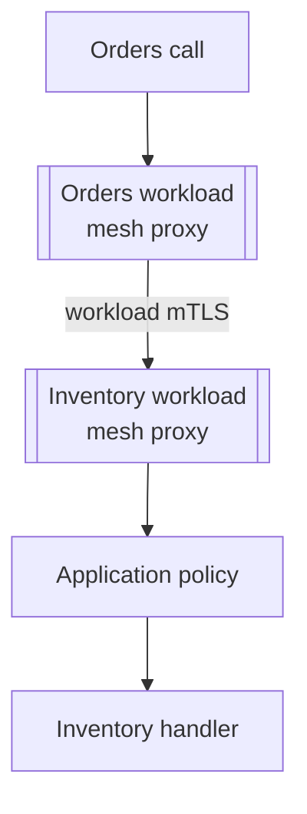

# Istio Service Mesh

A mesh can secure and manage connections between service workloads. It is
not required for Connectum: add it when your deployment needs workload mTLS,
traffic policy or mesh-level visibility.

<figure class="technical-diagram" aria-label="Mesh policy surrounds the application call">

<figcaption>Workload identity does not by itself authorize a user to invoke an RPC.</figcaption>
</figure>

## One owner for each policy

Keep protobuf contracts and business authorization in the application.
Configure connection policy in the mesh. Coordinate retries and circuit
breakers across both layers so attempts and timeout budgets do not multiply.

## Go deeper

- [Configure Istio mTLS, traffic rules and observability](/en/guide/production/service-mesh-setup).
- [Compare mesh and application circuit breakers](/en/guide/production/service-mesh-setup#circuit-breaking-mesh-vs-application).
- [Configure application identity](/en/guide/auth).

<GuideSections route="/en/guide/production/service-mesh" />
