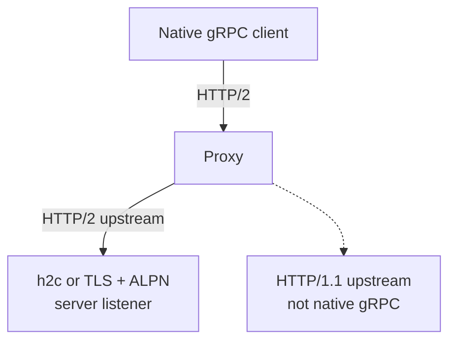

# Transport Matrix

The important question is not just “HTTP or gRPC?” It is whether the client,
proxy and server agree on a protocol all the way through.

<figure class="technical-diagram" aria-label="Every leg must support the requested protocol">

<figcaption>HTTP/2 at the edge does not guarantee HTTP/2 reaches the application.</figcaption>
</figure>

## The common choices

- **Connect over plaintext HTTP/1.1:** the default listener; not native gRPC.
- **Native gRPC on an internal plaintext connection:** set `allowHTTP1: false` for h2c.
- **A mixed HTTP/1.1 and HTTP/2 port:** use TLS + ALPN, or a suitable proxy.

A single plaintext listener does not automatically serve both HTTP versions.
Bidirectional streaming must stay on HTTP/2, including through intermediaries.

## Go deeper

- [The complete support matrix, startup diagnostics and residual risks](/en/guide/production/transport-matrix-details).
- [Historical measurements and untested combinations](/en/guide/production/transport-matrix-details#verified).
- [Configure TLS](/en/guide/security/tls).

<GuideSections route="/en/guide/production/transport-matrix" />
