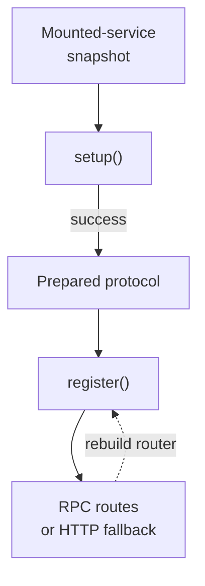

# Creating Custom Protocol Plugins

Most applications need only the built-in Health Check and Reflection modules.
A custom protocol is an extension point for infrastructure RPCs or plain HTTP
endpoints that do not belong in a business service.

<figure class="technical-diagram" aria-label="Initialize once, register routes, then serve">

<figcaption>One successful setup per server; route registration may happen more than once.</figcaption>
</figure>

## Keep registration repeatable

Do not put observable side effects in `register()`. Create a fresh protocol
instance for each server, and add it before startup or the first in-process
client materializes routes. If initial materialization fails, setup can run
again on the next attempt.

## Go deeper

- [Implement a protocol, an HTTP handler or a metrics endpoint](/en/guide/protocols/custom-implementation).
- [Use the built-in reflection protocol](/en/guide/protocols/reflection).
- [Use the built-in health protocol](/en/guide/health-checks).

<GuideSections route="/en/guide/protocols/custom" />
