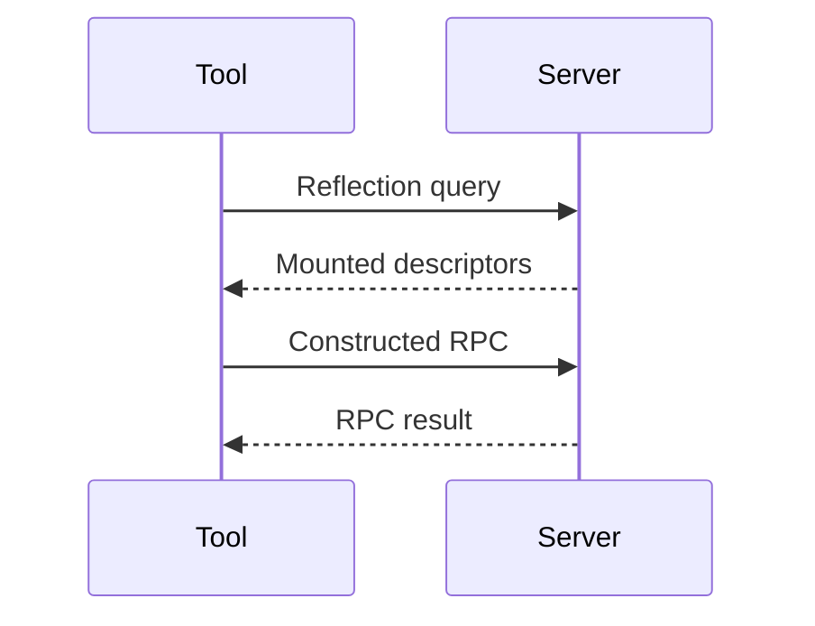

# Server Reflection

You know a server's address, but do not have its `.proto` files. Reflection
lets tools such as grpcurl ask that server for its service and message schemas.

<figure class="technical-diagram" aria-label="A tool learns a server's API through reflection">



<figcaption>Reflection discovers an API at one address. It does not find other running servers.</figcaption>
</figure>

## Add it explicitly

With `routes` containing your service handlers:

```typescript
import { createServer } from '@connectum/core';
import { Reflection } from '@connectum/reflection';

const server = createServer({
  services: [routes],
  allowHTTP1: false,
  protocols: [Reflection()],
});
```

After starting this plaintext HTTP/2 server, a reflection client can query it.
Restrict reflection exposure in production: the schema itself may be sensitive.

## Not the service catalog

The [service catalog](/en/guide/service-communication/service-catalog) is
generated contract knowledge used by your application. Reflection exposes
mounted schema information to external tools at runtime.

## Go deeper

[Install reflection, run grpcurl and buf curl, and configure exposure](/en/guide/protocols/reflection-tools).

<GuideSections route="/en/guide/protocols/reflection" />
