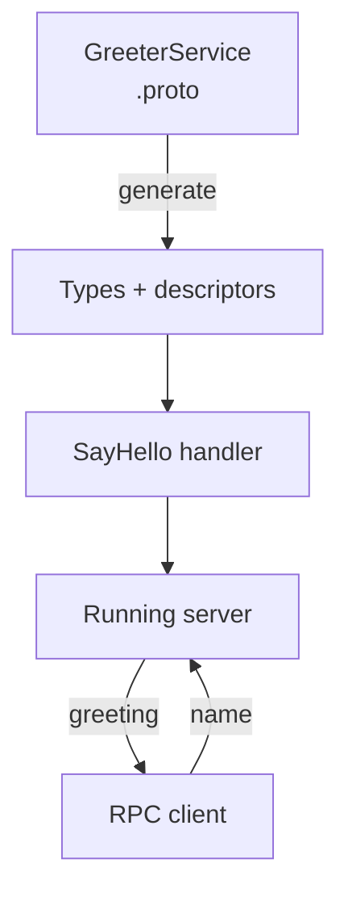

# Build Your First Connectum Service

One contract, one handler, one running service. You do not need a broker,
an identity provider or a telemetry backend to make your first call.

<figure class="technical-diagram" aria-label="From contract to a working RPC">



<figcaption>The first milestone is a real response, plus a rejected invalid request.</figcaption>
</figure>

## What you will build

A `GreeterService` accepts a name and returns a greeting:

```proto
service GreeterService {
  rpc SayHello(SayHelloRequest) returns (SayHelloResponse);
}
```

This is a contract excerpt. The tutorial supplies both messages, the handler,
server, generation configuration and commands.

## Choose how to start

- **Understand each file:** [Build the service step by step](/en/guide/quickstart-manual).
  Includes installation, Node.js/Bun commands, code generation, a real call,
  validation and troubleshooting.
- **Start from a generated project:** [Scaffold a service](/en/guide/scaffolding).
- **Explore the files first:** [Open the service builder](/en/builder).

Published packages require Node.js **≥22.13.0**. The tutorial's native Node.js
TypeScript path needs **≥25.2.0**; it also shows tsx and Bun alternatives.
See [runtime requirements and limits](/en/guide/runtime-compatibility).

<GuideSections route="/en/guide/quickstart" />
