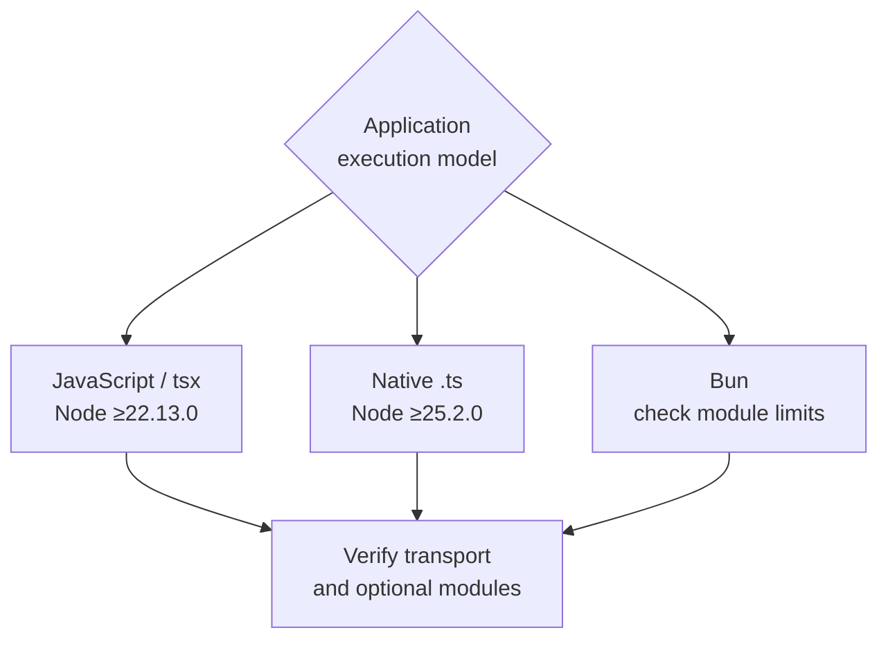

# Runtime Compatibility

The runtime requirement depends on **what you execute**. Published framework
packages are compiled JavaScript. Your application's `.ts` files may need
native type stripping, tsx, or Bun.

<figure class="technical-diagram guide-topic-diagram--wide" aria-label="Choose a runtime by the application execution model">

<figcaption>A package engine floor, a source execution requirement and a tested integration are different claims.</figcaption>
</figure>

## Choose the path

- **Node.js + compiled JavaScript or tsx:** package floor **≥22.13.0**.
- **Node.js + native TypeScript:** this project's generated source path requires **≥25.2.0**.
- **Bun:** the recorded HTTP/2 client boundary is **≥1.2.6**; an example may
  require a newer version. CLI execution and telemetry have separate limitations.

The framework contributor toolchain has its own higher requirement. No support
for Deno or Cloudflare Workers is implied by their mention in a comparison.

## Go deeper

- [Exact requirements, CI coverage and known limitations](/en/guide/runtime-compatibility-details).
- [Select a TypeScript execution model](/en/guide/typescript/runtime-support).
- [Compare RPC transports and their measured behavior](/en/guide/production/transport-matrix-details).

<GuideSections route="/en/guide/runtime-compatibility" />
