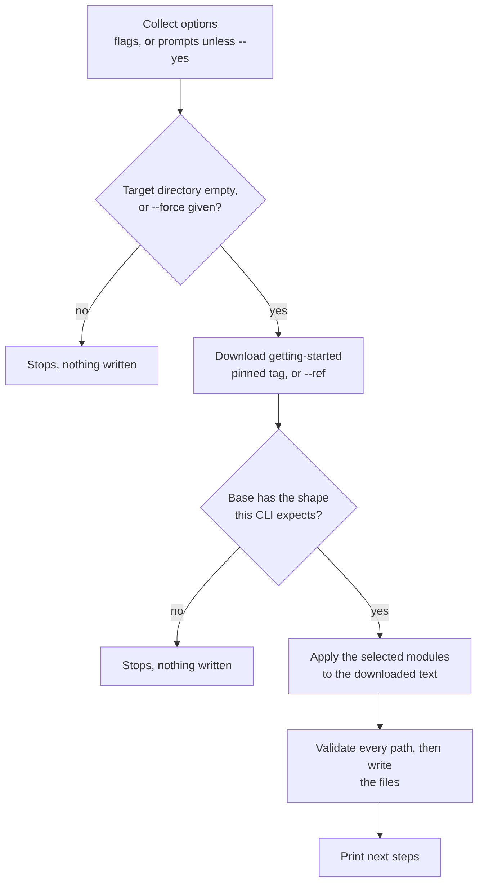

# Scaffolding a New Service

The `connectum` CLI scaffolds a starter Connectum project and adds services to
an existing one. It fetches the `getting-started` example as the base, so the starter
layout follows an example maintained in the examples repository. The CLI then
composes the modules you select on top.

::: tip Requirements
`connectum init` fetches the base from GitHub, so it needs network access the first
time. It produces a standalone project that depends on the published `@connectum/*`
packages. The CLI itself is exercised on Node.js — run it with `npx` even when the
project you are scaffolding targets Bun.
:::

::: tip The base is pinned per CLI release
Each CLI release fetches a **fixed tag** of the examples repository, not its default
branch, so the same CLI version always scaffolds the same base. Pass `--ref` to fetch a
different one (`--ref main` for the latest example). Drift between the pinned base and
the live example is caught by CI on the framework repository, not by your `init`.
:::

::: info Release availability
The `@connectum/*` descriptor exports described below are planned for the upcoming
1.3.0 release and are not yet published to npm. The published CLI cannot generate those
imports until the corresponding package exports are released.
:::

## `connectum init`

Create a new project. Run it interactively:

```bash
npx @connectum/cli init
```

Run the CLI with `npx` whatever you use day to day: it reaches a server through the
Node.js gRPC transport and is exercised on Node.js only. The project it generates has no
such restriction.

The wizard asks for a project name (see [Project path and name](#project-path-and-name)), runtime, package manager, and which modules to
include. Or pass everything as flags for a non-interactive run:

```bash
npx @connectum/cli init payments \
  --package-manager pnpm \
  --otel \
  --events nats \
  --auth \
  --yes
```

`init` checks as much as it can before it writes the first file:



Then:

```bash
cd payments
```

::: pm
== npm
```bash
npm install
npm run start
```
== pnpm
```bash
pnpm install
pnpm run start
```
== bun
```bash
bun install
bun run start
```
:::

::: tip `--package-manager` and `--runtime` are independent
`--package-manager` decides what installs dependencies and runs scripts;
`--runtime` decides what executes your TypeScript. Either accepts `bun`, and they do
not have to agree: `bun install` lays out an ordinary `node_modules`, so a
bun-installed project runs on Node.js and an npm-installed one runs on Bun. Both
crossings are exercised in CI.
:::

`buf generate` runs before `start`, `test`, and `typecheck`, so those scripts use
freshly generated code when generation succeeds. The `dev` script does not
generate code first; run `build:proto` before the first watch session and after
changing a proto contract.

The generated scripts match the runtime you picked:

::: runtime
== node
- `start` — `buf generate && node src/index.ts` for raw `.ts` execution (Node >= 25.2.0); with `--node-exec tsx`, `buf generate && tsx src/index.ts` (Node >= 22.13.0)
- `test` — `buf generate && node --test tests/**/*.test.ts`; the tsx model adds `--import tsx` before `--test`
== bun
- `start` — `buf generate && bun src/index.ts`
- `test` — `buf generate && bun test tests/`
:::

The generated e2e test itself is runtime-agnostic: it uses the in-process
`createLocalClient`, which opens no socket and behaves identically on both runtimes.

It also calls the project's own `buildServer()` rather than assembling a throwaway
server, so the request travels the same interceptor chain, protocols and services your
process entry starts. That matters: a test that builds its own bare server passes even
when a module has made the service unreachable.

### Options

| Flag | Values | Description |
|------|--------|-------------|
| `--runtime` | `node` (default), `bun` | Target runtime |
| `--package-manager` | `pnpm` (default), `npm`, `bun` | Package manager |
| `--node-exec` | `raw` (default), `tsx` | Node execution model: `raw` runs `.ts` directly (Node ≥25.2); `tsx` compiles (Node ≥22.13). Node runtime only: with `--runtime bun` the flag is refused, because Bun runs TypeScript itself |
| `--otel` | — | Add OpenTelemetry (interceptor + provider lifecycle) |
| `--events` | `nats`, `kafka`, `redpanda`, `redis`, `amqp` | Add an EventBus with the chosen adapter |
| `--auth` | — | Add JWT authentication + proto-driven authorization |
| `--catalog` | — | Add the service catalog (typed `ctx.call` / `ctx.stream`) |
| `--resilience` | comma list of `timeout,bulkhead,circuitBreaker,retry` | Enable resilience interceptors; `fallback` is refused, see [Interceptor order](#interceptor-order) |
| `--healthcheck` / `--no-healthcheck` | — | Include the gRPC health protocol (default on). Off also removes the `HEALTHCHECK` of `Dockerfile` and `Dockerfile.bun`, which probes `/healthz`, and the dependency on `@connectum/healthcheck` |
| `--reflection` / `--no-reflection` | — | Include gRPC server reflection (default on) |
| `--sample` / `--no-sample` | — | Emit the runnable sample Greeter service (default on); `--no-sample` is [config-only](#no-sample-a-config-only-project) and cannot be combined with `--auth` or `--events` |
| `--yes`, `-y` | — | Non-interactive; use flags and defaults. `init` also runs non-interactively, without `--yes`, when the environment variable `CI` is `true` or when standard output is not a terminal |
| `--force` | — | Overwrite existing files |
| `--ref` | any git ref | Base example ref to fetch (advanced; defaults to the tag pinned for this CLI release) |

A flag a command does not define is an error, not a no-op: `init --evnts nats` stops with
`Error: connectum init: unknown option --evnts. Valid options: ...`, exit code 1, and writes
nothing. The same holds for `connectum generate service` and `connectum proto sync`.

Files are written in ascending path order, whatever order the scaffold produced them
in. The existing files that `init` skips are listed in the same order.

### Project path and name {#project-path-and-name}

The argument of `init` is the **destination path**. The package name written to
`package.json` is the last segment of that path:

```bash
npx @connectum/cli init apps/payments   # created in apps/payments, "name": "payments"
npx @connectum/cli init .               # created in the current directory, named after it
```

The name must be valid for a **new npm package**. `init` refuses, before anything is
written and naming the rule, a name that is empty, longer than 214 characters, starts with
`.`, `_` or `-`, contains whitespace, upper-case letters or a character that is not
URL-safe (including `~ ' ! ( ) *`), equals `node_modules` or `favicon.ico`, or is the name
of a Node.js core module. The name is never corrected silently: pick another path, or, for
`init .`, create the project in a directory with a valid name. `@acme/payments`
is interpreted as a directory path and produces the unscoped name `payments`;
edit `package.json` afterwards if you need a scoped package name.

### `--no-sample`: a config-only project {#no-sample-a-config-only-project}

`--no-sample` leaves out the Greeter proto, the Greeter service and its end-to-end test.
The server starts with an empty service list and the project ships one smoke test that
builds the real server. Every module that does not depend on the sample (`--otel`,
`--catalog`, `--resilience`, `--healthcheck`, `--reflection`) is applied as usual.

`--auth` and `--events` build their demonstration on the Greeter service, so combining
either with `--no-sample` is an error that names both options.

`buf generate` fails on a module that holds no `.proto` file, so a `--no-sample` project
cannot run `typecheck`, `test` or `start` until it has a first service. Generate it, then
register it as printed:

```bash
cd payments
npx @connectum/cli generate service billing
```

### What `--auth` generates {#what-auth-generates}

Proto-driven authorization is **deny-by-default**, so the sample service is annotated to
be both usable and demonstrative:

- `SayHello` carries `option (connectum.auth.v1.method_auth) = { public: true }` — it
  skips authentication and authorization, so the scaffolded project answers a call the
  moment it starts;
- `SayGoodbye` is left unannotated — it requires a valid JWT.

The generated e2e test asserts both directions: the public rpc succeeds and the
authenticated one is rejected without credentials. Remove the option from `SayHello` once
you want every method to require a token.

The gRPC Health service and the reflection services (`v1` and `v1alpha`) are open without a
token, so probes and [`connectum proto sync`](#connectum-proto-sync) work against the
project. `src/auth.ts` opens them in both places that would otherwise refuse them: the JWT
interceptor skips them (`skipMethods`), and the authorizer has an unconditional allow rule
for them. Listing them in `skipMethods` alone is not enough, because the authorizer denies
by default and answers `unauthenticated`; the
[proto authorization guide](/en/guide/auth/proto-authz#syncing-public-methods-with-authentication)
describes the same pairing. A protocol you switch off with `--no-healthcheck` or
`--no-reflection` is not listed. To require a token for one of them, delete its entry from
`protocolMethods` in `src/auth.ts`. A project scaffolded before this was fixed keeps its
`src/auth.ts`: add the same patterns to
`createProtoAuthzInterceptor({ rules: [{ name: "protocol-endpoints", methods: [...], effect: AuthzEffect.ALLOW }] })`.

The generated `README.md` lists the environment the chain reads, `JWKS_URI`, `JWT_ISSUER`
and `JWT_AUDIENCE`, so a project needs no reading of `src/auth.ts` to be configured.

### What `--events` needs at run time {#what-events-needs}

The generated event bus connects to its broker when the server starts, so a broker has to be
reachable first. The address comes from an environment variable with a local default:

| Adapter | Variable | Default |
|---------|----------|---------|
| `nats` | `NATS_SERVERS` | `nats://localhost:4222` |
| `kafka` | `KAFKA_BROKERS` (comma-separated) | `localhost:9092` |
| `redpanda` | `REDPANDA_BROKERS` (comma-separated) | `localhost:9092` |
| `redis` | `REDIS_URL` | `redis://localhost:6379` |
| `amqp` | `AMQP_URL` | `amqp://localhost:5672` |

The project's `README.md` repeats this for the adapter you chose and, for NATS, Redis and
RabbitMQ, gives a `docker run` line with the image the repository's CI runs the adapter
against (NATS needs `-js`: the adapter uses JetStream, which the server enables only with
that flag). Without a reachable NATS server the project exits at startup with
`server error: ConnectionError: connection refused`.

### Lint rules in `buf.yaml` {#buf-lint-rules}

The generated `buf.yaml` lints with the STANDARD rule set and checks breaking changes with
`FILE`. The plain project and `--auth` add no lint exceptions.

With `--events`, the file also excepts `SERVICE_SUFFIX`, `RPC_REQUEST_STANDARD_NAME`,
`RPC_RESPONSE_STANDARD_NAME` and `RPC_REQUEST_RESPONSE_UNIQUE`, because event-handler
services break exactly these rules: they are not named `*Service`, take the event message
as the request, and answer with a shared `google.protobuf.Empty`. An `except` applies to
the whole `proto` module, so in an `--events` project these four rules are off for every
service you add later, not only for the event handlers.

### Connectum option protos

With `--auth` or `--events`, your protos import Connectum's option protos
(`connectum/auth/v1/options.proto`, `connectum/events/v1/options.proto`), but the project
does not generate code for them. The generated code imports their descriptors from the
packages instead — `@connectum/auth/gen/connectum/auth/v1/options_pb.js` and
`@connectum/events/gen/connectum/events/v1/options_pb.js`, the same modules the packages
use at runtime. The generated `buf.gen.yaml` does this with one `directory: proto` input
(with events, `proto/connectum/events/v1` — where the CLI writes its copy of the events
option proto — is excluded) and `map_imports` options on `protoc-gen-es`:

```yaml
inputs:
  - directory: proto
    exclude_paths:
      - proto/connectum/events/v1
plugins:
  - local: protoc-gen-es
    out: gen
    opt:
      - target=ts
      - import_extension=.ts
      - erasable_syntax=true
      - map_imports=connectum/auth/v1/:@connectum/auth/gen
      - map_imports=connectum/events/v1/:@connectum/events/gen
```

Those package exports are planned for the upcoming 1.3.0 release, which is not yet
published to npm. The current-main `init` implementation therefore sets every `@connectum/*`
dependency of such a project to one range — the highest `@connectum/*` requirement of the
fetched base, or `^1.3.0` if that is higher, so no base entry is lowered (also with
`--ref`). One range for the whole set matters: mixed
`@connectum/*` versions can install two copies of `@bufbuild/protobuf`. A project without
auth or events keeps the base's ranges. In a project scaffolded with `--events`,
`generate service --with-events` writes the events option proto to the same excluded
path, so a new event-handler service also imports the descriptor from
`@connectum/events`. Projects scaffolded with an earlier published CLI cannot use this
generated import path until the required package exports are published; they can adopt it by
hand: [Option descriptors from the packages](/en/migration/option-descriptor-imports).

### Enums in generated code

A Node.js project runs its TypeScript by stripping types and type-checks with
`erasableSyntaxOnly`, and neither accepts a TypeScript `enum`. The generated
`buf.gen.yaml` therefore passes `erasable_syntax=true` to `protoc-gen-es`, so each
Protobuf enum in your protos is generated as an `as const` object plus a type of the
same name:

```typescript
export const Color = { UNSPECIFIED: 0, RED: 1, GREEN: 2 } as const;
export type Color = (typeof Color)[keyof typeof Color] | UnknownEnum;
```

- `Color.RED` works as a value, as with an `enum`.
- There is no reverse mapping: `Color[1]` is `undefined` and a type error.
- For the type of a single value, write `typeof Color.RED`.
- An open (proto3) enum's type also admits `UnknownEnum`.

The option needs `@bufbuild/protoc-gen-es` and `@bufbuild/protobuf` 2.13.0 or later.
`init` declares both at `^2.16.0` — raising a lower range from the base, including a
base fetched with `--ref` — and keeps a base range that is already higher. Details and
the full comparison with TypeScript enums: [Proto Enums](/en/guide/typescript/proto-enums).

### Interceptor order

When multiple interceptor-adding modules are selected, `init` emits a single, consistent
order (outermost → innermost): **OpenTelemetry → error handler → auth →
enabled resilience → validation**. OpenTelemetry is outermost so a span always
covers the whole request, including errors.

The resilience entries follow the [built-in chain order](/en/guide/interceptors/built-in).

`--resilience` accepts `timeout`, `bulkhead`, `circuitBreaker` and `retry`, each
enabled with its default options. `fallback` is not offered: a fallback needs a handler that produces an application-specific response, which a
generator cannot write, and `createDefaultInterceptors({ fallback: true })` is
refused. `connectum init --resilience fallback` exits with
`invalid --resilience "fallback"` and a hint; add the interceptor yourself:

```typescript
createDefaultInterceptors({ fallback: { handler: () => ({ items: [] }) } })
```

### Dependency build scripts under pnpm

pnpm 11 and later stop the first `pnpm install` with `ERR_PNPM_IGNORED_BUILDS` when a
dependency has a build script that the project neither approves nor denies. With
`--package-manager pnpm`, `init` therefore writes an `allowBuilds` map in
`pnpm-workspace.yaml` that covers every module combination:

```yaml
allowBuilds:
  '@bufbuild/buf': true
  esbuild: true
  protobufjs: false
```

`@bufbuild/buf` and `esbuild` stay approved, because their scripts locate or download the
platform binary the project needs. `protobufjs` arrives with the OpenTelemetry module's
OTLP gRPC exporters; its script only prints a warning and has no effect at runtime, so it
is denied. A project scaffolded with `--otel` before this was added fails its first
`pnpm install`; add `protobufjs: false` under `allowBuilds` in its `pnpm-workspace.yaml`.

## `connectum generate service`

Add a service to an existing project:

```bash
npx @connectum/cli generate service billing
# with an event handler too:
npx @connectum/cli generate service inventory --with-events
```

This scaffolds:

- `proto/<name>/v1/<name>.proto` — a starter service (and, with `--with-events`, an
  event-handler service annotated with a topic);
- `src/services/<name>Service.ts` — a `defineService` skeleton whose rpc handlers throw
  `Code.Unimplemented` until you implement them (and, with `--with-events`, an
  `EventRoute` with an ack-by-default handler).

Run it in the root of a project: the directory must have a `package.json`, and with
`--with-events` that `package.json` must list `@connectum/events` in `dependencies`,
`devDependencies`, `peerDependencies` or `optionalDependencies`. Otherwise the command stops
before it writes anything, with a message that names the missing piece
(`no package.json in "<dir>"`, or `--with-events needs @connectum/events`). To add the
events module to an existing project, install `@connectum/events` and an adapter first.

It never edits your `src/server.ts` (that file is yours). Instead it prints the exact
registration to add:

```text
Register the new service in src/server.ts:
  import { billingService } from "#services/billingService.ts";
  // add billingService to the services: [...] array passed to createServer
```

### Service names

The name becomes the proto package, the proto service (`BillingService`), the TypeScript
binding (`billingService`) and the two file paths, so it has to survive that derivation
unchanged. `generate service` refuses, before it creates any file or directory and with a
non-zero exit code, a name that:

- contains anything but ASCII letters, digits, `-` and `_` — path separators (`/`, `\`),
  dots (`.`, `..`), whitespace inside the name and non-ASCII letters such as Cyrillic are
  refused rather than dropped, so `../x`, `a/b`, `Order Service` and `Привет-billing` are errors;
- does not start with a letter (`123-orders`, `_billing`);
- is longer than 214 characters.

The message names the name and every rule it breaks. Whitespace around the name is
ignored. `-` and `_` separate words: `billing-v2` gives the proto package `billingv2` and the
service `BillingV2Service`; upper and lower case give the same files (`Billing` is `billing`).

Two different names can give the same proto package (`ab` and `a-b` both write
`proto/ab/v1/ab.proto`, but declare `AbService` and `ABService`). When the proto of a new name
already exists and does not declare the service that name needs, the command stops before
writing anything and names the proto and the missing service; choose another name, or pass
`--force` to overwrite the proto. Running the same name again stays a no-op.

## `connectum proto sync`

Generate TypeScript types from a **running** server through gRPC reflection, without
access to its `.proto` files:

Enable `Reflection()` on an HTTP/2 server. For generation, run in a project with
`buf` available on `PATH`, a `buf.gen.yaml` (or `--template`), and the code-generation
plugins referenced by that template installed. `--dry-run` only fetches descriptors.

```bash
npx @connectum/cli proto sync --from localhost:5000 --out ./generated
# list what would be synced, generate nothing:
npx @connectum/cli proto sync --from localhost:5000 --out ./generated --dry-run
```

| Flag | Description |
|------|-------------|
| `--from` | Server address (required): `host:port`, which gets `http://` put in front of it, or a full `http://` / `https://` URL, used as typed (the scheme may be written in any letter case). Any other scheme, such as `ftp://host:port`, is refused before a connection is made, with a message that names the scheme |
| `--out` | Output directory for the generated types (required) |
| `--template` | Path to a custom `buf.gen.yaml` |
| `--dry-run` | Connect, list the services and files, generate nothing |
| `--timeout` | Time limit of each reflection request in milliseconds: an integer from 1 to 99999999 (the longest limit an eight-digit `grpc-timeout` header can carry), written in plain decimal digits: a value with a leading zero, such as `007`, is rejected like any other invalid value (default `10000`) |

`--dry-run` prints `Connected to <url>`, a `Services:` list of fully qualified service names
as the server reports them (for example `grpc.health.v1.Health`), a `Files:` list of the
file names in the fetched descriptors, and the line `Would generate to: <out>`. Each entry
is on its own line, prefixed with `  - `.

The command either obtains a descriptor for **every** service the server lists or fails
with a non-zero exit code. If the server lists a service that reflection cannot describe,
the error names each such service and nothing is generated (this holds for `--dry-run`
too). A server that accepts the connection but never answers ends with an error naming the
address and the limit, rather than waiting forever; raise `--timeout` for a slow server.
The command ends as soon as its work is done: the limit is a ceiling for a silent
server, not a time the command waits out.

A full sync prints the size of the fetched descriptor set, then the exact `buf generate`
command line it runs. The stdout and stderr of `buf` pass straight through to your
terminal. The output directory is printed only after `buf` has succeeded.

### Failures

A failure caused by the input ends the command with exit code 1 and one line, `Error: ...`,
that names what failed:

| Situation | Message starts with |
|-----------|---------------------|
| Nobody listens at the address | `Cannot connect to http://localhost:1: ECONNREFUSED.` |
| The server speaks only HTTP/1.1 | `HTTP/2 protocol error talking to <url> (Protocol error).` |
| The server answers with an error | `Reflection request to <url> failed: [unauthenticated] ...` |
| The server stays silent | `Reflection request to <url> timed out after <n> ms` |
| `--from` is empty or not an address | `--from must not be empty.` / `--from "<value>" is not a valid server address.` |
| `--template` is not an existing file | `--template "<path>" is not an existing file.` |
| `buf` is not installed | `buf was not found on the PATH.` |
| `buf generate` fails | `buf generate failed with exit code <n>; see its output above.` |

The address and the template are checked before the command connects. The HTTP/1.1 message
exists because `createServer()` leaves `allowHTTP1` on by default, which on plain TCP makes the
server HTTP/1.1-only, while this command speaks gRPC over HTTP/2: set `allowHTTP1: false` on the
server (the scaffolded projects do).

## Adding a service by hand

The one-shot commands are conveniences — the underlying loop is small:

1. Add a `proto/<pkg>/v1/<file>.proto`.
2. Run `buf generate` (or just `pnpm run test` / `start` — it runs first).
3. Write `defineService(MyService, { ... })` in `src/services/`.
4. Register it in the `services: [...]` array in `src/server.ts`.
