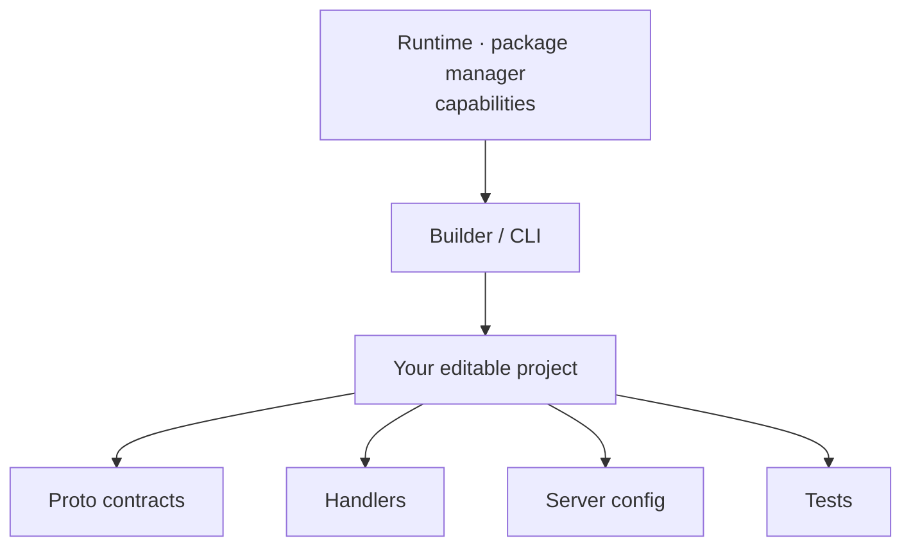

# Scaffolding a New Service

Scaffolding writes the starting files. After that, they are your application —
not hidden framework configuration.

<figure class="technical-diagram guide-topic-diagram--wide" aria-label="Scaffold, inspect, then change your service">

<figcaption>Generated starting code remains ordinary, editable project code.</figcaption>
</figure>

## Start with the files

The [service builder](/en/builder) lets you inspect the project and download all
its files. It also shows what each selected capability changes.

Prefer to build everything yourself? Follow the
[manual first-service tutorial](/en/guide/quickstart-manual).

## Use the CLI deliberately

The [command guide](/en/guide/scaffolding-commands) keeps the full `init`,
`generate service` and `proto sync` instructions, naming rules and generated-file
behavior. Its **1.3** CLI options are not available from published **1.2.x**
packages until that release is published. The builder identifies its pinned
generator source; do not treat its preview command as proof of npm availability.

<GuideSections route="/en/guide/scaffolding" />
