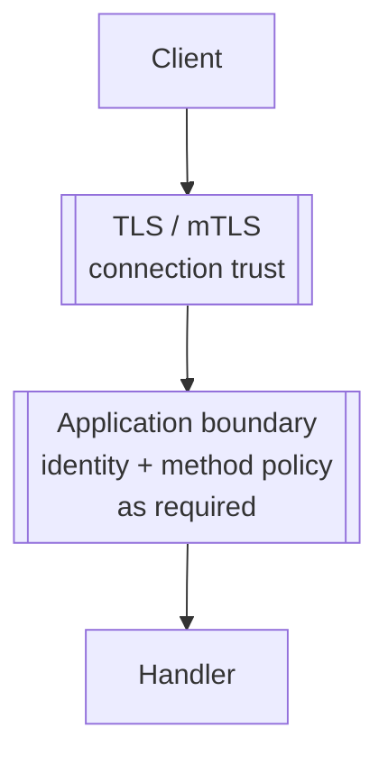

# Transport Security

TLS encrypts the connection and authenticates the server. Mutual TLS additionally authenticates the client certificate. Neither replaces application-level identity and authorization when a request crosses a user or gateway trust boundary.

<figure class="technical-diagram" aria-label="Connection security and application authorization are separate">



<figcaption>A secure connection does not replace application access policy.</figcaption>
</figure>

## Choose the task

Configure [server TLS](/en/guide/security/tls) or
[mutual TLS](/en/guide/security/mtls). Use
[request admission](/en/guide/security/request-admission) to reject unsuitable
requests before reading their bodies.

::: details Transport choices and exact configuration fields
| Need | Canonical guide |
|---|---|
| Load a server key/certificate, use environment paths, or test TLS locally | [TLS configuration](/en/guide/security/tls) |
| Require and validate client certificates for service-to-service traffic | [Mutual TLS](/en/guide/security/mtls) |
| Decide between HTTP/1.1, h2c, and TLS/ALPN transports | [Transport matrix](/en/guide/production/transport-matrix) |
| Add JWT, session, gateway, or per-method policy | [Auth and authz](/en/guide/auth) |
| Reject unauthenticated or oversized requests before the body is read | [Request admission](/en/guide/security/request-admission) |
| Find exact server TLS fields | [`CreateServerOptions`](/en/api/@connectum/core/types/interfaces/CreateServerOptions) |
:::

```typescript
const server = createServer({
  services: [routes],
  tls: { dirPath: './keys' },
});
```

This excerpt assumes `createServer` and your service `routes` are in scope.
The TLS guide supplies certificate setup and a complete example.

Production certificates should be issued and rotated by the platform rather than baked into an image. Keep private keys out of source control, validate the full chain, and do not disable peer verification as a production workaround. The mTLS page owns client-certificate policy; the TLS page owns certificate loading and server transport setup.
