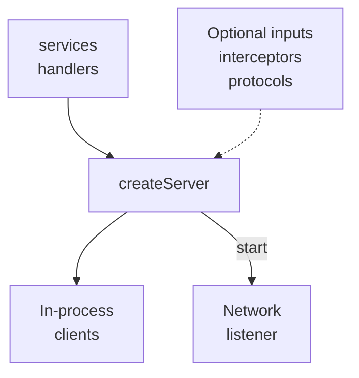

# Server

One server owns one process's RPC boundary. Give it your services and any
middleware or protocols you need; it owns listening, startup and shutdown.

<figure class="technical-diagram" aria-label="The public inputs and call boundaries of one server">



<figcaption>In-process clients can use registered services before a network listener starts. Dashed inputs are optional; lifecycle and shutdown behavior have their own guides below.</figcaption>
</figure>

## Minimal server

With your service implementation exported as `greeterService`:

```typescript
import { createServer } from '@connectum/core';
import { greeterService } from './services/greeterService.ts';

const server = createServer({ services: [greeterService], port: 5000 });
await server.start();
```

This starts the default HTTP/1.1 listener. Middleware and protocols are explicit
additions; native gRPC needs [HTTP/2](/en/guide/production/transport-matrix).

::: details Add health, reflection, middleware and shutdown coordination
```typescript
import { createServer } from '@connectum/core';
import { Healthcheck, healthcheckManager, ServingStatus } from '@connectum/healthcheck';
import { createDefaultInterceptors } from '@connectum/interceptors';
import { Reflection } from '@connectum/reflection';
import { greeterService } from './services/greeterService.ts';

const server = createServer({
  services: [greeterService],
  port: 5000,
  protocols: [Healthcheck({ httpEnabled: true }), Reflection()],
  interceptors: createDefaultInterceptors(),
  shutdown: { autoShutdown: true, timeout: 30_000 },
});

server.on('ready', () => {
  healthcheckManager.update(ServingStatus.SERVING);
});

server.on('stopping', () => {
  healthcheckManager.update(ServingStatus.NOT_SERVING);
});

server.on('error', (err) => {
  console.error('Server error:', err);
});

await server.start();
```

Starting the server does not automatically set health status to `SERVING`. See
[Lifecycle's health-check integration](/en/guide/server/lifecycle#integrating-with-health-checks).
:::

## Choose the owning guide

Start with [lifecycle](/en/guide/server/lifecycle),
[configuration](/en/guide/server/configuration) or
[graceful shutdown](/en/guide/server/graceful-shutdown).

::: details Find an exact server task or API
| Need | Canonical destination |
|---|---|
| Understand states, events, and `shutdownSignal` | [Lifecycle](/en/guide/server/lifecycle) |
| Configure listen address, TLS, environment, or schema extension | [Configuration](/en/guide/server/configuration) |
| Drain requests, coordinate hooks, and fit a deployment deadline | [Graceful shutdown](/en/guide/server/graceful-shutdown) |
| Select HTTP/1.1, h2c, or TLS/ALPN behavior | [Transport matrix](/en/guide/production/transport-matrix) |
| Find an exact server option or method | [`CreateServerOptions`](/en/api/@connectum/core/types/interfaces/CreateServerOptions) and [core API](/en/api/@connectum/core/) |
:::

The stable state progression is `created → starting → running → stopping → stopped`. React to lifecycle events for application coordination; pass `server.shutdownSignal` to long-running work so cancellation follows the same shutdown boundary.

## Module route

Use the [`@connectum/core` module hub](/en/packages/core) for installation, the smallest package example, related guides, source, and API entry points.
