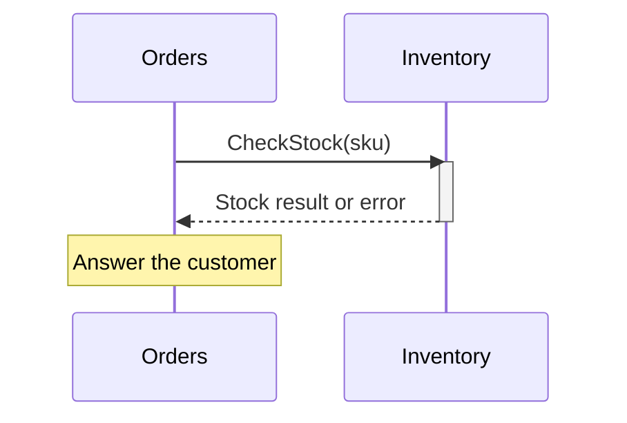

# Service Communication

Orders needs an answer about stock before replying to a customer. It calls
Inventory's contract and waits for the result. That is the synchronous path.

<figure class="technical-diagram" aria-label="Orders waits for Inventory's answer">



<figcaption>Use an event instead when another service can react later and no immediate answer is needed.</figcaption>
</figure>

Inside the Orders handler, with generated contract types in scope:

```typescript
const stock = await ctx.call(
  'shop.v1.InventoryService/CheckStock',
  create(CheckStockRequestSchema, { sku: req.sku }),
);
```

## Choose the mechanism

Learn [how the catalog knows the method](/en/guide/service-communication/service-catalog),
then [how the server chooses its route](/en/guide/service-communication/resolvers).

::: details Patterns, client policy and other communication choices
| Need | Canonical route |
|---|---|
| Decide between request/response, streaming, and events | [Choosing a mechanism](/en/guide/service-communication/choosing-a-mechanism) |
| Call generated internal services through `ctx.call` / `ctx.stream` | [Service catalog](/en/guide/service-communication/service-catalog) |
| Select and compose endpoint resolution | [Resolvers](/en/guide/service-communication/resolvers) |
| Add client tracing, deadlines, retry, or credentials | [Client interceptors](/en/guide/service-communication/client-interceptors) |
| Model fan-out, partial failure, or server streaming | [Communication patterns](/en/guide/service-communication/patterns) |
| Keep calls in the same process with transport parity | [In-process transport](/en/guide/production/in-process-transport) |
| React asynchronously through a broker | [Events](/en/guide/events) |
:::

## Synchronous baseline

Use the generated service catalog when services are part of the Connectum contract. It keeps target resolution, propagated request context, deadlines, and typed call names in one boundary. Use a direct ConnectRPC `createClient()` only for an external or deliberately uncatalogued API.

For direct gRPC calls, the transport must support HTTP/2. Client-side resilience belongs around the outgoing transport, and only client-safe interceptors should be composed there. The exact supported set and ordering are owned by [Client interceptors](/en/guide/service-communication/client-interceptors), not repeated on every communication page.

## Operational rule

Synchronous calls couple caller availability and latency to the downstream service. Events decouple time but add delivery, idempotency, ordering, and broker operations. The [mechanism decision guide](/en/guide/service-communication/choosing-a-mechanism) owns that trade-off; the focused pages own implementation details.
