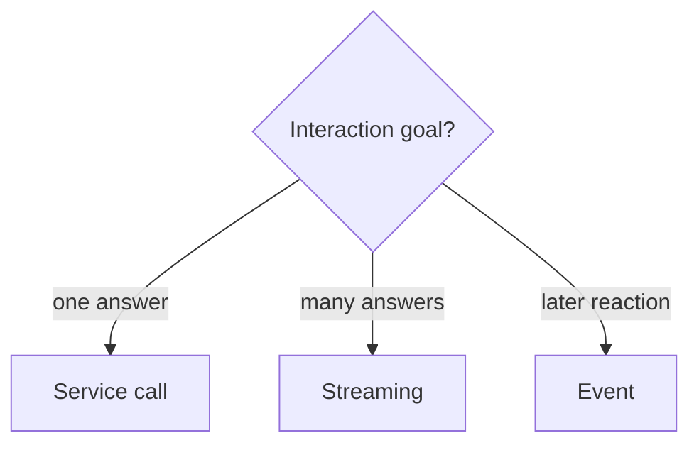

# Choosing a Communication Mechanism

Orders needs to know whether Inventory has stock **before answering** the
customer. That is a service call. After an order is accepted, other services
can react to **what happened** through an event.

<figure class="technical-diagram guide-topic-diagram--scroll" aria-label="Choose communication by the result the caller needs">

<figcaption>These are different interaction contracts, not competing transport libraries.</figcaption>
</figure>

## Choose by the result you need

- **One answer now:** [Service calls](/en/guide/service-communication).
- **A sequence of answers:** [Streaming patterns](/en/guide/service-communication/patterns#server-streaming).
- **A reaction later:** [Events](/en/guide/events).
- **A workflow that survives failure:** [Sagas and compensations](/en/guide/service-communication/mechanisms#durable-a-saga-with-compensations).

Calls couple latency and availability. Events add delivery, ordering and
idempotency concerns. Neither makes a multi-service operation atomic.

## Go deeper

[Compare the full examples and failure trade-offs](/en/guide/service-communication/mechanisms).

<GuideSections route="/en/guide/service-communication/choosing-a-mechanism" />
