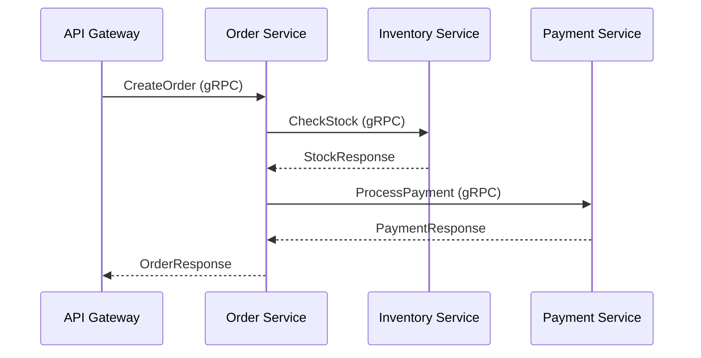

# Communication Patterns

Common inter-service communication patterns for gRPC/ConnectRPC microservices.

Calls between services of your own system go through the [service catalog](/en/guide/service-communication/service-catalog): a handler writes `ctx.call(...)` for a unary method or `ctx.stream(...)` for a streaming one. The framework picks the transport (in-process or remote), passes the inbound cancellation signal and the remaining deadline to the call, and applies the server's `outgoingInterceptors`. A client you build yourself does none of this; [Calls Outside the Catalog](#calls-outside-the-catalog) shows what you must forward by hand.

## Prerequisites

The handler examples on this page need:

- **A loaded catalog.** The generated `catalog.gen.ts` types the method keys; without it `ctx.call` is statically uncallable. See [Generating the catalog](/en/guide/service-communication/service-catalog#generating-the-catalog).
- **The catalog on the server.** Pass it as `createServer({ services, catalog })`. A callee that is not mounted on this server also needs a `remoteResolver` (see [Resolvers](/en/guide/service-communication/resolvers)); without one the call fails with `Unavailable`.
- **Plain-object requests need a regenerated catalog.** They require the upcoming `@connectum/protoc-gen-catalog` 1.3.0. With the published 1.2.x generator, wrap each request in `create(Schema, { ... })`; see the [service-catalog migration guide](/en/migration/service-catalog).

A catalog key is `"<typeName>/<Method>"` with the proto method name in PascalCase (`CheckStock`), not the camelCase client method (`checkStock`).

## Request-Response Chain

The most common pattern -- one service calls another sequentially, each call waiting for a response before proceeding.



```typescript
import { defineService } from '@connectum/core';
import { Code, ConnectError } from '@connectrpc/connect';
import { OrderService } from '#gen/order/v1/order_pb.ts';

// Sequential: check stock, then process payment.
// Pass the result to createServer({ services: [orderService], catalog }).
const orderService = defineService(OrderService, {
  async createOrder(req, ctx) {
    const stock = await ctx.call('inventory.v1.InventoryService/CheckStock', {
      sku: req.sku,
    });
    if (!stock.available) {
      throw new ConnectError('Out of stock', Code.FailedPrecondition);
    }

    const payment = await ctx.call('payment.v1.PaymentService/ProcessPayment', {
      amount: stock.price,
      customerId: req.customerId,
    });

    // ... create order with stock and payment data
  },
});
```

Each `ctx.call` receives the inbound request's `ctx.signal` and what is left of its deadline. If the caller cancels `CreateOrder`, the call in flight is canceled and the second call is never started. The deadline is shared by the whole chain, not restarted per step. A call may shorten its own deadline with `{ timeoutMs }`, never extend it. See [Cascade behaviour](/en/guide/service-communication/service-catalog#cascade-behaviour-calloptions).

::: tip When to use
Use sequential chains when each step depends on the result of the previous one. If steps are independent, prefer [Fan-Out / Fan-In](#fan-out-fan-in) for better latency.
:::

## Fan-Out / Fan-In

When a service needs data from multiple independent downstream services, call them in parallel with `Promise.all`:

```typescript
async createOrder(req, ctx) {
  // Fan-out: parallel calls to independent services
  const [stock, pricing, customerProfile] = await Promise.all([
    ctx.call('inventory.v1.InventoryService/CheckStock', { sku: req.sku }),
    ctx.call('pricing.v1.PricingService/GetPrice', { sku: req.sku }),
    ctx.call('customer.v1.CustomerService/GetProfile', { customerId: req.customerId }),
  ]);

  // Fan-in: combine results
  return createOrderFromData(stock, pricing, customerProfile);
}
```

**Benefits:**
- The calls overlap, so waiting time follows the slowest call rather than the
  sum of their individual waits, before local processing overhead.
- Every call carries the same inbound signal and the deadline that remains, so canceling the inbound request cancels all calls still in flight.
- With an OTel client interceptor in `outgoingInterceptors`, each downstream call gets a client span.
- With a separate circuit breaker instance on each transport the `remoteResolver` returns, each remote downstream service has its own failure budget.

**Considerations:**
- If one call fails, `Promise.all` rejects immediately, and the rejection itself does not cancel the other calls: they stop when they finish or when the cascade cancels them (inbound cancellation or deadline). Use `Promise.allSettled` if partial results are acceptable.
- Parallel calls use separate RPC streams; HTTP/2 transports can multiplex them
  over a shared connection. Downstream concurrency limits still apply.

### Partial Failure Handling

```typescript
const results = await Promise.allSettled([
  ctx.call('inventory.v1.InventoryService/CheckStock', { sku: req.sku }),
  ctx.call('pricing.v1.PricingService/GetPrice', { sku: req.sku }),
  ctx.call('recommendation.v1.RecommendationService/GetSuggestions', { sku: req.sku }),
]);

const [stockResult, pricingResult, suggestionsResult] = results;

// Stock and pricing are required
if (stockResult.status === 'rejected' || pricingResult.status === 'rejected') {
  throw new ConnectError('Required service unavailable', Code.Unavailable);
}

// Suggestions are optional -- degrade gracefully
const suggestions = suggestionsResult.status === 'fulfilled'
  ? suggestionsResult.value.items
  : [];
```

## Server Streaming

For real-time data feeds -- the server sends a stream of messages in response to a single request.

Inside a handler, consume a cataloged server stream with `ctx.stream`. It takes only the method key and returns a factory for that RPC kind; for server streaming the factory takes the request and returns an `AsyncIterable`. The example is itself a streaming handler that relays another service's feed:

```typescript
const dashboardService = defineService(DashboardService, {
  async *watchOrder(req, ctx) {
    // Server streaming: the factory takes the request and returns an AsyncIterable.
    const updates = ctx.stream('order.v1.OrderService/WatchOrderStatus')({
      orderId: req.orderId,
    });

    for await (const update of updates) {
      yield { status: update.status };
    }
  },
});
```

The stream is bound to the inbound request like `ctx.call`: canceling the inbound request ends the stream, and the deadline that remains applies to the whole stream. If the transport fails mid-stream, the loop first receives the messages that already arrived, then the terminal `ConnectError` is thrown. A client-streaming method returns a handle with `send()` and `close()`, and a bidirectional one adds `responses`; see the "Streaming calls" section of the [Service Catalog](/en/guide/service-communication/service-catalog) guide. Calling `ctx.stream` on a unary method, or `ctx.call` on a streaming one, fails with `Unimplemented`.

### Standalone Consumers

Code that runs outside a handler has no inbound request, so there is nothing to cascade. A script, a worker, or a test consumes the stream through `createCatalogClient` (see [Calling from outside a handler](/en/guide/service-communication/service-catalog#calling-from-outside-a-handler)) or, for a service that is not in the catalog, a plain client:

```typescript
// Client consuming a server stream, outside any handler
for await (const update of orderClient.watchOrderStatus({ orderId: '123' })) {
  console.log(`Order status: ${update.status}`);
}
```

Pass your own `signal` or `timeoutMs` in the call options if the loop must be cancellable or bounded.

### Instrumentation

Streaming RPCs are fully instrumented by `createOtelClientInterceptor()`, whether it is mounted in `outgoingInterceptors` (for `ctx.stream`) or on a client transport. The span covers the entire stream lifecycle -- from the initial request to stream completion. Individual messages are recorded as span events when `recordMessages` is enabled.

See [Client Interceptors -- Streaming Instrumentation](./client-interceptors#streaming-instrumentation) for details.

## Calls Outside the Catalog

Use a plain `createClient` client inside a handler only for a service that is not in the catalog, such as a third-party gRPC API. The framework does not see that call: the inbound signal and deadline do not reach it, the server's `outgoingInterceptors` do not run, and no inbound header is forwarded. Forward what the call needs, explicitly:

```typescript
import { createClient } from '@connectrpc/connect';
import { LedgerService } from '#gen/ledger/v1/ledger_pb.ts';

const ledgerClient = createClient(LedgerService, ledgerTransport);

const orderService = defineService(OrderService, {
  async createOrder(req, ctx) {
    // Not in the catalog, so forward the cancellation signal and the
    // remaining deadline yourself.
    const remaining = ctx.timeoutMs();
    const entry = await ledgerClient.record(
      { orderId: req.orderId },
      {
        signal: ctx.signal,
        ...(remaining === undefined ? {} : { timeoutMs: remaining }),
      },
    );

    // ... create order with the ledger entry
  },
});
```

Without the options, canceling the inbound request leaves the ledger call running, and it has no deadline of its own beyond what `ledgerTransport` sets. `ctx.timeoutMs()` is `undefined` when the inbound call has no deadline; the spread then leaves `timeoutMs` out, which also keeps the example valid under `exactOptionalPropertyTypes`. Unlike `ctx.call`, a client call with an own `timeoutMs` is not clamped to the remaining deadline, so take the smaller of the two yourself when you set one. Tracing and resilience for such a client are configured on its own transport; see [Client Interceptors](./client-interceptors).

## Error Handling

gRPC errors propagate as `ConnectError` with standard status codes. A failing `ctx.call` rejects with the `ConnectError` of the downstream handler, and the failures of the call path itself (no catalog, unknown method, no route) are `ConnectError` too; see [Error model](/en/guide/service-communication/service-catalog#error-model). Handle them explicitly when calling downstream services:

```typescript
import { ConnectError, Code } from '@connectrpc/connect';

try {
  const stock = await ctx.call('inventory.v1.InventoryService/CheckStock', {
    sku: req.sku,
  });
} catch (err) {
  if (err instanceof ConnectError) {
    switch (err.code) {
      case Code.Canceled:
        // The inbound request was canceled; the cascade canceled this call.
        // Rethrow instead of reporting an internal failure.
        throw err;
      case Code.NotFound:
        throw new ConnectError('SKU not found', Code.InvalidArgument);
      case Code.Unavailable:
        // Service is down, a circuit breaker on its transport has opened,
        // or the remoteResolver has no route to it
        throw new ConnectError('Inventory service unavailable', Code.Unavailable);
      case Code.DeadlineExceeded:
        throw new ConnectError('Inventory check timed out', Code.DeadlineExceeded);
      default:
        throw new ConnectError('Inventory check failed', Code.Internal);
    }
  }
  throw err;
}
```

### Error Translation

When forwarding errors from a downstream service, translate status codes to match your service's API contract. Don't leak internal error details to callers:

| Downstream Error | Recommended Translation |
|-----------------|------------------------|
| `NotFound` | `InvalidArgument` or `NotFound` (depending on context) |
| `Unavailable` | `Unavailable` (propagate) |
| `DeadlineExceeded` | `DeadlineExceeded` (propagate) |
| `Internal` | `Internal` (log details, return generic message) |
| `PermissionDenied` | `Internal` (don't expose auth details) |

## Related

- [Service Communication](/en/guide/service-communication) -- overview, transport configuration, service discovery
- [Client Interceptors](./client-interceptors) -- OTel, resilience, circuit breaker configuration
- [Connectum Runtime Architecture](/en/guide/production/architecture) -- process boundaries and local/remote routing
- [Interceptors](/en/guide/interceptors) -- server-side interceptor chain
