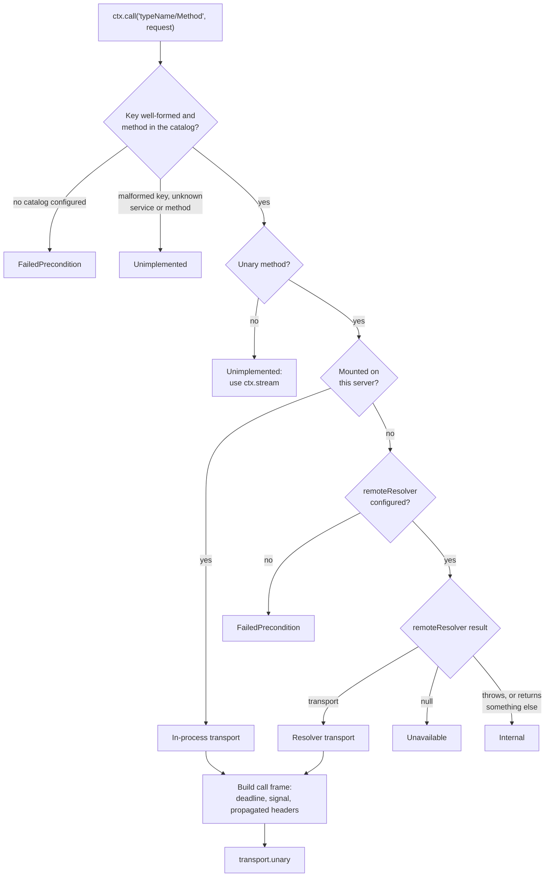

# Service Catalog

The **service catalog** turns cross-service calls into a single declarative primitive. Instead of constructing a transport and a client at every call site, a handler writes `ctx.call(...)` (or `ctx.stream(...)`) and the framework chooses the transport for you: an **in-process** call when the target service is mounted locally, a **remote** call (via a resolver) when it lives in another process. The call site never changes — split a service out of a monolith and the same `ctx.call` line keeps working.

A catalog is a plain readonly map of proto `typeName → DescService`. It carries **no topology**: what is local versus remote is decided at boot by `enabledServices` and a `remoteResolver`, never baked into the proto. The catalog exists to do two jobs — make `ctx.call` / `ctx.stream` **fully typed**, and let the server **resolve** a target to a transport.

## Defining services

Register a service with `defineService(descriptor, handlers)`. Each handler receives a Connectum `Context` as its second argument. `Context` extends ConnectRPC's `HandlerContext` — every field you already know (`signal`, `timeoutMs()`, `requestHeader`, `values`, …) is still there — and adds `ctx.call` and `ctx.stream`.

```typescript
import { create } from '@bufbuild/protobuf';
import { defineService } from '@connectum/core';
import { OrdersService, CreateOrderResponseSchema } from './gen/orders/v1/orders_pb.js';
import { ReserveRequestSchema } from './gen/inventory/v1/inventory_pb.js';

const orders = defineService(OrdersService, {
  async createOrder(req, ctx) {
    // Cross-service call — local or remote is decided by the framework.
    const reservation = await ctx.call(
      'inventory.v1.InventoryService/Reserve',
      create(ReserveRequestSchema, { sku: req.sku, quantity: req.quantity }),
    );
    return create(CreateOrderResponseSchema, { orderId: reservation.orderId });
  },
});
```

`defineService` returns a `ServiceDefinition` (`{ descriptor, register }`) that you pass to `createServer({ services })`.

`handlers` must be an object whose present members are functions; a method you leave out answers `unimplemented`. Anything else throws a `TypeError` that names the service. Two definitions for one service type name are rejected by `createServer()` and `addService()` with `CatalogConfigError`.

`defineLazyService(descriptor, factory)` is the same, but `factory()` runs **only when the service is actually mounted locally** — i.e. when its `typeName` is in `enabledServices` (or `enabledServices` is `undefined`). A service routed to a remote process never instantiates its local dependencies, which is useful for DI-heavy monoliths where wiring a service is expensive. When it is mounted, `factory()` runs **once per server**: HTTP clients, `server.localClient()` and `ctx.call` all reach the same instance, so in-memory state and resources the factory opens (connection pools, caches) are shared rather than duplicated per transport. `factory` must be synchronous and return the handlers object: an `async` factory, or a result that is not an object of functions, throws a `TypeError` naming the service when the factory runs.

## Configuring the catalog

Pass the catalog to `createServer({ catalog })`. The catalog drives startup validation and remote routing. It is **optional** — a process that hosts everything locally and makes no cross-service calls needs none of these fields.

```typescript
import { createServer, defineCatalog } from '@connectum/core';
import { OrdersService } from './gen/orders/v1/orders_pb.js';
import { InventoryService } from './gen/inventory/v1/inventory_pb.js';

const catalog = defineCatalog({
  [OrdersService.typeName]: OrdersService,
  [InventoryService.typeName]: InventoryService,
});

const server = createServer({
  services: [orders],
  catalog,
});
```

`defineCatalog` freezes the record and preserves the literal key type for inference. `mergeCatalogs(...catalogs)` combines several catalogs into one (handy in a polyrepo); it throws `CatalogConfigError` on a duplicate `typeName`.

### Generating the catalog

Writing the catalog and its type augmentations by hand is tedious and drifts from proto. The `@connectum/protoc-gen-catalog` buf plugin generates a `catalog.gen.ts` per buf module containing both the runtime `serviceCatalog` object and the type augmentations.

```yaml
# buf.gen.yaml
version: v2
plugins:
  - local: protoc-gen-es
    out: gen
    opt: [target=ts, import_extension=.js]
  - local: protoc-gen-connectum-catalog
    strategy: all
    out: gen
    opt: [target=ts, import_extension=.js]
```

Set `strategy: all` on the catalog plugin only; `protoc-gen-es` keeps buf's default. The catalog is one aggregate file, so buf must call the plugin once with every proto file of the module. With buf's default `directory` strategy it calls a local plugin once per proto directory, and every call writes the same `catalog.gen.ts` for its own directory's services. buf keeps one of those files and drops the rest with a `duplicate generated file name "catalog.gen.ts"` warning, but it still exits with code 0: the catalog silently lists only some of your services, and `ctx.call` keys for the others are missing from `ConnectumCallMap`.

The generated file augments `@connectum/core`'s `ConnectumCallMap` (one entry per unary RPC) and `ConnectumStreamMap` (one per streaming RPC), keying each `"<typeName>/<Method>"` to its request/response types:

```typescript
// catalog.gen.ts (generated — DO NOT EDIT)
import type {} from '@connectum/core';
import type { MessageInitShape } from '@bufbuild/protobuf';
import { GreeterService } from './greeter_pb.js';
import type { SayHelloRequestSchema, SayHelloResponse } from './greeter_pb.js';

export const serviceCatalog = {
  'greeter.v1.GreeterService': GreeterService,
} as const;

declare module '@connectum/core' {
  interface ConnectumCallMap {
    'greeter.v1.GreeterService/SayHello': { request: MessageInitShape<typeof SayHelloRequestSchema>; response: SayHelloResponse };
  }
  interface ConnectumStreamMap {}
}
```

The request slot is an initializer type: a plain object or a full message. The response is the
full message. Code that reads the request type from these maps as a full message must take
`MessageShape<typeof SayHelloRequestSchema>` from the schema instead, or normalize a value with
`create(SayHelloRequestSchema, request)`. A catalog generated by `@connectum/protoc-gen-catalog`
1.2.x keeps the full-message request type until it is regenerated; see the
[service-catalog migration guide](/en/migration/service-catalog).

::: warning The generated file must be loaded
The `declare module` augmentation is types-only and is **erased** unless something imports the file. Re-export it from your contracts package's `index.ts`, or add a top-level `import './catalog.gen.js';`. Without it, consumers silently see `keyof ConnectumCallMap` as `never` and `ctx.call` becomes uncallable. Keep the mandatory `import type {} from '@connectum/core';` line — it lets the augmentation merge across packages.
:::

With no augmentation, `keyof ConnectumCallMap` is `never`, so `ctx.call` is statically uncallable — the right default for a service that makes no cross-service calls.

## Unary calls — `ctx.call`

```typescript
const response = await ctx.call(method, request, options?);
```

`method` is a `"${typeName}/${Method}"` key. **Note the casing:** the key uses the proto method name (PascalCase, e.g. `.../SayHello`), which is distinct from the camelCase handler name (`sayHello`). `request` is the request message; build it with `create(Schema, { ... })`. The return is a `Promise<response>`.

The transport is chosen automatically: an in-process call when the target is mounted locally (no TCP socket is opened), otherwise the transport supplied by the configured `remoteResolver`. Successful remote resolutions are cached per `(typeName, endpoint)`; a `null` result, a thrown error or a value that is not a `Transport` is not cached, so the next call asks the resolver again.

Each `ctx.call` passes these steps in order, and each failure is a `ConnectError`:



```typescript
async secureEcho(req, ctx) {
  const inner = await ctx.call(
    'inventory.v1.InventoryService/CheckStock',
    create(CheckStockRequestSchema, { sku: req.sku }),
  );
  return create(EchoResponseSchema, { available: inner.available });
}
```

## Streaming calls — `ctx.stream`

`ctx.stream(method)` is **curried**: it returns a kind-specific factory, then you call that factory. The shape depends on the streaming kind recorded in `ConnectumStreamMap`.

**Server-streaming** → factory takes the request and returns an `AsyncIterable`:

```typescript
for await (const item of ctx.stream('streaming.v1.StreamingService/Server')(
  create(ItemSchema, { value: req.message, sequence: 3 }),
)) {
  // consume item
}
```

**Client-streaming** → factory returns a `ClientStreamHandle`: `send()` N requests, then `close()` resolves the single aggregated response:

```typescript
const handle = ctx.stream('streaming.v1.StreamingService/Client')();
handle.send(create(ItemSchema, { value: 'a', sequence: 0 }));
handle.send(create(ItemSchema, { value: 'b', sequence: 1 }));
const count = await handle.close(); // Promise<Res>
```

`close()` settles when the call has finished, not when the response arrives: it resolves with the response only after the server's final status, and rejects if the call ends without a response, carries more than one, or fails after the response (the failure is what the call reports). A server that delays its final status therefore holds `close()` until that status arrives, the call is canceled through `CallOptions.signal` or its deadline passes. Versions before 1.3.0 resolved at the first response and silently dropped a later failure; the catalog now follows the same client-streaming contract as a standard Connect client, except for one code: a call that ends without a response or with more than one is reported as `Internal` (a standard Connect client reports `Unimplemented`), because it is a protocol violation by the server, not an unimplemented method. A deadline is enforced by the call's transport, as with a standard Connect client. An OpenTelemetry client interceptor on the call finishes its span once the call has finished.

**Bidi-streaming** → factory returns a `BidiStreamHandle`: `send()` requests while iterating `responses`; `close()` ends **only** the request (send) half — the response half keeps yielding until the server completes:

```typescript
const handle = ctx.stream('streaming.v1.StreamingService/Bidi')();
handle.send(create(ItemSchema, { value: 'a', sequence: 0 }));
handle.send(create(ItemSchema, { value: 'b', sequence: 1 }));
handle.close(); // void — ends the send half only
for await (const item of handle.responses) {
  // consume server responses
}
```

On a **mid-stream transport failure** the iterator follows a **deliver-then-error** policy: it delivers the messages received so far, then throws the terminal `ConnectError`. Consumers that `break` early do not hang.

## Cascade behaviour (`CallOptions`)

`ctx.call(method, request, options?)` accepts an optional `CallOptions` as its third argument. `ctx.stream(method)` takes only the method key and returns a factory — pass `CallOptions` to that returned factory, not to `ctx.stream` itself (e.g. `ctx.stream(method)(request, options)` for server-streaming, or `ctx.stream(method)(options)` for client/bidi). Omitted dimensions cascade from the incoming request.

```typescript
type CallOptions = {
  signal?: AbortSignal;   // default: inbound ctx.signal
  timeoutMs?: number;     // default: remaining inbound deadline
  headers?: HeadersInit;  // default: none (see below)
  endpoint?: string;      // hint for the remoteResolver
};
```

- **`signal`** — when omitted, the inbound request's `ctx.signal` is injected, so cancelling the inbound RPC cancels every in-flight `ctx.call`. A supplied signal **replaces** the cascade — it is **not** AND-linked with `ctx.signal`.
- **`timeoutMs`** — when omitted, the remaining inbound deadline (`ctx.timeoutMs()`) is injected. A caller may **shorten** the deadline but never extend it; the effective value is `min(timeoutMs, remaining)`. An over-long override is clamped to the remaining deadline. The value must be a finite number greater than 0: `0`, a negative number, `NaN` or `Infinity` rejects the call with `Code.InvalidArgument` instead of lifting the inherited deadline. If the inbound deadline has already passed, the nested call fails with `Code.DeadlineExceeded`.
- **`endpoint`** — an empty string counts as no endpoint: the resolver receives the same context, and shares the same cached transport, as for a call without the option.
- **Trace context** flows implicitly via the `@connectum/otel` client interceptor when it is mounted in `outgoingInterceptors` — no header plumbing needed.
- **Headers are NOT propagated by default.** No inbound header leaks onto an outgoing call.

### Header propagation

Opt in by listing header names in `createServer({ propagateHeaders })`. `defaultPropagateHeaders` is a ready-made allow-list of W3C trace-context headers (`["traceparent", "tracestate"]`) you can spread and extend. `authorization` is deliberately excluded — forwarding credentials is a security-sensitive choice you must make explicitly. The list is checked and copied when the server is created: an entry that is not a valid HTTP header name (`"x y"`, `""`, a pseudo-header such as `":authority"`) throws a `TypeError` that names `propagateHeaders`, and changing the array you passed afterwards does not change what is forwarded. `defaultPropagateHeaders` is frozen; spread it to build your own list.

```typescript
import { createServer, defaultPropagateHeaders } from '@connectum/core';

const server = createServer({
  services: [orders],
  catalog,
  propagateHeaders: [...defaultPropagateHeaders, 'x-tenant-id'],
});
```

Explicit `CallOptions.headers` always win over a propagated value.

### Outgoing interceptors

`createServer({ outgoingInterceptors })` is the client-side chain of catalog routing. It runs exactly once per call on every route — `ctx.call` / `ctx.stream` and `server.client()`, all four RPC kinds, whether the target is mounted on this server (in-process), reached through the `remoteResolver`, or served by `mockResolver` in a test. The first element is the outermost; the chain runs outside the interceptors of the resolver's own transport, and the call's deadline budget is already running when it starts (the transport receives what is left). `server.localClient()` and `createLocalTransport()` stay plain, and `createCatalogClient({ outgoingInterceptors })` takes its own explicit chain (default empty; it never inherits one from a server).

Mount application policy here once — identity and tracing for every route:

```typescript
import { createClientBearerInterceptor } from '@connectum/auth';
import { createServer, dnsResolver } from '@connectum/core';
import { createOtelClientInterceptor } from '@connectum/otel';

const server = createServer({
  services: [orders],
  catalog,
  outgoingInterceptors: [
    createClientBearerInterceptor({ token: () => fetchServiceToken() }),
    createOtelClientInterceptor({ serverAddress: 'catalog' }),
  ],
  remoteResolver: dnsResolver({ template: 'http://{shortName}.internal:5000' }),
});
```

Keep only transport-specific middleware (TLS, compression, a per-upstream gateway header) on the resolver's transports: the framework cannot see inside a `Transport`, so the same policy configured in both places runs twice. On a resolver route an interceptor in the chain reads `req.url` as `https://catalog/<typeName>/<Method>` with `requestMethod: "POST"` and sees no protocol headers; policy that needs the wire request — signing over headers, an audience derived from the host — belongs on the resolver's transport. See [Transport-owned vs application-owned interceptors](./resolvers#transport-owned-vs-application-owned-interceptors).

## Single-image, multiple roles — `enabledServices`

`enabledServices` is a list of full proto `typeName`s a process mounts **locally**. Any service in `services` whose `typeName` is not listed is treated as remote and reached via the `remoteResolver`. `undefined` mounts every provided service locally. Every entry must be the `typeName` of a service in `services` (and a key of the catalog, when one is set); `start()` rejects with `CatalogConfigError` naming the entries that match nothing, so a misspelled name cannot leave a running server with nothing mounted. This lets one image play different roles depending on configuration — a modular monolith in one deployment, split processes in another, with no code change.

```typescript
import { createServer, parseServicesEnv } from '@connectum/core';

const server = createServer({
  services: [orders, inventory, payments],
  catalog,
  // e.g. CONNECTUM_SERVICES="orders.v1.OrdersService,inventory.v1.InventoryService"
  enabledServices: parseServicesEnv(process.env.CONNECTUM_SERVICES),
  remoteResolver, // see the Resolvers guide
});
```

Full `typeName`s are mandatory — short names collide (`catalog.v1.UsersService` and `auth.v1.UsersService` both shorten to `users`). Three helpers support env-driven configuration:

- `parseServicesEnv(value)` — parses a comma-separated env string into a `string[]`, trimming whitespace and dropping empties. Returns `[]` for an empty/undefined value.
- `matchServicesPattern(pattern, names)` — returns the subset of `names` matching a glob `pattern`, where `*` matches any run of characters including dots (e.g. `"acme.*"` matches `"acme.v1.UsersService"`). This is a **glob, not a RegExp** — only `*` is special.
- `mergeEnabledServices(...lists)` — merges several lists, de-duplicating while preserving first-seen order.

## Calling from outside a handler

`ctx.call` only exists inside a handler (it needs a live `HandlerContext`). For boot code, scripts, or tests, use the server's client factories:

- **`server.localClient(Desc)`** — a fully-typed client that dispatches directly to handlers on this server, with no TCP socket. Safe to call before `server.start()`.
- **`server.client(Desc, options?)`** — auto-routes: in-process when the service is mounted locally, otherwise via the configured `remoteResolver`. The same call site works for monolith and split deployments. `options.endpoint` is an opaque hint forwarded to the resolver.

```typescript
const client = server.client(InventoryService);   // local or remote — same call
const stock = await client.checkStock({ sku: 'A-1' });
```

Both `server.localClient` and `server.client` require a `Server` instance. For a process with **no server at all** — a Temporal worker, a scheduler, a CLI — use `createCatalogClient`. It provides the same catalog-typed `call`/`stream` surface as the handler `ctx`, routing every call through the supplied resolver (there is no in-process path without a `Server`):

```typescript
import { createCatalogClient, mapResolver } from '@connectum/core';
import { createGrpcTransport } from '@connectrpc/connect-node';
import { serviceCatalog } from './gen/catalog.gen.js';

const client = createCatalogClient({
  catalog: serviceCatalog,
  resolver: mapResolver({
    'inventory.v1.InventoryService': createGrpcTransport({ baseUrl: process.env.INVENTORY_ADDR }),
  }),
});

const stock = await client.call('inventory.v1.InventoryService/CheckStock', { sku: 'A-1' });
// ctx.stream mirrors: client.stream('...')(request) for server-streaming, etc.
```

The plain-object request requires the upcoming `@connectum/protoc-gen-catalog`
1.3.0 release and a regenerated `catalog.gen.ts`. With the published 1.2.x
generator or an existing catalog, pass a full generated protobuf request
message. See the [service-catalog migration guide](/en/migration/service-catalog)
for the upgrade boundary.

## Error model

Connectum splits **configuration mistakes** (programmer errors, thrown eagerly) from **operational failures** (runtime, mapped to RPC status codes).

**`CatalogConfigError`** — a configuration mistake; fails loud with a stack trace. Thrown for:

- `server.client(Desc)` on a service that is **not mounted locally and has no `remoteResolver`** configured (the catalog is not consulted in this path);
- `enabledServices` that is **not a subset of the catalog**, or names a service that is not in `services`, at `start()` (caught by an always-on shape check);
- a catalog **key that differs from its descriptor's `typeName`** in `createServer({ catalog })` or `createCatalogClient({ catalog })`, a `createCatalogClient()` without a `resolver` function, or malformed `dnsResolver` / `perServiceEnvResolver` / `mapResolver` options;
- the **same service defined twice** (`createServer({ services })`, `addService()`);
- a **duplicate `typeName`** during `mergeCatalogs`.

**`ConnectError`** — operational failures from `ctx.call` / `ctx.stream`, with the appropriate Connect status code:

| Situation | Code |
|-----------|------|
| No catalog configured | `Code.FailedPrecondition` |
| Unknown service, or known service with unknown method | `Code.Unimplemented` |
| Target not mounted locally and no `remoteResolver` configured | `Code.FailedPrecondition` (a wiring mistake; the `retry` interceptor does not retry it by default) |
| `remoteResolver` returns `null` (no route) | `Code.Unavailable` |
| `remoteResolver` throws | `Code.Internal` (original error preserved as `cause`) |
| `remoteResolver` returns something that is not a `Transport` or `null` (a string, `undefined`, a `Promise`) | `Code.Internal`, naming the service |
| `CallOptions.timeoutMs` is not a finite number greater than 0 | `Code.InvalidArgument` |
| The inbound deadline has already passed | `Code.DeadlineExceeded` |

## Related

- [Resolvers](/en/guide/service-communication/resolvers) -- resolver patterns (`singleTransportResolver`, `mapResolver`, `dnsResolver`, `perServiceEnvResolver`) for remote routing
- [Communication Patterns](./patterns) -- request-response chains, fan-out/fan-in, streaming
- [Client Interceptors](./client-interceptors) -- OTel, resilience, the `outgoingInterceptors` chain
