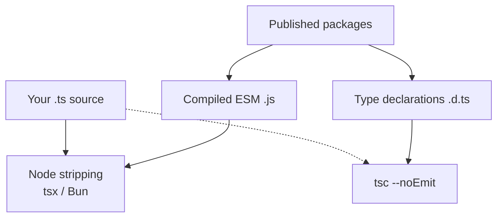

# TypeScript

Applications can execute erasable TypeScript directly on the documented Node.js
line. Connectum packages ship compiled ESM JavaScript and declarations; supported
versions and tested Bun behavior are in [Runtime Compatibility](/en/guide/runtime-compatibility).

<figure class="technical-diagram guide-topic-diagram--wide" aria-label="Application TypeScript and published framework code are different inputs">



<figcaption>Native execution skips a build step, not type checking.</figcaption>
</figure>

## Quick Start

```bash
# Node.js >=25.2.0 -- run erasable TypeScript directly
node src/index.ts

# Development with auto-reload
node --watch src/index.ts
```

No loaders, no compilation step, no `tsc` required to run your code. TypeScript is used for type checking only (`tsc --noEmit`).

## Key Concepts

Native type stripping only removes erasable syntax. Use `const` objects rather
than runtime enums, and keep `tsc --noEmit` in your development checks.

::: details Syntax and import rules
| Constraint | Rule |
|------------|------|
| **No `enum`** | Use `const` objects with `as const` |
| **No `namespace`** | Only type-only namespaces allowed |
| **No parameter properties** | Use explicit property declarations |
| **Explicit `import type`** | `verbatimModuleSyntax: true` |
| **Import extensions** | Relative source imports use `.ts`; generated imports match `buf.gen.yaml` |
| **`node:` prefix** | Required for Node.js built-in modules |

The syntax restrictions follow `erasableSyntaxOnly: true`: stripping types must
leave valid JavaScript. Explicit type imports, import extensions, and the `node:`
prefix are the project's import conventions; the `node:` prefix is not a
TypeScript type-stripping requirement.
:::

## Learn More

- [Execution Models](/en/guide/typescript/runtime-support) -- native Node.js, Bun, and tsx workflows
- [Runtime Compatibility](/en/guide/runtime-compatibility) -- canonical supported-version and limitation matrix
- [Erasable Syntax](/en/guide/typescript/erasable-syntax) -- constraints, import rules, tsconfig.json
- [Proto Enums](/en/guide/typescript/proto-enums) -- generating proto enums as `as const` objects
- [Patterns & Workflow](/en/guide/typescript/patterns) -- named parameters, branded types, development workflow
- [@connectum/core](/en/packages/core) -- Package Guide
