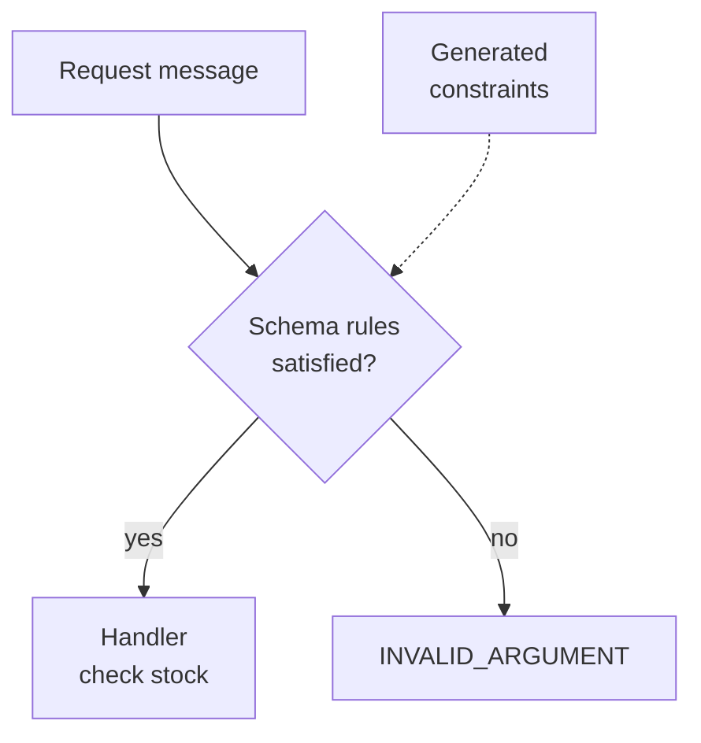

# Validation

Inventory should receive a meaningful SKU, not an empty string. Put that rule
beside the field in your protobuf contract; the configured validation
interceptor checks it before the handler runs.

<figure class="technical-diagram" aria-label="Validation before application work">



<figcaption>A schema rule checks input shape. Stock availability remains a business decision in the handler.</figcaption>
</figure>

## One rule

With `buf/validate/validate.proto` imported:

```proto
message CheckStockRequest {
  string sku = 1 [(buf.validate.field).string.min_len = 1];
}
```

Regenerate the descriptors after changing constraints.
`createDefaultInterceptors()` includes validation by default; the validation
dependencies still need to be installed. Defining the annotation alone does
not install middleware on a server.

## Go deeper

- [Set up validation and test an invalid request](/en/guide/validation-setup).
- [All constraint examples, error messages and business validation](/en/guide/validation-setup#proto-constraints).
- [Understand the interceptor chain](/en/guide/interceptors).

<GuideSections route="/en/guide/validation" />
