# Service Catalog — Configuration and Behavior

For a visual introduction, start with
[how contracts become a catalog](/en/guide/service-communication/service-catalog).
For local/remote dispatch, use the [resolver illustration](/en/guide/service-communication/resolvers)
and its [runnable Orders → Inventory example](/en/guide/service-communication/routing-example).
This page keeps the complete configuration and behavior reference.

The **service catalog** records known protobuf service contracts and enables
typed `ctx.call(...)` / `ctx.stream(...)` calls. It is not a registry of running
processes and performs no network discovery. Local registration and remote
resolution determine where those calls execute.

A catalog is a plain readonly map of proto `typeName → DescService`. It carries **no topology**: what is local versus remote is decided at boot by `enabledServices` and a `remoteResolver`, never baked into the proto. The catalog exists to do two jobs — make `ctx.call` / `ctx.stream` **fully typed**, and let the server **resolve** a target to a transport.

Keep three inputs separate: `services` supplies local implementations, `catalog`
describes callable contracts, and `remoteResolver` supplies transports for targets
not mounted here. Adding a descriptor to the catalog does not mount its service,
start another process, or configure its address.

## Defining services

Register a service with `defineService(descriptor, handlers)`. Each handler receives a Connectum `Context` as its second argument. `Context` extends ConnectRPC's `HandlerContext` — every field you already know (`signal`, `timeoutMs()`, `requestHeader`, `values`, …) is still there — and adds `ctx.call` and `ctx.stream`.

```typescript
import { create } from '@bufbuild/protobuf';
import { defineService } from '@connectum/core';
import { OrdersService, CreateOrderResponseSchema } from './gen/orders/v1/orders_pb.js';
import { ReserveRequestSchema } from './gen/inventory/v1/inventory_pb.js';

const orders = defineService(OrdersService, {
  async createOrder(req, ctx) {
    // Cross-service call — local or remote is decided by the framework.
    const reservation = await ctx.call(
      'inventory.v1.InventoryService/Reserve',
      create(ReserveRequestSchema, { sku: req.sku, quantity: req.quantity }),
    );
    return create(CreateOrderResponseSchema, { orderId: reservation.orderId });
  },
});
```

`defineService` returns a `ServiceDefinition` (`{ descriptor, register }`) that you pass to `createServer({ services })`.

`defineLazyService(descriptor, factory)` is the same, but `factory()` runs **only when the service is actually mounted locally** — i.e. when its `typeName` is in `enabledServices` (or `enabledServices` is `undefined`). A service routed to a remote process never instantiates its local dependencies, which is useful for DI-heavy monoliths where wiring a service is expensive. When it is mounted, `factory()` runs **once per server**: HTTP clients, `server.localClient()` and `ctx.call` all reach the same instance, so in-memory state and resources the factory opens (connection pools, caches) are shared rather than duplicated per transport.

## Configuring the catalog

Pass the catalog to `createServer({ catalog })`. The catalog drives startup validation and remote routing. It is **optional** — a process that hosts everything locally and makes no cross-service calls needs none of these fields.

```typescript
import { createServer, defineCatalog } from '@connectum/core';
import { OrdersService } from './gen/orders/v1/orders_pb.js';
import { InventoryService } from './gen/inventory/v1/inventory_pb.js';

const catalog = defineCatalog({
  [OrdersService.typeName]: OrdersService,
  [InventoryService.typeName]: InventoryService,
});

const server = createServer({
  services: [orders],
  catalog,
});
```

`defineCatalog` freezes the record and preserves the literal key type for inference. `mergeCatalogs(...catalogs)` combines several catalogs into one (handy in a polyrepo); it throws `CatalogConfigError` on a duplicate `typeName`.

### Generating the catalog

Writing the catalog and its type augmentations by hand is tedious and drifts from proto. The `@connectum/protoc-gen-catalog` buf plugin generates a `catalog.gen.ts` per buf module containing both the runtime `serviceCatalog` object and the type augmentations.

```yaml
# buf.gen.yaml
version: v2
plugins:
  - local: protoc-gen-es
    out: gen
    opt: [target=ts, import_extension=.js]
  - local: protoc-gen-connectum-catalog
    strategy: all
    out: gen
    opt: [target=ts, import_extension=.js]
```

Set `strategy: all` on the catalog plugin only; `protoc-gen-es` keeps buf's default. The catalog is one aggregate file, so buf must call the plugin once with every proto file of the module. With buf's default `directory` strategy it calls a local plugin once per proto directory, and every call writes the same `catalog.gen.ts` for its own directory's services. buf keeps one of those files and drops the rest with a `duplicate generated file name "catalog.gen.ts"` warning, but it still exits with code 0: the catalog silently lists only some of your services, and `ctx.call` keys for the others are missing from `ConnectumCallMap`.

The generated file augments `@connectum/core`'s `ConnectumCallMap` (one entry per unary RPC) and `ConnectumStreamMap` (one per streaming RPC), keying each `"<typeName>/<Method>"` to its request/response types:

```typescript
// catalog.gen.ts (generated — DO NOT EDIT)
import type {} from '@connectum/core';
import type { MessageInitShape } from '@bufbuild/protobuf';
import { GreeterService } from './greeter_pb.js';
import type { SayHelloRequestSchema, SayHelloResponse } from './greeter_pb.js';

export const serviceCatalog = {
  'greeter.v1.GreeterService': GreeterService,
} as const;

declare module '@connectum/core' {
  interface ConnectumCallMap {
    'greeter.v1.GreeterService/SayHello': { request: MessageInitShape<typeof SayHelloRequestSchema>; response: SayHelloResponse };
  }
  interface ConnectumStreamMap {}
}
```

The request slot is an initializer type: a plain object or a full message. The response is the
full message. Code that reads the request type from these maps as a full message must take
`MessageShape<typeof SayHelloRequestSchema>` from the schema instead, or normalize a value with
`create(SayHelloRequestSchema, request)`. A catalog generated by `@connectum/protoc-gen-catalog`
1.2.x keeps the full-message request type until it is regenerated; see the
[service-catalog migration guide](/en/migration/service-catalog).

::: warning Include the generated types and configure the runtime catalog
TypeScript must include the generated module in the consumer's compilation. Import
its `serviceCatalog` value for `createServer({ catalog: serviceCatalog })`, or
re-export it through your contracts package. A type-only import also makes its
augmentation available to the compiler, but does not supply the runtime catalog.
Erasing types during JavaScript emission does not remove types from compilation.

If the augmentation is absent from the compilation, `keyof ConnectumCallMap` is
`never` and `ctx.call` is uncallable. Including the generated file through `tsconfig`
also makes its types visible; consumers of a separate contracts package must have
an import or declaration reference that includes them. Keep the generated
`import type {} from '@connectum/core';` line so the declaration augments the
existing module rather than replacing it.
:::

With no augmentation, `keyof ConnectumCallMap` is `never`, so `ctx.call` is statically uncallable — the right default for a service that makes no cross-service calls.

## Unary calls — `ctx.call` {#unary-calls}

```typescript
const response = await ctx.call(method, request, options?);
```

`method` is a `"${typeName}/${Method}"` key. **Note the casing:** the key uses the proto method name (PascalCase, e.g. `.../SayHello`), which is distinct from the camelCase handler name (`sayHello`). With a regenerated 1.3 catalog, `request` accepts a plain initializer or a full message built with `create(Schema, { ... })`; older catalogs require the full message. The return is a `Promise<response>`.

The transport is chosen automatically: an in-process call when the target is mounted locally (no TCP socket is opened), otherwise the transport supplied by the configured `remoteResolver`. Successful remote resolutions are cached per `(typeName, endpoint)`; a `null` result or thrown resolver error causes another lookup on the next call, not an automatic retry of the failed RPC. See [route-cache behavior](/en/guide/service-communication/resolver-configuration#route-cache-lifetime).

Each `ctx.call` passes these steps in order, and each failure is a `ConnectError`:

```mermaid
flowchart TD
    Call["ctx.call('typeName/Method', request)"] --> Lookup{"Key well-formed and<br/>method in the catalog?"}
    Lookup -->|"no catalog configured"| E0["FailedPrecondition"]
    Lookup -->|"malformed key, unknown<br/>service or method"| E1["Unimplemented"]
    Lookup -->|"yes"| Kind{"Unary method?"}
    Kind -->|"no"| E2["Unimplemented:<br/>use ctx.stream"]
    Kind -->|"yes"| Local{"Mounted on<br/>this server?"}
    Local -->|"yes"| InProc["In-process transport"]
    Local -->|"no"| Resolver{"remoteResolver result"}
    Resolver -->|"transport"| Remote["Resolver transport"]
    Resolver -->|"null"| E3["Unavailable"]
    Resolver -->|"throws"| E4["Internal"]
    InProc --> Frame["Build call frame:<br/>deadline, signal, propagated headers"]
    Remote --> Frame
    Frame --> Send["transport.unary"]

    class Resolver accent
    class E0 critical
    class E1 critical
    class E2 critical
    class E3 warning
    class E4 critical
```



```typescript
async secureEcho(req, ctx) {
  const inner = await ctx.call(
    'inventory.v1.InventoryService/CheckStock',
    create(CheckStockRequestSchema, { sku: req.sku }),
  );
  return create(EchoResponseSchema, { available: inner.available });
}
```

## Streaming calls — `ctx.stream` {#streaming-calls}

`ctx.stream(method)` is **curried**: it returns a kind-specific factory, then you call that factory. The shape depends on the streaming kind recorded in `ConnectumStreamMap`.

**Server-streaming** → factory takes the request and returns an `AsyncIterable`:

```typescript
for await (const item of ctx.stream('streaming.v1.StreamingService/Server')(
  create(ItemSchema, { value: req.message, sequence: 3 }),
)) {
  // consume item
}
```

**Client-streaming** → factory returns a `ClientStreamHandle`: `send()` N requests, then `close()` resolves the single aggregated response:

```typescript
const handle = ctx.stream('streaming.v1.StreamingService/Client')();
handle.send(create(ItemSchema, { value: 'a', sequence: 0 }));
handle.send(create(ItemSchema, { value: 'b', sequence: 1 }));
const count = await handle.close(); // Promise<Res>
```

`close()` settles when the call has finished, not when the response arrives: it resolves with the response only after the server's final status, and rejects if the call ends without a response, carries more than one, or fails after the response (the failure is what the call reports). A server that delays its final status therefore holds `close()` until that status arrives, the call is canceled through `CallOptions.signal` or its deadline passes. Versions before 1.3.0 resolved at the first response and silently dropped a later failure; the catalog now follows the same client-streaming contract as a standard Connect client, except for one code: a call that ends without a response or with more than one is reported as `Internal` (a standard Connect client reports `Unimplemented`), because it is a protocol violation by the server, not an unimplemented method. A deadline is enforced by the call's transport, as with a standard Connect client. An OpenTelemetry client interceptor on the call finishes its span once the call has finished.

**Bidi-streaming** → factory returns a `BidiStreamHandle`: `send()` requests while iterating `responses`; `close()` ends **only** the request (send) half — the response half keeps yielding until the server completes:

```typescript
const handle = ctx.stream('streaming.v1.StreamingService/Bidi')();
handle.send(create(ItemSchema, { value: 'a', sequence: 0 }));
handle.send(create(ItemSchema, { value: 'b', sequence: 1 }));
handle.close(); // void — ends the send half only
for await (const item of handle.responses) {
  // consume server responses
}
```

On a **mid-stream transport failure** the iterator follows a **deliver-then-error** policy: it delivers the messages received so far, then throws the terminal `ConnectError`. Consumers that `break` early do not hang.

Ending iteration is not a cancellation guarantee. For an in-process stream,
`break` does not itself abort the handler; use a call `AbortSignal` or deadline
when work must stop. See [in-process streaming](/en/guide/production/in-process-transport).

## Cascade behaviour (`CallOptions`)

`ctx.call(method, request, options?)` accepts an optional `CallOptions` as its third argument. `ctx.stream(method)` takes only the method key and returns a factory — pass `CallOptions` to that returned factory, not to `ctx.stream` itself (e.g. `ctx.stream(method)(request, options)` for server-streaming, or `ctx.stream(method)(options)` for client/bidi). Omitted dimensions cascade from the incoming request.

```typescript
type CallOptions = {
  signal?: AbortSignal;   // default: inbound ctx.signal
  timeoutMs?: number;     // default: remaining inbound deadline
  headers?: HeadersInit;  // default: none (see below)
  endpoint?: string;      // hint for the remoteResolver
};
```

- **`signal`** — when omitted, the inbound request's `ctx.signal` is injected, so cancelling the inbound RPC cancels every in-flight `ctx.call`. A supplied signal **replaces** the cascade — it is **not** AND-linked with `ctx.signal`.
- **`timeoutMs`** — when omitted, the remaining inbound deadline (`ctx.timeoutMs()`) is injected. A caller may **shorten** the deadline but never extend it; the effective value is `min(timeoutMs, remaining)`. An over-long override is clamped to the remaining deadline.
- **Trace context** is injected by the `@connectum/otel` client interceptor in `outgoingInterceptors` when tracing and its provider are configured. Server instrumentation must establish the inbound trace context to continue that trace; this is separate from copying arbitrary inbound headers.
- **Headers are NOT propagated by default.** No inbound header leaks onto an outgoing call.

These defaults belong to the live handler context, not to the catalog. A
standalone `createCatalogClient()` has no inbound signal, deadline or headers to
inherit; pass them in its call options. Cancellation is cooperative and does not
roll back application side effects.

### Header propagation

Opt in by listing header names in `createServer({ propagateHeaders })`. `defaultPropagateHeaders` is a ready-made allow-list of W3C trace-context headers (`["traceparent", "tracestate"]`) you can spread and extend. `authorization` is deliberately excluded — forwarding credentials is a security-sensitive choice you must make explicitly.

```typescript
import { createServer, defaultPropagateHeaders } from '@connectum/core';

const server = createServer({
  services: [orders],
  catalog,
  propagateHeaders: [...defaultPropagateHeaders, 'x-tenant-id'],
});
```

Explicit `CallOptions.headers` always win over a propagated value.

### Outgoing interceptors

`createServer({ outgoingInterceptors })` is the client-side chain of catalog routing. It runs exactly once per call on every route — `ctx.call` / `ctx.stream` and `server.client()`, all four RPC kinds, whether the target is mounted on this server (in-process), reached through the `remoteResolver`, or served by `mockResolver` in a test. The first element is the outermost; the chain runs outside the interceptors of the resolver's own transport, and the call's deadline budget is already running when it starts (the transport receives what is left). `server.localClient()` and `createLocalTransport()` stay plain, and `createCatalogClient({ outgoingInterceptors })` takes its own explicit chain (default empty; it never inherits one from a server).

Mount application policy here once — identity and tracing for every route:

```typescript
import { createClientBearerInterceptor } from '@connectum/auth';
import { createServer, dnsResolver } from '@connectum/core';
import { createOtelClientInterceptor } from '@connectum/otel';

const server = createServer({
  services: [orders],
  catalog,
  outgoingInterceptors: [
    createClientBearerInterceptor({ token: () => fetchServiceToken() }),
    createOtelClientInterceptor({ serverAddress: 'catalog' }),
  ],
  remoteResolver: dnsResolver({ template: 'http://{shortName}.internal:5000' }),
});
```

Keep only transport-specific middleware (TLS, compression, a per-upstream gateway header) on the resolver's transports: the framework cannot see inside a `Transport`, so the same policy configured in both places runs twice. On a resolver route an interceptor in the chain reads `req.url` as `https://catalog/<typeName>/<Method>` with `requestMethod: "POST"` and sees no protocol headers; policy that needs the wire request — signing over headers, an audience derived from the host — belongs on the resolver's transport. See [Transport-owned vs application-owned interceptors](/en/guide/service-communication/resolvers#transport-owned-vs-application-owned-interceptors).

## Single-image, multiple roles — `enabledServices` {#single-image-multiple-roles-enabledservices}

`enabledServices` selects which services from `services` a process mounts **locally**.
Omit it, or pass `undefined`, to mount every supplied service. A non-empty list mounts
only the named services; pass `[]` explicitly to mount none of them. This selection
does not disable protocol services such as health checks or reflection.

An unmounted service needs a `remoteResolver` route for catalog calls to reach it in
another process. The catalog does not supply deployment addresses. This lets one
image host all services locally or a selected role without changing its call sites.

::: info Upcoming in 1.3.0
`enabledServicesFromEnv` is part of the 1.3 source contract; it is not available in
the published 1.2.x packages. It preserves the server's mount-all default when the
variable names no services. `parseServicesEnv` keeps its existing behavior and
returns `[]` for the same input, which mounts no supplied services if passed directly.
:::

```typescript
import { createServer, enabledServicesFromEnv } from '@connectum/core';

const server = createServer({
  services: [orders, inventory, payments],
  catalog,
  // e.g. CONNECTUM_SERVICES="orders.v1.OrdersService,inventory.v1.InventoryService"
  enabledServices: enabledServicesFromEnv(process.env.CONNECTUM_SERVICES),
  remoteResolver, // see the Resolvers guide
});
```

| Configuration | Local application services |
|---|---|
| Variable unset, `null`, empty, whitespace-only or only commas | Every service supplied in `services` |
| `CONNECTUM_SERVICES="orders.v1.OrdersService,inventory.v1.InventoryService"` | Only those two services, if supplied in `services` |
| `enabledServices: []` passed directly | None of the supplied services; an env value cannot request this through the helper |

Full `typeName`s are mandatory — short names collide (`catalog.v1.UsersService` and
`auth.v1.UsersService` both shorten to `users`). An environment variable does not
instantiate a service missing from `services`.

Use [`enabledServicesFromEnv`](/en/api/@connectum/core/functions/enabledServicesFromEnv)
for the one-line configuration above. The lower-level helpers remain useful when
composing lists or retaining an application's own empty-value policy:

- [`parseServicesEnv(value)`](/en/api/@connectum/core/functions/parseServicesEnv) — parses a comma-separated env string into a `string[]`, trimming whitespace and dropping empties. Returns `[]` for an empty/undefined value; it does not preserve the mount-all default.
- `matchServicesPattern(pattern, names)` — returns the subset of `names` matching a glob `pattern`, where `*` matches any run of characters including dots (e.g. `"acme.*"` matches `"acme.v1.UsersService"`). This is a **glob, not a RegExp** — only `*` is special.
- `mergeEnabledServices(...lists)` — merges several lists, de-duplicating while preserving first-seen order.

## Calling from outside a handler

`ctx.call` only exists inside a handler (it needs a live `HandlerContext`). For boot code, scripts, or tests, use the server's client factories:

- **`server.localClient(Desc)`** — a fully-typed client that dispatches directly to handlers on this server, with no TCP socket. Safe to call before `server.start()`.
- **`server.client(Desc, options?)`** — auto-routes: in-process when the service is mounted locally, otherwise via the configured `remoteResolver`. The same call site works for monolith and split deployments. `options.endpoint` is an opaque hint forwarded to the resolver.

```typescript
const client = server.client(InventoryService);   // local or remote — same call
const stock = await client.checkStock({ sku: 'A-1' });
```

Both `server.localClient` and `server.client` require a `Server` instance. For a process with **no server at all** — a Temporal worker, a scheduler, a CLI — use `createCatalogClient`. It provides the same catalog-typed `call`/`stream` surface as the handler `ctx`, routing every call through the supplied resolver (there is no in-process path without a `Server`):

```typescript
import { createCatalogClient, mapResolver } from '@connectum/core';
import { createGrpcTransport } from '@connectrpc/connect-node';
import { serviceCatalog } from './gen/catalog.gen.js';

const inventoryAddress = process.env.INVENTORY_ADDR?.trim();
if (!inventoryAddress) throw new Error('Set INVENTORY_ADDR to the inventory HTTP/2 base URL.');

const client = createCatalogClient({
  catalog: serviceCatalog,
  resolver: mapResolver({
    'inventory.v1.InventoryService': createGrpcTransport({ baseUrl: inventoryAddress }),
  }),
});

const stock = await client.call('inventory.v1.InventoryService/CheckStock', { sku: 'A-1' });
// ctx.stream mirrors: client.stream('...')(request) for server-streaming, etc.
```

The plain-object request requires the upcoming `@connectum/protoc-gen-catalog`
1.3.0 release and a regenerated `catalog.gen.ts`. With the published 1.2.x
generator or an existing catalog, pass a full generated protobuf request
message. See the [service-catalog migration guide](/en/migration/service-catalog)
for the upgrade boundary.

## Error model

Connectum splits **configuration mistakes** (programmer errors, thrown eagerly) from **operational failures** (runtime, mapped to RPC status codes).

**`CatalogConfigError`** — a configuration mistake; fails loud with a stack trace. Thrown for:

- `server.client(Desc)` on a service that is **not mounted locally and has no `remoteResolver`** configured (the catalog is not consulted in this path);
- `enabledServices` that is **not a subset of the catalog** at `start()` (caught by an always-on shape check);
- a **duplicate `typeName`** during `mergeCatalogs`.

**`ConnectError`** — operational failures from `ctx.call` / `ctx.stream`, with the appropriate Connect status code:

| Situation | Code |
|-----------|------|
| No catalog configured | `Code.FailedPrecondition` |
| Unknown service, or known service with unknown method | `Code.Unimplemented` |
| `remoteResolver` returns `null` (no route) | `Code.Unavailable` |
| `remoteResolver` throws | `Code.Internal` (original error preserved as `cause`) |

## Related

- [Resolvers](/en/guide/service-communication/resolvers) -- resolver patterns (`singleTransportResolver`, `mapResolver`, `dnsResolver`, `perServiceEnvResolver`) for remote routing
- [Communication Patterns](/en/guide/service-communication/patterns) -- request-response chains, fan-out/fan-in, streaming
- [Client Interceptors](/en/guide/service-communication/client-interceptors) -- OTel, resilience, the `outgoingInterceptors` chain
